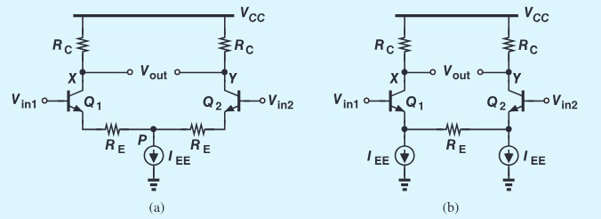

# 연습문제 10.14 — 이득 5, 전력 2 mW인 두 축퇴 차동쌍 설계 (예제 10.14 변형)

## 원문
이득이 5이고 전력 소모가 $2\ \text{mW}$인 각각의 회로를 설계하라. $V_{CC} = 2.5\ \text{V}$, $V_A = \infty$, $R_E = 2/g_m$라고 가정한다.

## 조건
- 예제 10.14의 두 회로 Fig 10.23(a), Fig 10.23(b) 각각을 설계
- 이득 5 (크기 $|A_v| = 5$로 해석, 원문에 없음)
- 전력 소모 $2\ \text{mW}$
- $V_{CC} = 2.5\ \text{V}$, $V_A = \infty$
- $R_E = 2/g_m$
- $V_T$ 값은 주어지지 않음 (원문에 없음)

## 구할 것
- (a), (b) 각 회로의 $I_{EE}$, $R_C$, $R_E$ 값 (원문에 없음, 원문은 "설계하라"만 적음)

## 상속·참조
- 예제 10.14 (E10.14), $V_A = \infty$
  - Fig 10.23(a): $P$가 가상 접지 → $A_v = -\dfrac{R_C}{R_E + 1/g_m}$ (식 10.102)
  - Fig 10.23(b): $R_E$ 가운데가 가상 접지 → $A_v = -\dfrac{R_C}{R_E/2 + 1/g_m}$ (식 10.103)
- 공급 전류: (a)는 테일 전류원 하나($I_{EE}$), (b)는 전류원 두 개($I_{EE}$씩). 전력 = $V_{CC} \times$ 전체 공급 전류 (원문에 없음)
- 각 트랜지스터 $g_m = I_C/V_T$ ((a)에서 $I_C = I_{EE}/2$, (b)에서 $I_C = I_{EE}$) (원문에 없음)

## 회로 — Fig 10.23(a)
```spice
RC1  VCC  X     {R_C}   ; 두 컬렉터 저항 모두 R_C로 인쇄
RC2  VCC  Y     {R_C}
Q1   X    Vin1  n1  npn
Q2   Y    Vin2  n2  npn
RE1  n1   P     {R_E}   ; 두 이미터 저항 모두 R_E로 인쇄
RE2  P    n2    {R_E}
IEE  P    0     {I_EE}
* X, Y에서 각각 가로선이 가운데 출력 원으로. 두 원 사이에 V_out 라벨 하나 (차동 출력)
```
- 단자: VCC = 전원, 값 미지정 (가로 레일) / Vin1, Vin2 = 입력 (개방 원) / X, Y 쪽 출력 원 두 개 = 차동 출력 V_out의 두 단자 (개방 원)
- 표시: 노드 라벨 VCC (레일 오른쪽 끝), X (X 점 왼쪽 아래), Y (Y 점 오른쪽 아래), V_out (두 출력 원 사이), V_in1 (왼쪽 입력 원 왼쪽), V_in2 (오른쪽 입력 원 오른쪽), P (P 점 왼쪽 아래) / 소자 라벨 R_C (왼쪽 저항 왼쪽), R_C (오른쪽 저항 오른쪽), Q1 (Q1 오른쪽), Q2 (Q2 왼쪽), R_E (왼쪽 이미터 저항 아래), R_E (오른쪽 이미터 저항 아래), I_EE (전류원 오른쪽) / 부호 없음 / 화살표 없음 / 수치·면적 라벨 없음
- 배치: 맨 위 굵은 가로 레일 VCC, 왼쪽 R_C보다 조금 왼쪽에서 오른쪽 R_C보다 조금 오른쪽까지 / 왼쪽 세로줄 위→아래 R_C, X 점, Q1 / 오른쪽 세로줄 위→아래 R_C, Y 점, Q2 (두 줄 사이가 넓음) / X 점에서 긴 가로선이 오른쪽 출력 원, Y 점에서 긴 가로선이 왼쪽 출력 원 (두 원이 가운데에서 마주 보고 그 사이에 V_out) / Q1 npn 보통 방향(베이스 왼쪽), Q2 npn 좌우 반전(베이스 오른쪽, 컬렉터 왼쪽 위, 이미터 왼쪽 아래) / V_in1 원 → Q1 베이스, V_in2 원 → Q2 베이스 / Q1 이미터는 아래로 내려가 오른쪽으로 꺾여 가로 R_E → 가운데 P 점, Q2 이미터도 아래로 내려가 왼쪽으로 꺾여 가로 R_E → P 점 / P에서 아래로 I_EE(화살표 아래), 그 아래 접지 / 접속점 (세 갈래 이상, 3곳): ① X = 위 R_C + 아래 Q1 컬렉터 + 오른쪽 출력선 (점) ② Y = 위 R_C + 아래 Q2 컬렉터 + 왼쪽 출력선 (점) ③ P = 왼쪽 R_E + 오른쪽 R_E + 아래 I_EE (점) / 교차: 없음

## 회로 — Fig 10.23(b)
```spice
RC1   VCC  X     {R_C}   ; 두 컬렉터 저항 모두 R_C로 인쇄
RC2   VCC  Y     {R_C}
Q1    X    Vin1  n1  npn
Q2    Y    Vin2  n2  npn
RE    n1   n2    {R_E}
IEE1  n1   0     {I_EE}  ; 두 전류원 모두 I_EE로 인쇄
IEE2  n2   0     {I_EE}
* X, Y에서 각각 가로선이 가운데 출력 원으로. 두 원 사이에 V_out 라벨 하나 (차동 출력)
```
- 단자: VCC = 전원, 값 미지정 (가로 레일) / Vin1, Vin2 = 입력 (개방 원) / X, Y 쪽 출력 원 두 개 = 차동 출력 V_out의 두 단자 (개방 원)
- 표시: 노드 라벨 VCC (레일 오른쪽 끝), X (X 점 왼쪽 아래), Y (Y 점 오른쪽 아래), V_out (두 출력 원 사이), V_in1 (왼쪽 입력 원 왼쪽), V_in2 (오른쪽 입력 원 오른쪽) / 소자 라벨 R_C (왼쪽 저항 왼쪽), R_C (오른쪽 저항 오른쪽), Q1 (Q1 오른쪽), Q2 (Q2 왼쪽), R_E (R_E 아래), I_EE (왼쪽 전류원 왼쪽), I_EE (오른쪽 전류원 오른쪽) / 부호 없음 / 화살표 없음 / 수치·면적 라벨 없음
- 배치: 맨 위 굵은 가로 레일 VCC, 왼쪽 R_C보다 조금 왼쪽에서 오른쪽 R_C보다 조금 오른쪽까지 / 왼쪽 세로줄 위→아래 R_C, X 점, Q1, 이미터 접속점, I_EE(화살표 아래), 접지 / 오른쪽 세로줄 위→아래 R_C, Y 점, Q2, 이미터 접속점, I_EE(화살표 아래), 접지 / X 점에서 가로선이 오른쪽 출력 원, Y 점에서 가로선이 왼쪽 출력 원 (두 원이 가운데에서 마주 보고 그 사이에 V_out) / Q1 npn 보통 방향(베이스 왼쪽), Q2 npn 좌우 반전(베이스 오른쪽) / V_in1 원 → Q1 베이스, V_in2 원 → Q2 베이스 / 두 이미터 접속점 사이를 가로 R_E 하나가 이음 / 접속점 (세 갈래 이상, 4곳): ① X = 위 R_C + 아래 Q1 컬렉터 + 오른쪽 출력선 (점) ② Y = 위 R_C + 아래 Q2 컬렉터 + 왼쪽 출력선 (점) ③ 왼쪽 이미터 접속점 = 위 Q1 이미터 + 오른쪽 R_E + 아래 I_EE (점) ④ 오른쪽 이미터 접속점 = 위 Q2 이미터 + 왼쪽 R_E + 아래 I_EE (점) / 교차: 없음


