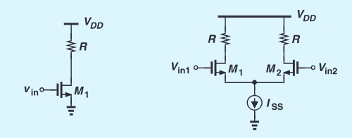

# 연습문제 10.18 — CS 단과 차동쌍에 같은 소스 축퇴 저항이 있을 때 (예제 10.18 변형)

## 조건
- 예제 10.18의 두 회로(Fig 10.30)가 동일한 소스 축퇴 저항을 가짐
- 소스 축퇴 저항은 그림에 없음. CS 단은 $M_1$ 소스와 접지 사이, 차동쌍은 각 트랜지스터 소스와 공통 소스 노드 사이에 넣는 것으로 해석 (원문에 없음)
- 저항 값은 주어지지 않음 (원문에 없음)

## 구할 것
- 예제 10.18의 결과((a) 주어진 전력에서의 트랜지스터 크기, (b) 주어진 크기에서의 전력 소모)가 어떻게 되는지 논의

## 상속·참조
- 예제 10.18 (E10.18): 두 회로의 부하 저항 $R$, 전압 이득, 공급 전압이 같음. (a) 같은 전력이면 차동쌍 각 트랜지스터 전류는 CS 트랜지스터의 절반 → 식 (10.126) $g_m = \sqrt{2\mu_n C_{ox}\tfrac{W}{L}\tfrac{I_{SS}}{2}}$의 일반형 $g_m = \sqrt{2\mu_n C_{ox}\tfrac{W}{L} I_D}$ (일반형은 원문에 없음)에 따라 차동쌍 트랜지스터가 2배 넓어야 함. (b) 크기가 같으면 차동쌍 테일 전류가 CS 바이어스 전류의 2배여야 해서 전력 소모가 2배
- 소스 축퇴 저항 $R_S$가 있는 CS 단의 이득 $-\dfrac{R}{1/g_m + R_S}$ ($\lambda = 0$) (원문에 없음)

## 회로 — Fig 10.30
```spice
* 왼쪽 회로: 공통 소스(CS) 단
RCS   VDD  n1    {R}
M1CS  n1   vin   0   nmos   ; 그림 라벨 M_1 (오른쪽 차동쌍의 M_1과 같은 라벨이 인쇄됨)
* 오른쪽 회로: 차동쌍 (왼쪽 회로와 선으로 이어지지 않음)
R1    VDD  n2    {R}
R2    VDD  n3    {R}
M1    n2   Vin1  n4  nmos
M2    n3   Vin2  n4  nmos
ISS   n4   0     {I_SS}
* n1, n2, n3 = 드레인 노드 (원·라벨 없음), n4 = 공통 소스 노드 (라벨 없음)
```
- 단자: VDD = 전원, 값 미지정 (왼쪽 회로는 T 전원 기호, 오른쪽 회로는 가로 레일) / vin = CS 단 입력 (개방 원) / Vin1, Vin2 = 차동쌍 입력 (개방 원) / 출력 단자는 그려져 있지 않음
- 표시: 노드 라벨 VDD (T 기호 오른쪽), VDD (레일 오른쪽 끝), v_in (CS 입력 원 왼쪽, 소문자 v), V_in1 (왼쪽 입력 원 왼쪽), V_in2 (오른쪽 입력 원 오른쪽) / 소자 라벨 R (CS 저항 오른쪽), M1 (CS 트랜지스터 오른쪽), R (차동쌍 왼쪽 저항 왼쪽), R (차동쌍 오른쪽 저항 오른쪽), M1 (차동쌍 왼쪽 트랜지스터 오른쪽), M2 (차동쌍 오른쪽 트랜지스터 왼쪽), I_SS (전류원 오른쪽) — M1 라벨이 두 회로에 한 번씩, 두 번 인쇄됨 / 부호 없음 / 화살표 없음 / 수치·면적 라벨 없음
- 배치: 왼쪽 CS 단, 오른쪽 차동쌍이 나란히 놓임 (CS 단이 조금 아래로 내려와 있음) / CS 단: 한 세로줄 위→아래 VDD T 기호, R, M1, 접지. M1 nmos 보통 방향(게이트 왼쪽), v_in 원 → 가로선 → 게이트 / 차동쌍: 맨 위 굵은 가로 레일 VDD, 왼쪽 세로줄 R → M1 드레인, 오른쪽 세로줄 R → M2 드레인. M1 nmos 보통 방향(게이트 왼쪽), M2 nmos 좌우 반전(게이트 오른쪽). V_in1 원 → 가로선 → M1 게이트, V_in2 원 → 가로선 → M2 게이트. 두 소스는 아래로 내려가 가로선으로 가운데 n4 점, n4에서 아래로 I_SS(화살표 아래), 그 아래 접지 / 접속점 (세 갈래 이상, 1곳): n4 = 왼쪽 M1 소스 선 + 오른쪽 M2 소스 선 + 아래 I_SS (점) / 교차: 없음


> 참고: 그림에는 소스 축퇴 저항이 없음 (연습문제가 추가하는 조건)
