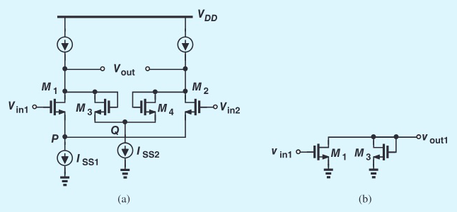

# 연습문제 10.23 — λ ≠ 0일 때 예제 10.23 반복 (예제 10.23 변형)

## 원문
$\lambda \ne 0$일 때, 위의 예제를 반복하라.

## 조건
- 예제 10.23의 회로(Fig 10.37(a))
- 바뀐 조건: $\lambda \ne 0$ (예제는 $\lambda = 0$)

## 구할 것
- 전압 이득 (예제 10.23 반복)

## 상속·참조
- 예제 10.23 (E10.23): $P$ 노드와 $Q$ 노드 모두 가상 접지 → 절반 회로 Fig 10.37(b) ($v_{in1}$이 $M_1$ 게이트, $M_1$ 드레인 = $v_{out1}$ = 다이오드 연결 $M_3$의 드레인·게이트, 두 소스 접지) → $\lambda = 0$에서 $A_v = -\dfrac{g_{m1}}{g_{m3}}$ (식 10.169)
- 위쪽 두 전류원은 이상적 (예제 10.23 그림 그대로, 원문에 없음)

## 회로 — Fig 10.37(a)
```spice
I1    VDD   out1   ; 이상적 전류원 (라벨·값 없음)
I2    VDD   out2   ; 이상적 전류원 (라벨·값 없음)
M1    out1  Vin1   P  nmos
M2    out2  Vin2   P  nmos
M3    out1  out1   Q  nmos   ; 다이오드 연결 (게이트 = 드레인)
M4    out2  out2   Q  nmos   ; 다이오드 연결 (게이트 = 드레인)
ISS1  P     0      {I_SS1}
ISS2  Q     0      {I_SS2}
* out1, out2 = 두 출력 원이 달린 드레인 노드. 원 사이에 V_out 라벨 하나 (차동 출력)
```
- 단자: VDD = 전원, 값 미지정 (가로 레일) / Vin1, Vin2 = 입력 (개방 원) / out1, out2 = 차동 출력 V_out의 두 단자 (개방 원, 각각에는 라벨 없음)
- 표시: 노드 라벨 VDD (레일 오른쪽 끝), V_out (두 출력 원 사이), V_in1 (왼쪽 입력 원 왼쪽), V_in2 (오른쪽 입력 원 오른쪽), P (P 점 왼쪽), Q (Q 점 왼쪽 아래) / 소자 라벨 M1 (M1 드레인 접속점 왼쪽 위), M2 (M2 드레인 접속점 오른쪽 위), M3 (M3 왼쪽), M4 (M4 오른쪽), I_SS1 (왼쪽 아래 전류원 오른쪽), I_SS2 (가운데 전류원 오른쪽), 위쪽 전류원 두 개 (라벨 없음) / 부호 없음 / 화살표 없음 / 수치·면적 라벨 없음
- 배치: 맨 위 굵은 가로 레일 VDD / 왼쪽 세로줄 위→아래 전류원(화살표 아래), 출력 접속점, M1 드레인 접속점, M1, P 점, I_SS1(화살표 아래), 접지 / 오른쪽 세로줄 위→아래 전류원(화살표 아래), 출력 접속점, M2 드레인 접속점, M2 / 출력 접속점에서 가로선이 가운데 쪽으로 출력 원 (두 원이 마주 보고 그 사이에 V_out) / M1 nmos 보통 방향(게이트 왼쪽), M2 nmos 좌우 반전(게이트 오른쪽) / M3, M4는 M1과 M2 사이에 나란히: M3 nmos 좌우 반전(게이트 오른쪽, 드레인 왼쪽 위, 소스 왼쪽 아래), M4 nmos 보통 방향(게이트 왼쪽, 드레인 오른쪽 위, 소스 오른쪽 아래) / M1 드레인 접속점에서 가로선이 오른쪽으로 M3 드레인 위 접속점을 지나 오른쪽 끝에서 아래로 꺾여 M3 게이트 (다이오드 연결), M2 드레인 접속점에서 가로선이 왼쪽으로 M4 드레인 위 접속점을 지나 왼쪽 끝에서 아래로 꺾여 M4 게이트 / M3, M4 소스는 아래로 내려가 가로선으로 가운데 Q 점, Q에서 아래로 I_SS2(화살표 아래), 그 아래 접지 / P 점에서 가로선이 오른쪽으로 M2 소스 아래까지 가서 위로 꺾여 M2 소스 (P 가로선은 Q 가로선보다 아래 높이) / 접속점 (세 갈래 이상, 8곳): ① 왼쪽 출력 = 위 전류원 + 아래 세로선 + 오른쪽 출력선 (점) ② 오른쪽 출력 = 위 전류원 + 아래 세로선 + 왼쪽 출력선 (점) ③ M1 드레인 = 위 세로선 + 아래 M1 드레인 + 오른쪽 가로선 (점) ④ M2 드레인 = 위 세로선 + 아래 M2 드레인 + 왼쪽 가로선 (점) ⑤ M3 드레인 위 = 왼쪽 가로선 + 오른쪽 게이트 되먹임 선 + 아래 M3 드레인 (점) ⑥ M4 드레인 위 = 오른쪽 가로선 + 왼쪽 게이트 되먹임 선 + 아래 M4 드레인 (점) ⑦ Q = 왼쪽 M3 소스 선 + 오른쪽 M4 소스 선 + 아래 I_SS2 (점) ⑧ P = 위 M1 소스 + 아래 I_SS1 + 오른쪽 P 가로선 (점) / 교차: Q에서 I_SS2로 내려가는 세로선이 P 가로선과 점 없이 교차


> 참고: 크롭 이미지 오른쪽 (b)는 예제 풀이 그림(절반 회로)
