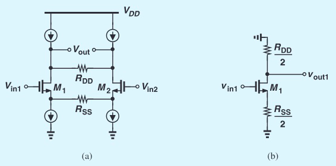

# 연습문제 10.24 — 부하 전류원을 다이오드 연결 PMOS로 바꾼 경우 (예제 10.24 변형)

## 조건
- 예제 10.24의 회로(Fig 10.38(a))에서 부하 전류원들을 다이오드 연결 PMOS 소자들로 대체
- 부하 전류원 = $V_{DD}$ 레일에서 두 드레인으로 내려오는 위쪽 전류원 두 개로 해석. 소스 쪽 아래 전류원 두 개는 그대로 (원문에 없음)
- $\lambda = 0$ (예제 조건 유지, 원문에 없음)

## 구할 것
- 전압 이득 (예제 10.24 반복)

## 상속·참조
- 예제 10.24 (E10.24): $R_{SS}$와 $R_{DD}$의 중점을 접지시키면 절반 회로 Fig 10.38(b) ($V_{DD}$ 쪽 교류 접지 – $R_{DD}/2$ – $v_{out1}$ = $M_1$ 드레인, $M_1$ 소스 – $R_{SS}/2$ – 접지) → $A_v = -\dfrac{R_{DD}/2}{\dfrac{R_{SS}}{2} + \dfrac{1}{g_m}}$ (식 10.170)
- 다이오드 연결 MOSFET의 소신호 임피던스 $1/g_m$ ($\lambda = 0$) (원문에 없음)

## 회로 — Fig 10.38(a)
```spice
I1   VDD   out1   ; 이상적 전류원 (라벨·값 없음)
I2   VDD   out2   ; 이상적 전류원 (라벨·값 없음)
RDD  out1  out2   {R_DD}
M1   out1  Vin1   n1  nmos
M2   out2  Vin2   n2  nmos
RSS  n1    n2     {R_SS}
I3   n1    0      ; 이상적 전류원 (라벨·값 없음)
I4   n2    0      ; 이상적 전류원 (라벨·값 없음)
* out1, out2 = 두 출력 원이 달린 드레인 노드. 원 사이에 V_out 라벨 하나 (차동 출력)
* n1, n2 = 소스 노드 (라벨 없음)
```
- 단자: VDD = 전원, 값 미지정 (가로 레일) / Vin1, Vin2 = 입력 (개방 원) / out1, out2 = 차동 출력 V_out의 두 단자 (개방 원, 각각에는 라벨 없음)
- 표시: 노드 라벨 VDD (레일 오른쪽 끝), V_out (두 출력 원 사이), V_in1 (왼쪽 입력 원 왼쪽), V_in2 (오른쪽 입력 원 오른쪽) / 소자 라벨 R_DD (R_DD 아래), R_SS (R_SS 아래), M1 (M1 오른쪽), M2 (M2 왼쪽), 전류원 네 개 (라벨 없음) / 부호 없음 / 화살표 없음 / 수치·면적 라벨 없음
- 배치: 맨 위 굵은 가로 레일 VDD / 왼쪽 세로줄 위→아래 전류원(화살표 아래), 출력 접속점, R_DD 접속점, M1, 소스 접속점, 전류원(화살표 아래), 접지 / 오른쪽 세로줄도 같은 순서 (M2) / 출력 접속점에서 가로선이 가운데 쪽으로 출력 원 (두 원이 마주 보고 그 사이에 V_out) / R_DD는 두 R_DD 접속점 사이의 가로 저항 (출력 원 줄 바로 아래 높이), R_SS는 두 소스 접속점 사이의 가로 저항 / M1 nmos 보통 방향(게이트 왼쪽), M2 nmos 좌우 반전(게이트 오른쪽) / V_in1 원 → 가로선 → M1 게이트, V_in2 원 → 가로선 → M2 게이트 / 꼬리 전류원 대신 소스마다 전류원이 하나씩 (공통 소스 노드 없음) / 접속점 (세 갈래 이상, 6곳): ① 왼쪽 출력 = 위 전류원 + 아래 세로선 + 오른쪽 출력선 (점) ② 오른쪽 출력 = 위 전류원 + 아래 세로선 + 왼쪽 출력선 (점) ③ 왼쪽 R_DD = 위 세로선 + 아래 M1 드레인 + 오른쪽 R_DD (점) ④ 오른쪽 R_DD = 위 세로선 + 아래 M2 드레인 + 왼쪽 R_DD (점) ⑤ 왼쪽 소스 = 위 M1 소스 + 아래 전류원 + 오른쪽 R_SS (점) ⑥ 오른쪽 소스 = 위 M2 소스 + 아래 전류원 + 왼쪽 R_SS (점) / 교차: 없음


> 참고: 그림에는 위쪽 부하가 이상적 전류원으로 그려져 있음 (연습문제가 다이오드 연결 PMOS로 바꿈). 크롭 이미지 오른쪽 (b)는 예제 풀이 그림(절반 회로)
