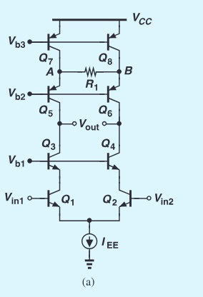

# 연습문제 10.25 — 이득을 절반으로 줄이는 기생 저항 R1 값 (예제 10.25 변형)

## 원문
모든 트랜지스터가 $\beta = 50$, $V_A = 4\ \text{V}$, $I_{EE} = 1\ \text{mA}$라면, 이득을 2배만큼 감소시키는 $R_1$의 값은 얼마인가?

## 조건
- 예제 10.25의 회로(Fig 10.41(a))
- 모든 트랜지스터 $\beta = 50$, $V_A = 4\ \text{V}$
- $I_{EE} = 1\ \text{mA}$
- $V_T$ 값은 주어지지 않음 (원문에 없음)

## 구할 것
- 이득을 2배만큼 감소시키는 (절반으로 만드는) $R_1$의 값

## 상속·참조
- 예제 10.25 (E10.25): 대칭 → $R_1$ 중점이 가상 접지 → 절반 회로 Fig 10.41(b)에서 $R_1/2$가 $r_{O7}$과 병렬
  - $R_{op} = \left[1 + g_{m5}\left(r_{O7} \| r_{\pi 5} \| \dfrac{R_1}{2}\right)\right] r_{O5} + r_{O7} \| r_{\pi 5} \| \dfrac{R_1}{2}$ (식 10.173)
  - $A_v = -g_{m1}[g_{m3} r_{O3}(r_{O1} \| r_{\pi 3})] \| R_{op}$ (식 10.174)
- 본문 Fig 10.40(a) (교재 539쪽, 이 파일의 그림 목록에는 넣지 않음, 크롭은 fig10-40.png): pnp 캐스코드 부하를 가진 바이폴라 캐스코드 차동쌍. Fig 10.41(a)에서 $R_1$만 뺀 회로 (라벨 $Q_1$–$Q_8$, $V_{b1}$–$V_{b3}$ 같음, A·B 라벨 없음). 절반 회로 이득 $A_v \approx -g_{m1}[g_{m3} r_{O3}(r_{O1} \| r_{\pi 3})] \| [g_{m5} r_{O5}(r_{O7} \| r_{\pi 5})]$ (식 10.172)
- 식 (9.1): 이미터 축퇴된 트랜지스터의 컬렉터 쪽 출력 저항 $R_{out} = \left[1 + g_m (R_E \parallel r_\pi)\right] r_O + R_E \parallel r_\pi$
- "2배만큼 감소" = $R_1$이 없을 때(식 10.172)의 이득의 절반 (원문에 없음)
- 각 트랜지스터 바이어스 전류 $I_C = I_{EE}/2$, $g_m = I_C/V_T$, $r_O = V_A/I_C$, $r_\pi = \beta/g_m$ (원문에 없음)

## 회로 — Fig 10.41(a)
```spice
Q7   A     Vb3   VCC  pnp
Q8   B     Vb3   VCC  pnp
R1   A     B     {R_1}
Q5   out1  Vb2   A    pnp
Q6   out2  Vb2   B    pnp
Q3   out1  Vb1   n2   npn
Q4   out2  Vb1   n3   npn
Q1   n2    Vin1  n1   npn
Q2   n3    Vin2  n1   npn
IEE  n1    0     {I_EE}
* out1, out2 = 두 출력 원이 달린 컬렉터 노드. 원 사이에 V_out 라벨 하나 (차동 출력)
* n1 = 공통 이미터 노드 (라벨 없음), n2, n3 = 캐스코드 중간 노드 (라벨 없음)
```
- 단자: VCC = 전원, 값 미지정 (가로 레일) / Vb3, Vb2, Vb1 = 이상적 DC 바이어스, 값 미지정 (점 단자) / Vin1, Vin2 = 입력 (개방 원) / out1, out2 = 차동 출력 V_out의 두 단자 (개방 원, 각각에는 라벨 없음)
- 표시: 노드 라벨 VCC (레일 오른쪽 끝), V_b3, V_b2, V_b1 (각 점 단자 왼쪽), A (A 점 왼쪽), B (B 점 오른쪽), V_out (두 출력 원 사이), V_in1 (왼쪽 입력 원 왼쪽), V_in2 (오른쪽 입력 원 오른쪽) / 소자 라벨 Q7, Q8 (각 트랜지스터 아래), R1 (R1 아래), Q5, Q6 (각 트랜지스터 아래), Q3, Q4 (각 트랜지스터 위), Q1 (Q1 오른쪽), Q2 (Q2 왼쪽), I_EE (전류원 오른쪽) / 부호 없음 / 화살표 없음 / 수치·면적 라벨 없음
- 배치: 맨 위 굵은 가로 레일 VCC / 두 세로줄에 위→아래 Q7–A–Q5–출력 접속점–Q3–Q1 (왼쪽), Q8–B–Q6–출력 접속점–Q4–Q2 (오른쪽) / Q7, Q8, Q5, Q6 pnp 모두 보통 방향(베이스 막대 왼쪽, 이미터 오른쪽 위, 컬렉터 오른쪽 아래), Q7·Q8 이미터는 위로 레일 / Q3, Q4 npn 보통 방향(베이스 왼쪽, 컬렉터 오른쪽 위, 이미터 오른쪽 아래), Q1 npn 보통 방향(베이스 왼쪽), Q2 npn 좌우 반전(베이스 오른쪽) / 베이스 공통선 세 개: Vb3 점에서 오른쪽으로 Q7 막대에 닿고 계속 Q8 막대까지, Vb2 점에서 Q5 막대를 지나 Q6 막대까지, Vb1 점에서 Q3 막대를 지나 Q4 막대까지 (각각 왼쪽 트랜지스터 막대 가운데 높이, 그 트랜지스터의 이미터·컬렉터 인출선 사이로 지남) / A–B 사이 가로 R1 (A, B 점 높이) / 출력 접속점에서 가로선이 가운데 쪽으로 출력 원 (두 원이 마주 보고 그 사이에 V_out) / V_in1 원 → Q1 베이스, V_in2 원 → Q2 베이스 / Q1, Q2 이미터는 아래로 내려가 가로선으로 가운데 n1 점, n1에서 아래로 I_EE(화살표 아래), 그 아래 접지 / 접속점 (세 갈래 이상, 5곳 + 점 없는 3곳): ① A = 위 Q7 컬렉터 + 아래 Q5 이미터 + 오른쪽 R1 (점) ② B = 위 Q8 컬렉터 + 아래 Q6 이미터 + 왼쪽 R1 (점) ③ 왼쪽 출력 = 위 Q5 컬렉터 + 아래 Q3 컬렉터 + 오른쪽 출력선 (점) ④ 오른쪽 출력 = 위 Q6 컬렉터 + 아래 Q4 컬렉터 + 왼쪽 출력선 (점) ⑤ n1 = 왼쪽 Q1 이미터 선 + 오른쪽 Q2 이미터 선 + 아래 I_EE (점) ⑥–⑧ 베이스 공통선이 Q7, Q5, Q3 막대에 닿는 곳, 왼쪽 선 + 오른쪽 선 + 베이스 (점 없음) / 교차: 없음


