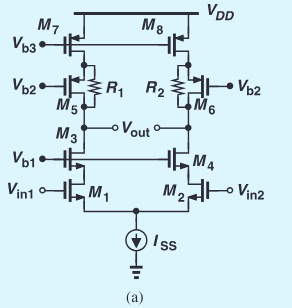

# 연습문제 10.26 — M3, M4 소스 사이에 저항 R3를 더한 경우 (예제 10.26 변형)

## 원문
$R_1$과 $R_2$ 이외에, $M_3$와 $M_4$의 소스 사이에 저항 $R_3$가 있을 때, 위의 예제를 반복하라.

## 조건
- 예제 10.26의 회로(Fig 10.44(a))에서 $R_1$과 $R_2$ 이외에, $M_3$와 $M_4$의 소스 사이에 저항 $R_3$가 있음
- $R_3$는 $M_3$ 소스($M_1$ 드레인) 노드와 $M_4$ 소스($M_2$ 드레인) 노드 사이에 걸린 것으로 해석 (원문에 없음)

## 구할 것
- 전압 이득 (예제 10.26 반복)

## 상속·참조
- 예제 10.26 (E10.26): $R_1$, $R_2$가 각각 $r_{O5}$, $r_{O6}$와 병렬 → 절반 회로 Fig 10.44(b)
  - $R_p = [1 + g_{m5}(r_{O5} \| R_1)] r_{O7} + r_{O5} \| R_1$ (식 10.177)
  - $R_n \approx g_{m3} r_{O3} r_{O1}$ (식 10.178), $A_v = -g_{m1}(R_p \| R_n)$ (식 10.179)
- 본문 Fig 10.43(a) (교재 541쪽, 이 파일의 그림 목록에는 넣지 않음, 크롭은 fig10-43.png): MOS 텔레스코픽 캐스코드 증폭기. Fig 10.44(a)에서 $R_1$, $R_2$를 빼고 $M_6$ 게이트를 $V_{b2}$ 공통선으로 이은 회로. 이득 $A_v \approx -g_{m1}[(g_{m3} r_{O3} r_{O1}) \| (g_{m5} r_{O5} r_{O7})]$ (식 10.176)
- 식 (9.3): 소스 축퇴된 MOSFET의 드레인 쪽 출력 저항 $R_{out} = (1 + g_m R_S) r_O + R_S$
- 대칭이므로 $R_3$의 중점은 차동 입력에서 가상 접지 (본문 Fig 10.20의 성질) (원문에 없음)

## 회로 — Fig 10.44(a)
```spice
M7   n1    Vb3   VDD  pmos
M8   n2    Vb3   VDD  pmos
M5   out1  Vb2   n1   pmos
R1   n1    out1  {R_1}   ; M5 소스–드레인 사이에 병렬
M6   out2  Vb2   n2   pmos   ; 게이트의 V_b2 점 단자는 오른쪽에 따로 인쇄 (왼쪽 V_b2와 같은 라벨)
R2   n2    out2  {R_2}   ; M6 소스–드레인 사이에 병렬
M3   out1  Vb1   n3   nmos
M4   out2  Vb1   n4   nmos
M1   n3    Vin1  n5   nmos
M2   n4    Vin2  n5   nmos
ISS  n5    0     {I_SS}
* out1, out2 = 두 출력 원이 달린 드레인 노드. 원 사이에 V_out 라벨 하나 (차동 출력)
* n1, n2 = M7·M8 드레인 노드, n3, n4 = 캐스코드 중간 노드, n5 = 공통 소스 노드 (모두 라벨 없음)
```
- 단자: VDD = 전원, 값 미지정 (가로 레일) / Vb3, Vb1 = 이상적 DC 바이어스, 값 미지정 (점 단자, 왼쪽) / Vb2 = 이상적 DC 바이어스, 값 미지정 (점 단자 두 개: 왼쪽 M5 게이트, 오른쪽 M6 게이트, 같은 라벨) / Vin1, Vin2 = 입력 (개방 원) / out1, out2 = 차동 출력 V_out의 두 단자 (개방 원, 각각에는 라벨 없음)
- 표시: 노드 라벨 VDD (레일 오른쪽 끝), V_b3 (왼쪽 점 단자 왼쪽), V_b2 (왼쪽 점 단자 왼쪽), V_b2 (오른쪽 점 단자 오른쪽), V_b1 (왼쪽 점 단자 왼쪽), V_out (두 출력 원 사이), V_in1 (왼쪽 입력 원 왼쪽), V_in2 (오른쪽 입력 원 오른쪽) / 소자 라벨 M7 (M7 왼쪽 위), M8 (M8 왼쪽 위), M5 (M5 왼쪽 아래), R1 (R1 오른쪽), R2 (R2 왼쪽), M6 (M6 드레인 접속점 오른쪽), M3 (M3 왼쪽 위), M4 (M4 오른쪽), M1 (M1 오른쪽), M2 (M2 왼쪽), I_SS (전류원 오른쪽) / 부호 없음 / 화살표 없음 / 수치·면적 라벨 없음
- 배치: 맨 위 굵은 가로 레일 VDD / 두 세로줄에 위→아래 M7–n1 접속점–M5(R1 병렬)–M5 드레인 접속점–출력 접속점–M3–M1 (왼쪽), M8–n2 접속점–M6(R2 병렬)–M6 드레인 접속점–출력 접속점–M4–M2 (오른쪽) / M7, M8, M5 pmos 보통 방향(게이트 왼쪽, 소스 위), M6 pmos 좌우 반전(게이트 오른쪽, 소스 위) / R1은 M5 오른쪽에 세로로, R2는 M6 왼쪽에 세로로 (두 저항이 가운데 쪽을 향해 마주 봄) / M3, M4 nmos 보통 방향(게이트 왼쪽), M1 nmos 보통 방향(게이트 왼쪽), M2 nmos 좌우 반전(게이트 오른쪽) / 게이트 공통선 두 개: Vb3 점에서 오른쪽으로 M7 게이트에 닿고 계속 M8 게이트까지, Vb1 점에서 M3 게이트를 지나 M4 게이트까지 (왼쪽 트랜지스터의 소스·드레인 인출선 사이로 지남) / 출력 접속점에서 가로선이 가운데 쪽으로 출력 원 (두 원이 마주 보고 그 사이에 V_out) / V_in1 원 → M1 게이트, V_in2 원 → M2 게이트 / M1, M2 소스는 아래로 내려가 가로선으로 가운데 n5 점, n5에서 아래로 I_SS(화살표 아래), 그 아래 접지 / 접속점 (세 갈래 이상, 7곳 + 점 없는 2곳): ① n1 = 위 M7 드레인 + 아래 M5 소스 + R1 위 끝 (점) ② n2 = 위 M8 드레인 + 아래 M6 소스 + R2 위 끝 (점) ③ M5 드레인 = 위 M5 드레인 + R1 아래 끝 + 아래 세로선 (점) ④ M6 드레인 = 위 M6 드레인 + R2 아래 끝 + 아래 세로선 (점) ⑤ 왼쪽 출력 = 위 세로선 + 아래 M3 드레인 + 오른쪽 출력선 (점) ⑥ 오른쪽 출력 = 위 세로선 + 아래 M4 드레인 + 왼쪽 출력선 (점) ⑦ n5 = 왼쪽 M1 소스 선 + 오른쪽 M2 소스 선 + 아래 I_SS (점) ⑧⑨ 게이트 공통선이 M7, M3 게이트에 닿는 곳, 왼쪽 선 + 오른쪽 선 + 게이트 (점 없음) / 교차: 없음


> 참고: 그림에는 R3가 없음 (연습문제가 추가하는 조건)
