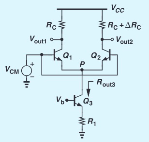

# 연습문제 10.27 — R1 → ∞일 때의 A_CM−DM (예제 10.27 변형)

## 원문
$R_1 \to \infty$일 때, 위의 결과를 계산하라.

## 조건
- 예제 10.27의 회로(Fig 10.48)
- $A_{CM-DM}$: 입력 공통 모드 변화가 차동 출력으로 바뀌는 이득 $A_{CM-DM} = \left|\Delta V_{out}/\Delta V_{CM}\right|$ (본문 정의, 원문에 없음)
- 예제 10.27의 결과: $Q_1$, $Q_2$의 $V_A = \infty$일 때 $A_{CM-DM} = \dfrac{\Delta R_C}{\dfrac{1}{g_{m1}} + 2\{[1 + g_{m3}(R_1 \| r_{\pi 3})] r_{O3} + R_1 \| r_{\pi 3}\}}$ (원문에 없음)
- 바뀐 조건: $R_1 \to \infty$

## 구할 것
- 위의 결과($A_{CM-DM}$)

## 상속·참조
- 예제 10.27 (E10.27): $R_{out3} = [1 + g_{m3}(R_1 \| r_{\pi 3})] r_{O3} + R_1 \| r_{\pi 3}$ (식 10.193), $A_{CM-DM} = \dfrac{\Delta R_C}{\dfrac{1}{g_{m1}} + 2\{[1 + g_{m3}(R_1 \| r_{\pi 3})] r_{O3} + R_1 \| r_{\pi 3}\}}$ (식 10.194) (가정: $Q_1$, $Q_2$의 $V_A = \infty$)

## 회로 — Fig 10.48
```spice
RC1  VCC    Vout1  {R_C}
RC2  VCC    Vout2  {R_C+ΔR_C}   ; 라벨 "R_C + ΔR_C"
Q1   Vout1  n1     P    npn
Q2   Vout2  n1     P    npn
VCM  n1     0      {V_CM}
Q3   P      Vb     n2   npn
R1   n2     0      {R_1}
* n1 = V_CM의 + 단자와 두 베이스를 잇는 공통선 (라벨 없음), n2 = Q3 이미터 (라벨 없음)
```
- 단자: VCC = 전원, 값 미지정 (가로 레일) / Vb = 이상적 DC 바이어스, 값 미지정 (점 단자) / Vout1, Vout2 = 출력 (개방 원)
- 표시: 노드 라벨 VCC (레일 오른쪽 끝), V_out1 (왼쪽 출력 원 왼쪽), V_out2 (오른쪽 출력 원 오른쪽), P (P 점 위), V_b (점 단자 왼쪽) / 소자 라벨 R_C (왼쪽 저항 왼쪽), R_C + ΔR_C (오른쪽 저항 오른쪽), Q1 (Q1 오른쪽), Q2 (Q2 왼쪽), V_CM (전압원 왼쪽), Q3 (Q3 오른쪽), R1 (R1 오른쪽) / 부호 V_CM 전압원 원의 오른쪽 위에 +, 오른쪽 아래에 − / 화살표 "R_out3": P에서 Q3 컬렉터로 내려가는 선을 위에서 아래로 들여다봄, 아래 방향, 도선 옆 별도 화살표 (┌ 꺾임: 세로선 오른쪽에 세로 화살대를 두고 그 위 끝에서 짧은 가로선이 오른쪽 R_out3 글자 쪽으로 뻗음, 화살촉은 아래 끝), 화살촉은 Q3 컬렉터 대각선 바로 위 높이에서 끝남 / 수치·면적 라벨 없음
- 배치: 맨 위 굵은 가로 레일 VCC / 왼쪽 세로줄 위→아래 R_C, Vout1 접속점, Q1 / 오른쪽 세로줄 위→아래 R_C + ΔR_C, Vout2 접속점, Q2 / Vout1 접속점에서 가로선이 왼쪽 출력 원, Vout2 접속점에서 가로선이 오른쪽 출력 원 / Q1 npn 보통 방향(베이스 왼쪽), Q2 npn 좌우 반전(베이스 오른쪽) / 두 이미터는 아래로 내려가 가로선으로 가운데 P 점 / V_CM 전압원은 Q1 왼쪽 아래, − 단자 아래 접지 / V_CM + 단자에서 선이 위로 올라가 오른쪽으로 꺾여 베이스 접속점 → 계속 오른쪽 Q1 베이스. 베이스 접속점에서 아래로 내려가 P 가로선보다 조금 아래 높이에서 오른쪽으로 길게 가로질러 Q2 오른쪽 바깥까지 간 뒤 위로 올라가 왼쪽으로 꺾여 Q2 베이스 / P에서 세로선이 아래로 Q3 컬렉터 / Q3 npn 보통 방향(베이스 왼쪽): V_b 점 단자 → 가로선 → 베이스, 이미터 → R1 → 접지 / 접속점 (세 갈래 이상, 4곳): ① Vout1 = 위 R_C + 아래 Q1 컬렉터 + 왼쪽 출력선 (점) ② Vout2 = 위 R_C + ΔR_C + 아래 Q2 컬렉터 + 오른쪽 출력선 (점) ③ 베이스 접속점 = 왼쪽 V_CM 선 + 오른쪽 Q1 베이스 선 + 아래로 내려가는 공통선 (점) ④ P = 왼쪽 Q1 이미터 선 + 오른쪽 Q2 이미터 선 + 아래 Q3 쪽 세로선 (점) / 교차: P에서 Q3로 내려가는 세로선이 베이스 공통선(P 아래 가로선)과 점 없이 교차



## 풀이
### 테일 전류원의 출력 저항
- $R_1 \to \infty$이면 $Q_3$ 이미터 축퇴 저항은 $R_1 \parallel r_{\pi 3} \to r_{\pi 3}$이다
- 축퇴 저항이 $r_\pi$ 수준이라 $g_{m3} r_{\pi 3} = \beta \gg 1$이므로 1을 빼면 $R_{out3} \approx g_{m3} r_{O3} r_{\pi 3} = \beta r_{O3}$ ($\beta$: $Q_3$의 전류 이득)
### 공통 모드 입력에 대한 컬렉터 전류 변화
- 공통 모드 입력 변화 $\Delta V_{CM}$에 대한 각 컬렉터 전류 변화를 $\Delta I_C$라 한다. 대칭이라 $P$에서 $R_{out3}$를 둘로 나눠 각 쪽 이미터에 $2R_{out3}$가 달린 것으로 본다
- $\Delta I_C = \dfrac{\Delta V_{CM}}{1/g_{m1} + 2R_{out3}}$ ($g_{m1}$: $Q_1$, $Q_2$의 트랜스컨덕턴스, $V_A = \infty$)
### $A_{CM-DM}$
- 차동 출력은 $\Delta R_C\, \Delta I_C$이므로 $A_{CM-DM} = \dfrac{\Delta R_C}{1/g_{m1} + 2\beta r_{O3}}$
- $2\beta r_{O3} \gg 1/g_{m1}$이므로 $A_{CM-DM} \approx \dfrac{\Delta R_C}{2\beta r_{O3}}$. $R_1$이 유한할 때보다 작다
### 답
- $A_{CM-DM} = \dfrac{\Delta R_C}{\dfrac{1}{g_{m1}} + 2\beta r_{O3}} \approx \dfrac{\Delta R_C}{2\beta r_{O3}}$
