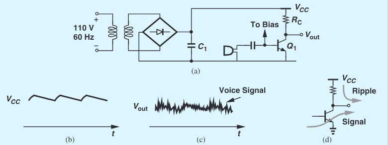

# 예제 10.1 — 정류기로 전원을 공급한 CE 단 출력의 '윙윙거리는' 잡음

## 조건
- 회로: Fig 10.1(a) — 정류기로 전력을 공급받는 CE 단. 마이크 신호를 증폭하려고 구성함
- 교류 선로: $110\ \text{V}$, $60\ \text{Hz}$ (그림 라벨)
- 정류기 출력($C_1$ 양단)이 $V_{CC}$로 쓰이고, $Q_1$의 컬렉터 저항 $R_C$가 $V_{CC}$에 매달림
- 스피커에 연결하자 심하게 '윙윙거리는' 잡음(규칙적인 저주파 성분)이 섞인 출력이 관찰됨
- 소자 값($C_1$, $R_C$ 등)은 주어지지 않음 (원문에 없음)

## 구할 것
- 이 현상이 왜 생기는지 설명

## 상속·참조
- 3장 정류기: 정류된 출력에서 끌어 쓰는 전류는 교류 선로 주파수(50 또는 60 Hz)의 2배인 리플 파형을 만든다 (풀이가 상기시키는 내용)

## 회로 — Fig 10.1(a)
```spice
* n1(+), n2(-): "110 V 60 Hz" 교류 선로가 걸리는 입력 단자 (그림은 개방 원 두 개, 전원 기호 없음)
LP    n1    n2                         ; 변압기 1차 코일 (라벨·값 없음)
LS    n3    n4                         ; 변압기 2차 코일 (라벨·값 없음)
* LP와 LS는 자기 결합된 변압기 한 개 (그림은 코일 두 개를 나란히 그림). 결합은 SPICE K 문 대신 주석으로 적음 (원문에 없음)
* XBR 노드 순서: 위 꼭짓점, 아래 꼭짓점(교류 입력), 오른쪽 꼭짓점(+ 출력), 왼쪽 꼭짓점(- 출력)
XBR   n3    n4    VCC  0  box "정류 브리지"   ; 그림은 다이아몬드 안에 다이오드 기호 하나, 글자 없음. 상자 라벨은 원문에 없음
C1    VCC   0     {C_1}
XMIC  n5    0     box "마이크"               ; 그림은 D자 모양 마이크 기호, 글자 없음. 상자 라벨은 원문에 없음
CC    n5    n6                               ; 결합 커패시터 (라벨·값 없음)
RC    VCC   Vout  {R_C}
Q1    Vout  n6    0  npn
* 노드 0 = 그림 아래쪽 공통 귀환선. 그림에 접지 기호 없음 (기준 노드로 적은 것은 원문에 없음)
```
- 단자: n1, n2 = 교류 선로 입력 110 V 60 Hz, n1 쪽 +, n2 쪽 − (개방 원 두 개) / VCC = 정류기 출력이자 CE 단 전원, 값 미지정 (T 전원 기호, 정류기 쪽 도선이 T 막대 왼쪽 끝에 닿음) / n6 = Q1 베이스 노드, 바이어스 회로로 가는 "To Bias" 연결 (선 끝, 끝에 위쪽 화살촉) / Vout = 출력 (개방 원)
- 표시: 노드 라벨 VCC (T 막대 오른쪽), V_out (출력 원 오른쪽) / 소자 라벨 C1 (커패시터 오른쪽), R_C (저항 오른쪽), Q1 (Q1 오른쪽, 이미터 옆), 변압기 코일·정류 브리지·마이크·결합 커패시터 (라벨 없음) / 부호 + (위 입력 원 바로 아래), − (아래 입력 원 바로 위) / 화살표 "To Bias": n6 접속점에서 위로 뻗은 짧은 도선, 위 방향, 도선 위 (도선 끝에 화살촉, 글자는 화살표 왼쪽 위) / 수치·면적 라벨 "110 V", "60 Hz" (두 줄, 입력 원 두 개 왼쪽)
- 배치: 왼쪽→오른쪽 순서로 입력 원 두 개, 1차 코일(세로), 2차 코일(세로), 다이아몬드 정류 브리지, C1(세로), 마이크·결합 커패시터·Q1 / 위 입력 원 → 가로선 → 1차 코일 위 끝, 1차 코일 아래 끝 → 가로선 → 아래 입력 원 / 2차 코일 위 끝은 위로 올라가 오른쪽으로 꺾여 다이아몬드 위 꼭짓점, 2차 코일 아래 끝은 내려가 가로선으로 다이아몬드 아래 꼭짓점 / 다이아몬드 안 다이오드 기호는 가로 방향, 화살표가 오른쪽(오른쪽 꼭짓점 쪽)을 향함 / 오른쪽 꼭짓점 → 가로선 → C1 위 접속점, 여기서 세로선이 위로 올라가 맨 위 가로선이 되어 오른쪽 VCC T 막대까지 / 왼쪽 꼭짓점 → 왼쪽으로 조금 → 아래로 꺾여 맨 아래 공통 귀환선의 왼쪽 끝 / 공통 귀환선은 C1 아래 접속점, 마이크 아래 도선, Q1 이미터를 지나 Q1 이미터보다 조금 오른쪽까지 뻗음 / R_C는 VCC T 막대에서 세로로 내려와 Vout 접속점, 여기서 오른쪽으로 Vout 원, 아래로 Q1 컬렉터 / Q1 npn 보통 방향(베이스 왼쪽, 이미터 오른쪽 아래 → 공통 귀환선) / 마이크(D자, 평평한 쪽 왼쪽)는 오른쪽 짧은 세로 인출선에서 위쪽 도선이 오른쪽 결합 커패시터(가로 방향)로, 아래쪽 도선이 공통 귀환선으로 / 결합 커패시터 오른쪽 → n6 접속점 → 오른쪽 Q1 베이스 / 접속점 (세 갈래 이상): ① C1 위 = 왼쪽 브리지 출력선 + 아래 C1 + 위 VCC 쪽 선 (점) ② C1 아래 = 왼쪽 귀환선 + 위 C1 + 오른쪽 귀환선 (점) ③ n6 = 왼쪽 결합 커패시터 + 오른쪽 Q1 베이스 + 위 To Bias 화살표 선 (점) ④ Vout = 위 R_C + 아래 Q1 컬렉터 + 오른쪽 Vout 선 (점) ⑤ 마이크 아래 도선이 귀환선에 닿는 곳, 왼쪽 + 오른쪽 + 위 (점 없음) ⑥ Q1 이미터가 귀환선에 닿는 곳, 왼쪽 귀환선 + 오른쪽 짧은 끝 + 위 이미터 (점 없음) / 교차: 다이아몬드 왼쪽 꼭짓점에서 내려오는 세로선이 2차 코일 아래 끝 → 다이아몬드 아래 꼭짓점 가로선과 점 없이 교차 (1곳)


> 참고: 크롭 이미지 아래 줄 (b), (c), (d)는 예제 풀이가 참조하는 그림 (답 절 참고)

## 답 (검증용)
- 정류기 출력에서 끌어 쓰는 전류 때문에 $V_{CC}$에 선로 주파수의 2배인 리플이 생김 (Fig 10.1(b)). $V_{out} = V_{CC} - R_C I_C$ (식 10.1)이므로 $V_{out}$은 $V_{CC}$를 그대로 '뒤따라' 리플을 전부 포함함 → 출력 = 증폭된 마이크 신호 + 리플 (Fig 10.1(c)). 즉 공급 전원 잡음이 이득 1로 출력에 나타남 (Fig 10.1(d)). MOS로 구현해도 같은 문제
- Fig 10.1(b): 세로축 라벨 V_CC, 가로축 t. 톱니 모양(짧게 올라갔다가 길게 천천히 내려가는 모양이 세 번 반복)의 리플 파형
- Fig 10.1(c): 세로축 라벨 V_out, 가로축 t. 불규칙한 잡음 모양 파형, 화살표가 파형 오른쪽 부분을 가리키며 "Voice Signal" 라벨

### 정답 회로 — Fig 10.1(d)
```spice
RC  VCC  out  ; 라벨 없음
Q1  out  n1   0  npn  ; 라벨 없음
```
- 단자: VCC = 전원 (T 전원 기호) / n1 = 베이스 입력 (선 끝, 원 없음) / out = 출력 (개방 원)
- 표시: 노드 라벨 VCC (T 기호 오른쪽) / 소자 라벨 없음 (저항, 트랜지스터 모두 라벨 없음) / 부호 없음 / 화살표 "Ripple": VCC 근처에서 아래로 내려오다 오른쪽으로 휘어 출력 원 오른쪽 위를 향함, 도선 옆 별도 화살표 (L자에 가까운 곡선, 회색 굵은 선, 글자는 화살표 오른쪽 위); "Signal": 트랜지스터 왼쪽 아래(베이스 선 아래)에서 트랜지스터를 가로질러 위 오른쪽으로 휘어 출력 원 오른쪽 아래를 향함, 도선 옆 별도 화살표 (완만한 S자 곡선, 회색 굵은 선, 글자는 화살표 오른쪽 아래) / 수치·면적 라벨 없음
- 배치: 한 세로줄 위→아래 VCC T 기호, 저항, 출력 접속점, 트랜지스터, 접지 / 트랜지스터 npn 보통 방향(베이스 왼쪽) / 베이스 선은 왼쪽으로 짧게 뻗어 선 끝 / 출력 접속점에서 가로선이 오른쪽 출력 원 / 접속점 (세 갈래 이상, 1곳): 출력 = 위 저항 + 아래 컬렉터 + 오른쪽 출력선 (점) / 교차: 없음 (회색 화살표는 도선이 아님)


