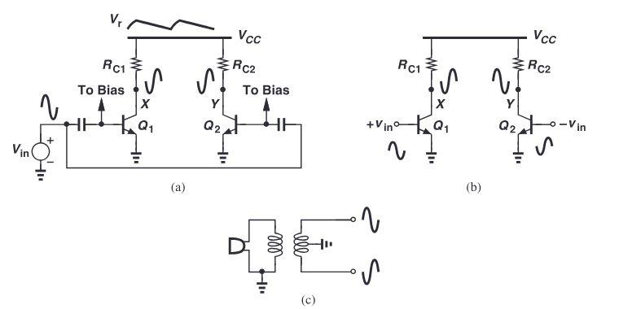
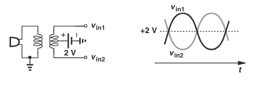

# 예제 10.2 — 변압기 출력의 CM 레벨을 +2 V로 만들기

## 조건
- 회로: Fig 10.3(c) — 마이크 신호를 변압기로 180° 위상차를 갖는 두 성분으로 바꾸는 회로
- 2차 코일의 가운데 탭이 접지돼 있어 두 출력(본문 표기 $+v_{in}$, $-v_{in}$, 그림에는 라벨 없음)의 CM 레벨은 0
- 목표: 두 출력의 CM 레벨을 $+2\ \text{V}$로 만듦

## 구할 것
- 변압기 출력 CM 레벨을 $+2\ \text{V}$로 만드는 방법

## 상속·참조
- 식 (10.11)–(10.12): 차동 신호 $V_1 = V_0 \sin\omega t + V_{CM}$, $V_2 = -V_0 \sin\omega t + V_{CM}$. 두 신호에 공통인 dc 전압 $V_{CM}$(그림 10.4(c))이 공통 모드(CM) 레벨. 차동 신호가 없을 때 두 출력 노드는 접지에 대해 $V_{CM}$을 유지

## 회로 — Fig 10.3(c)
```spice
XMIC  n1    0  box "마이크"   ; 그림은 D자 모양 마이크 기호, 글자 없음. 상자 라벨은 원문에 없음
LP    n1    0                  ; 변압기 1차 코일 (라벨·값 없음)
* LS1 + LS2 = 가운데 탭이 있는 2차 코일 하나 (그림은 코일 하나에서 가운데 탭을 인출). LP와 자기 결합 (결합은 SPICE K 문 대신 주석, 원문에 없음)
LS1   out1  0                  ; 2차 코일 위쪽 절반, 가운데 탭 = 접지
LS2   0     out2               ; 2차 코일 아래쪽 절반
```
- 단자: out1, out2 = 변압기 2차 코일 양 끝의 출력 (개방 원, 라벨 없음) / 가운데 탭은 접지 기호에 바로 연결
- 표시: 노드 라벨 없음 / 소자 라벨 없음 (마이크, 1차 코일, 2차 코일 모두 라벨 없음) / 부호 없음 / 화살표 없음 / 수치·면적 라벨 없음. 두 출력 원 오른쪽에 사인 한 주기 조각 모양 파형 기호가 하나씩 있고 서로 뒤집힌 모양 (180° 위상차)
- 배치: 왼쪽 마이크(D자, 평평한 쪽 왼쪽), 가운데 1차 코일(세로), 그 오른쪽 2차 코일(세로), 오른쪽 끝 출력 원 두 개(위·아래) / 마이크 오른쪽 짧은 세로 인출선에서 위쪽 도선은 위로 올라가 오른쪽으로 꺾여 1차 코일 위 끝, 아래쪽 도선은 아래로 내려가 가로선으로 1차 코일 아래 끝 / 그 아래 가로선 가운데 접속점에서 아래로 접지 기호 / 2차 코일 위 끝 → 위로 → 오른쪽 가로선 → 위 출력 원, 아래 끝 → 아래로 → 오른쪽 가로선 → 아래 출력 원 / 2차 코일 가운데에서 가로선이 오른쪽으로 짧게 나가 옆으로 누운 접지 기호(막대가 세로, 오른쪽을 향함) / 접속점 (세 갈래 이상, 1곳): 1차 쪽 아래 가로선 = 왼쪽 마이크 아래 도선 + 오른쪽 1차 코일 아래 끝 + 아래 접지 (점) / 교차: 없음


> 참고: 크롭 이미지의 (a), (b)는 본문 그림 (b는 예제 10.3의 문제 그림)

## 답 (검증용)
- 가운데 탭을 $+2\ \text{V}$ 전압에 묶음 (Fig 10.5): 탭과 접지 사이에 2 V 배터리(+ 쪽이 탭)

### 정답 회로 — Fig 10.5
```spice
XMIC  n1    0  box "마이크"   ; 그림은 D자 모양 마이크 기호, 글자 없음. 상자 라벨은 원문에 없음
LP    n1    0                  ; 변압기 1차 코일 (라벨·값 없음)
* LS1 + LS2 = 가운데 탭이 있는 2차 코일 하나 (그림은 코일 하나에서 가운데 탭을 인출). LP와 자기 결합 (결합은 SPICE K 문 대신 주석, 원문에 없음)
LS1   vin1  n2                 ; 2차 코일 위쪽 절반
LS2   n2    vin2               ; 2차 코일 아래쪽 절반
VB    n2    0   2V             ; 배터리, + 쪽이 가운데 탭
```
- 단자: vin1, vin2 = 변압기 2차 코일 양 끝의 출력 (개방 원) / 배터리 − 쪽은 접지 기호에 바로 연결
- 표시: 노드 라벨 v_in1 (위 출력 원 오른쪽), v_in2 (아래 출력 원 오른쪽) / 소자 라벨 없음 (마이크, 코일, 배터리 모두 라벨 없음) / 부호 + (배터리 왼쪽 판 왼쪽 위), 배터리 오른쪽 판 위에 짧은 세로 획 하나 (− 표시로 보임) / 화살표 없음 / 수치·면적 라벨 "2 V" (배터리 아래)
- 배치: 왼쪽 마이크(D자, 평평한 쪽 왼쪽), 1차 코일(세로), 2차 코일(세로), 오른쪽 출력 원 두 개(위·아래) / 마이크 위쪽 도선 → 위로 → 오른쪽 → 1차 코일 위 끝, 아래쪽 도선 → 아래로 → 가로선 → 1차 코일 아래 끝, 가로선 가운데 접속점에서 아래로 접지 기호 / 2차 코일 위 끝 → 위로 → 오른쪽 가로선 → v_in1 원, 아래 끝 → 아래로 → 오른쪽 가로선 → v_in2 원 / 2차 코일 가운데 탭에서 가로선이 오른쪽으로 배터리 왼쪽(긴) 판, 배터리 오른쪽(짧은) 판에서 짧은 가로선 → 옆으로 누운 접지 기호(막대가 세로, 오른쪽을 향함) / 접속점 (세 갈래 이상, 1곳): 1차 쪽 아래 가로선 = 왼쪽 마이크 아래 도선 + 오른쪽 1차 코일 아래 끝 + 아래 접지 (점) / 교차: 없음


> 참고: 크롭 이미지 오른쪽은 같은 그림의 파형 — v_in1(검은 선)과 v_in2(회색 선)가 점선 "+2 V" 레벨을 중심으로 서로 반대 위상으로 흔들림, 가로축 t
