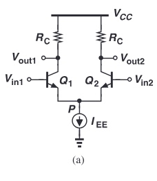
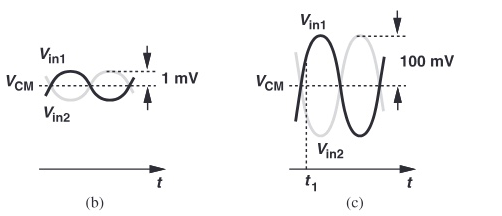
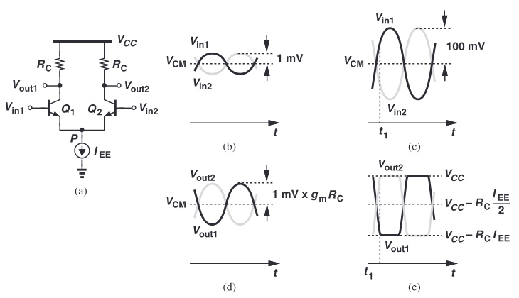

# 예제 10.9 — 작은·큰 사인파 입력에 대한 바이폴라 차동쌍의 출력 파형

## 원문
그림 10.16(b)와 (c)의 사인파(정현파) 입력에 대한 응답으로 그림 10.16(a)의 바이폴라 차동쌍의 출력 파형을 그려라. $Q_1$과 $Q_2$는 순방향 활성 영역에 있다고 가정한다.

## 조건
- 회로: Fig 10.16(a) 바이폴라 차동쌍 ($R_C$ 두 개, $Q_1$, $Q_2$, 테일 전류원 $I_{EE}$)
- $Q_1$과 $Q_2$는 순방향 활성 영역에 있다고 가정
- 입력 1: Fig 10.16(b) — $V_{in1}$, $V_{in2}$가 공통 레벨 $V_{CM}$을 중심으로 서로 반대 위상인 사인파, 각 피크 진폭 $1\ \text{mV}$
- 입력 2: Fig 10.16(c) — 같은 모양, 각 피크 진폭 $100\ \text{mV}$. 시간축에 $t_1$ 표시
- 소자 값은 주어지지 않음 (답은 기호로) (원문에 없음)

## 구할 것
- Fig 10.16(b)의 입력과 Fig 10.16(c)의 입력 각각에 대한 출력 파형 ($V_{out1}$, $V_{out2}$) 그리기

## 상속·참조
- 식 (10.45): 작은 차동 입력에서 차동쌍의 소신호 이득 크기 $g_m R_C$
- 대신호 특성 (본문 Fig 10.15, 식 10.77–10.83): $V_{out1} = V_{CC} - R_C I_{C1}$, $V_{out2} = V_{CC} - R_C I_{C2}$. 큰 차동 입력이면 한쪽이 테일 전류 $I_{EE}$를 전부 흘려 출력이 $V_{CC}$와 $V_{CC} - R_C I_{EE}$에서 포화. 약 $4V_T \approx 104\ \text{mV}$의 차동 입력이면 쌍이 거의 완전히 전환됨 (예제 10.8)
- 3장 다이오드 제한기: 풀이가 결과를 비교하는 회로

## 회로 — Fig 10.16(a)
```spice
RC1  VCC    Vout1  {R_C}   ; 두 저항 모두 R_C로 인쇄
RC2  VCC    Vout2  {R_C}
Q1   Vout1  Vin1   P  npn
Q2   Vout2  Vin2   P  npn
IEE  P      0      {I_EE}
```
- 단자: VCC = 전원, 값 미지정 (가로 레일) / Vin1, Vin2 = 입력 (개방 원) / Vout1, Vout2 = 출력 (개방 원)
- 표시: 노드 라벨 VCC (레일 오른쪽 끝), V_out1 (왼쪽 출력 원 왼쪽), V_out2 (오른쪽 출력 원 오른쪽), V_in1 (왼쪽 입력 원 왼쪽), V_in2 (오른쪽 입력 원 오른쪽), P (P 점 왼쪽 아래) / 소자 라벨 R_C (왼쪽 저항 왼쪽), R_C (오른쪽 저항 오른쪽), Q1 (Q1 오른쪽), Q2 (Q2 왼쪽), I_EE (전류원 오른쪽) / 부호 없음 / 화살표 없음 / 수치·면적 라벨 없음
- 배치: 맨 위 굵은 가로 레일 VCC, 왼쪽 R_C보다 조금 왼쪽에서 오른쪽 R_C보다 조금 오른쪽까지 / 왼쪽 세로줄 위→아래 R_C, Vout1 접속점, Q1 / 오른쪽 세로줄 위→아래 R_C, Vout2 접속점, Q2 / Vout1 접속점에서 가로선이 왼쪽 Vout1 원, Vout2 접속점에서 가로선이 오른쪽 Vout2 원 / Q1 npn 보통 방향(베이스 왼쪽), Q2 npn 좌우 반전(베이스 오른쪽, 컬렉터 왼쪽 위, 이미터 왼쪽 아래) / V_in1 원 → 가로선 → Q1 베이스, V_in2 원 → 가로선 → Q2 베이스 / 두 이미터는 아래로 내려가 가로선으로 가운데 P 점에서 만남, P에서 아래로 I_EE 전류원(화살표 아래), 그 아래 접지 / 접속점 (세 갈래 이상, 3곳): ① Vout1 = 위 R_C + 아래 Q1 컬렉터 + 왼쪽 출력선 (점) ② Vout2 = 위 R_C + 아래 Q2 컬렉터 + 오른쪽 출력선 (점) ③ P = 왼쪽 Q1 이미터 선 + 오른쪽 Q2 이미터 선 + 아래 I_EE (점) / 교차: 없음



> 참고: (b), (c)는 입력 파형 그림. (b): V_in1(검은 굵은 선)과 V_in2(회색 선)가 점선 "V_CM" 레벨을 중심으로 반대 위상으로 흔들림, V_CM 점선과 피크 점선 사이에 안쪽을 향한 화살표 한 쌍과 "1 mV", 가로축 t. (c): 같은 모양에 "100 mV", 가로축 "t_1"에서 세로 점선이 V_in1 곡선의 상승 구간(V_CM보다 위)까지 올라감

## 답 (검증용)
- (b) 입력: 최대 차동 입력 $\pm 2\ \text{mV}$ → 선형 동작 → 출력은 피크 진폭 $1\ \text{mV} \times g_m R_C$인 사인파 (Fig 10.16(d))
- (c) 입력: 최대 차동 입력 $\pm 200\ \text{mV}$ → $Q_1$ 또는 $Q_2$가 오프. $t = t_1$에서 $V_{in1} \approx V_{CM} + 50\ \text{mV}$, $V_{in2} \approx V_{CM} - 50\ \text{mV}$가 되면 $Q_1$이 테일 전류 대부분을 흡수 → $V_{out1} \approx V_{CC} - R_C I_{EE}$ (식 10.84), $V_{out2} \approx V_{CC}$ (식 10.85). $|V_{in1} - V_{in2}|$가 $100\ \text{mV}$ 이하로 떨어질 때까지 출력은 포화 상태 (Fig 10.16(e)). 회로는 '제한기'처럼 동작 (3장 다이오드 제한기와 비슷)
- Fig 10.16(d): V_out1(검은 굵은 선)과 V_out2(회색 선)가 점선 "V_CM"을 중심으로 반대 위상 사인파, 진폭 라벨 "1 mV x g_m R_C", 가로축 t
- Fig 10.16(e): 점선 레벨 세 개 "V_CC", "V_CC − R_C I_EE/2", "V_CC − R_C I_EE". 검은 굵은 선이 t_1 무렵 V_CC에서 V_CC − R_C I_EE로 급히 내려가 평탄하게 머문 뒤 급히 올라가 V_CC에서 평탄하게 머묾(위아래가 잘린 사다리꼴 파형). 라벨 V_out2는 위쪽 평탄부 근처, V_out1은 아래쪽 평탄부 아래. 뒤에 흐린 회색 사인 곡선들, 가로축 "t_1"에서 세로 점선, 가로축 t



## 힌트
### 차동 입력을 $V_T$ 단위로 재기
- 차동 입력은 두 입력의 차이라서 한쪽 진폭의 두 배만큼 흔들린다
- 대신호 특성에서 차동 입력이 몇 $V_T$를 넘으면 테일 전류가 거의 한쪽으로 쏠린다. 입력 폭을 이 전환 폭과 견주면 선형으로 따라가는지 위아래가 잘리는지 갈린다

## 풀이
### 차동 입력을 $V_T$ 단위로 재기
- 두 입력이 반대 위상이라 차동 입력 $V_{in1} - V_{in2}$의 진폭은 한쪽 진폭의 2배다
- (b): 최대 $\pm 2\ \text{mV} = \pm 0.0769\, V_T$ ($V_T = 26\ \text{mV}$), (c): 최대 $\pm 200\ \text{mV} = \pm 7.69\, V_T$
- 약 $4V_T \approx 104\ \text{mV}$를 넘으면 테일 전류가 거의 한쪽으로 쏠린다(예제 10.8), 그보다 훨씬 작으면 선형이다
### 작은 입력 (b): 선형 증폭
- 선형 영역이므로 $v_{out1} = -g_m R_C\, v_{in1}$, $v_{out2} = -g_m R_C\, v_{in2}$ (절반 회로)
- 출력은 $V_{CC} - R_C I_{EE}/2$를 중심으로, 피크 진폭 $1\ \text{mV} \times g_m R_C$인 반대 위상 사인파. $V_{out1}$은 $V_{in1}$과 반대 위상
### 큰 입력 (c): 출력이 잘림
- $t_1$ 무렵 $V_{in1} \approx V_{CM} + 50\ \text{mV}$, $V_{in2} \approx V_{CM} - 50\ \text{mV}$ → 차동 $100\ \text{mV} = 3.85\, V_T$에서 $I_{C1}/I_{EE} = 1/(1 + e^{-3.85}) = 0.979$
- 이후 $Q_1$이 거의 전부 흘려 $V_{out1} \approx V_{CC} - R_C I_{EE}$, $V_{out2} \approx V_{CC}$로 고정되고, $|V_{in1} - V_{in2}|$가 약 $100\ \text{mV}$ 아래로 내려갈 때까지 유지된다
- 반주기 뒤에는 반대로 $V_{out1} \approx V_{CC}$, $V_{out2} \approx V_{CC} - R_C I_{EE}$ → 위아래가 잘린 사다리꼴 파형
### 답
- (b) 입력: 출력 $V_{out1}$, $V_{out2}$는 $V_{CC} - R_C I_{EE}/2$를 중심으로 피크 진폭 $1\ \text{mV} \times g_m R_C$인 서로 반대 위상 사인파
- (c) 입력: 출력은 $V_{CC}$와 $V_{CC} - R_C I_{EE}$ 사이를 오가며 평탄하게 잘린 사다리꼴 파형($t_1$ 무렵 $V_{out1}$은 $V_{CC} - R_C I_{EE}$, $V_{out2}$는 $V_{CC}$로 전환). 회로는 다이오드 제한기처럼 동작한다.
