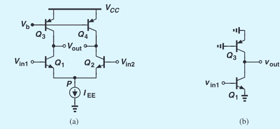

# 예제 10.11 — pnp 전류원 부하로 구현한 바이폴라 차동쌍의 차동 이득

## 조건
- 회로: Fig 10.19(a) — Fig 10.18(a)의 토폴로지(이상적 전류원 부하 차동쌍)를 구현한 회로. 전류원 자리에 pnp 트랜지스터 $Q_3$, $Q_4$ (베이스 공통, 바이어스 $V_b$)
- 소자 값은 주어지지 않음 (답은 소신호 파라미터 기호로) (원문에 없음)

## 구할 것
- 차동 전압 이득

## 상속·참조
- Fig 10.18(a) (예제 10.10): $V_{CC}$에서 내려오는 이상적 전류원 두 개가 $Q_1$, $Q_2$의 컬렉터 부하인 바이폴라 차동쌍. 그 차동 이득 $-g_m r_O$ (식 10.97)
- 차동 소신호 입력에서 $P$ 노드는 가상 접지 → 절반 회로 해석

## 회로 — Fig 10.19(a)
```spice
Q3   out1  Vb    VCC  pnp
Q4   out2  Vb    VCC  pnp
Q1   out1  Vin1  P    npn
Q2   out2  Vin2  P    npn
IEE  P     0     {I_EE}
* out1, out2 = 두 출력 원. 원 사이에 V_out 라벨 하나 (차동 출력)
```
- 단자: VCC = 전원, 값 미지정 (가로 레일) / Vb = pnp 바이어스 전압 (점 단자) / Vin1, Vin2 = 입력 (개방 원) / out1, out2 = 차동 출력 V_out의 두 단자 (개방 원, 각각에는 라벨 없음)
- 표시: 노드 라벨 VCC (레일 오른쪽 끝), V_b (Vb 점 왼쪽), V_out (두 출력 원 사이), V_in1 (왼쪽 입력 원 왼쪽), V_in2 (오른쪽 입력 원 오른쪽), P (P 점 왼쪽 아래) / 소자 라벨 Q3 (Q3 왼쪽 아래), Q4 (Q4 왼쪽 아래), Q1 (Q1 오른쪽), Q2 (Q2 왼쪽), I_EE (전류원 오른쪽) / 부호 없음 / 화살표 없음 / 수치·면적 라벨 없음
- 배치: 맨 위 굵은 가로 레일 VCC, Q3 이미터 선보다 조금 왼쪽에서 Q4 이미터 선보다 조금 오른쪽까지 / Q3, Q4 pnp 둘 다 보통 방향(베이스 막대 왼쪽, 이미터 오른쪽 위로 나가 수직으로 레일, 컬렉터 오른쪽 아래로 나가 수직으로 내려감) / 베이스 공통선: Vb 점에서 오른쪽으로 Q3 막대에 닿고 계속 오른쪽으로 Q4 막대까지 한 직선 (Q3 막대 가운데 높이, Q3의 이미터·컬렉터 인출선 사이로 지남) / Q3 컬렉터 → out1 접속점 → Q1 컬렉터, Q4 컬렉터 → out2 접속점 → Q2 컬렉터 / out1 접속점에서 가로선이 오른쪽 출력 원, out2 접속점에서 가로선이 왼쪽 출력 원 (두 원이 가운데에서 마주 보고 그 사이에 V_out) / Q1 npn 보통 방향(베이스 왼쪽), Q2 npn 좌우 반전(베이스 오른쪽) / V_in1 원 → Q1 베이스, V_in2 원 → Q2 베이스 / 두 이미터는 아래로 내려가 가로선으로 가운데 P 점, P에서 아래로 I_EE(화살표 아래), 그 아래 접지 / 접속점 (세 갈래 이상, 4곳): ① out1 = 위 Q3 컬렉터 + 아래 Q1 컬렉터 + 오른쪽 출력선 (점) ② out2 = 위 Q4 컬렉터 + 아래 Q2 컬렉터 + 왼쪽 출력선 (점) ③ P = 왼쪽 Q1 이미터 선 + 오른쪽 Q2 이미터 선 + 아래 I_EE (점) ④ 베이스 공통선이 Q3 막대에 닿는 곳, 왼쪽 Vb 선 + 오른쪽 Q4로 가는 선 + Q3 베이스 (점 없음) / 교차: 없음


> 참고: 크롭 이미지 오른쪽 (b)는 예제 풀이 그림 (답 절 참고)

## 답 (검증용)
- 각 pnp 소자가 출력 노드에 저항 $r_{OP}$를 만든다는 데 주의해 절반 회로를 그리면 (Fig 10.19(b)) $\dfrac{v_{out1} - v_{out2}}{v_{in1} - v_{in2}} = -g_m (r_{ON} \| r_{OP})$ (식 10.98). $r_{ON}$은 npn 트랜지스터의 출력 임피던스

### 정답 회로 — Fig 10.19(b)
```spice
Q3   vout  0     0  pnp   ; 베이스와 이미터 모두 옆으로 누운 접지 기호(교류 접지)
Q1   vout  vin1  0  npn
```
- 단자: vin1 = 소신호 입력 (개방 원) / vout = 출력 (개방 원)
- 표시: 노드 라벨 v_out (출력 원 오른쪽), v_in1 (입력 원 왼쪽) / 소자 라벨 Q3 (Q3 아래 왼쪽), Q1 (Q1 아래 왼쪽) / 부호 없음 / 화살표 없음 / 수치·면적 라벨 없음
- 배치: 한 세로줄 위→아래 Q3, vout 접속점, Q1, 접지 / Q3 pnp 보통 방향(베이스 막대 왼쪽): 이미터는 오른쪽 위로 나가 수직으로 올라가 왼쪽으로 꺾여 옆으로 누운 접지 기호(막대가 세로, 왼쪽을 향함), 베이스는 왼쪽 가로선 → 옆으로 누운 접지 기호(막대가 세로, 왼쪽을 향함) / Q3 컬렉터 → vout 접속점 → Q1 컬렉터 / vout 접속점에서 가로선이 오른쪽 출력 원 / Q1 npn 보통 방향(베이스 왼쪽), v_in1 원 → 가로선 → 베이스, 이미터 아래 접지 / 접속점 (세 갈래 이상, 1곳): vout = 위 Q3 컬렉터 + 아래 Q1 컬렉터 + 오른쪽 출력선 (점) / 교차: 없음


