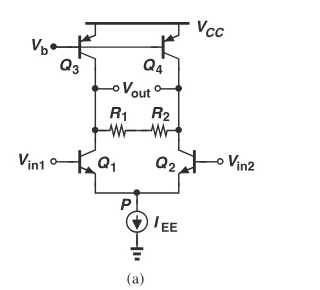
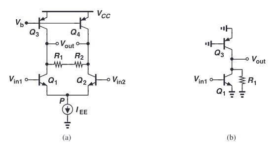

# 예제 10.12 — 두 출력 사이에 R1, R2를 직렬로 연결한 차동쌍의 차동 이득

## 원문
그림 10.21(a)의 회로에서 $V_A < \infty$이고 회로가 대칭일 때 차동 이득을 결정하라.

## 조건
- 회로: Fig 10.21(a) — pnp 전류원 부하($Q_3$, $Q_4$, 베이스 $V_b$) 바이폴라 차동쌍에서 두 컬렉터 사이에 $R_1$, $R_2$가 직렬로 연결됨
- $V_A < \infty$
- 회로가 대칭 ($R_1 = R_2$로 해석, 원문에 없음)
- 소자 값은 주어지지 않음 (답은 기호로) (원문에 없음)

## 구할 것
- 차동 이득

## 상속·참조
- 본문 Fig 10.20 (교재 521쪽, 크롭 안 함)의 성질: 직렬 저항 $R_1$, $R_2$ 양 끝 $A$, $B$가 같은 크기로 반대 방향으로 변하고 $R_1 = R_2$이면 두 저항 사이 노드 $X$는 가상 접지. 연결: `R1: A – X`, `R2: X – B`, `A`, `B`는 개방 원 단자
- 차동 소신호 입력에서 대칭축 위의 노드($P$ 등)는 가상 접지 → 절반 회로 해석. 각 트랜지스터의 출력 저항 $r_O$

## 회로 — Fig 10.21(a)
```spice
Q3   out1  Vb    VCC  pnp
Q4   out2  Vb    VCC  pnp
R1   out1  n1    {R_1}
R2   n1    out2  {R_2}
Q1   out1  Vin1  P    npn
Q2   out2  Vin2  P    npn
IEE  P     0     {I_EE}
* out1, out2 = 두 출력 원이 달린 컬렉터 노드. 원 사이에 V_out 라벨 하나 (차동 출력)
* n1 = R1과 R2 사이 노드 (라벨 없음)
```
- 단자: VCC = 전원, 값 미지정 (가로 레일) / Vb = pnp 바이어스 전압 (점 단자) / Vin1, Vin2 = 입력 (개방 원) / out1, out2 = 차동 출력 V_out의 두 단자 (개방 원, 각각에는 라벨 없음)
- 표시: 노드 라벨 VCC (레일 오른쪽 끝), V_b (Vb 점 왼쪽), V_out (두 출력 원 사이), V_in1 (왼쪽 입력 원 왼쪽), V_in2 (오른쪽 입력 원 오른쪽), P (P 점 왼쪽 아래) / 소자 라벨 Q3 (Q3 왼쪽 아래), Q4 (Q4 왼쪽 아래), R_1 (R1 위), R_2 (R2 위), Q1 (Q1 오른쪽), Q2 (Q2 왼쪽), I_EE (전류원 오른쪽) / 부호 없음 / 화살표 없음 / 수치·면적 라벨 없음
- 배치: 맨 위 굵은 가로 레일 VCC, Q3 이미터 선보다 조금 왼쪽에서 Q4 이미터 선보다 조금 오른쪽까지 / Q3, Q4 pnp 둘 다 보통 방향(베이스 막대 왼쪽, 이미터 오른쪽 위로 나가 수직으로 레일, 컬렉터 오른쪽 아래로 나가 수직으로 내려감) / 베이스 공통선: Vb 점에서 오른쪽으로 Q3 막대에 닿고 계속 오른쪽으로 Q4 막대까지 한 직선 (Q3의 이미터·컬렉터 인출선 사이로 지남) / 왼쪽 세로선: Q3 컬렉터 → 위 접속점(출력 원 쪽) → 아래 접속점(R1 쪽) → Q1 컬렉터, 오른쪽 세로선도 같은 순서(Q4 → 출력 → R2 → Q2) / 위 접속점에서 가로선이 가운데 쪽으로 출력 원 (두 원이 마주 보고 그 사이에 V_out) / 아래 접속점 높이에서 R1과 R2가 가로로 직렬 (가운데 n1은 점 없는 이음) / Q1 npn 보통 방향(베이스 왼쪽), Q2 npn 좌우 반전(베이스 오른쪽) / V_in1 원 → Q1 베이스, V_in2 원 → Q2 베이스 / 두 이미터는 아래로 내려가 가로선으로 가운데 P 점, P에서 아래로 I_EE(화살표 아래), 그 아래 접지 / 접속점 (세 갈래 이상, 6곳): ① 왼쪽 위 = 위 Q3 컬렉터 + 아래 세로선 + 오른쪽 출력선 (점) ② 오른쪽 위 = 위 Q4 컬렉터 + 아래 세로선 + 왼쪽 출력선 (점) ③ 왼쪽 아래 = 위 세로선 + 아래 Q1 컬렉터 + 오른쪽 R1 (점) ④ 오른쪽 아래 = 위 세로선 + 아래 Q2 컬렉터 + 왼쪽 R2 (점) ⑤ P = 왼쪽 Q1 이미터 선 + 오른쪽 Q2 이미터 선 + 아래 I_EE (점) ⑥ 베이스 공통선이 Q3 막대에 닿는 곳, 왼쪽 Vb 선 + 오른쪽 Q4로 가는 선 + Q3 베이스 (점 없음) / 교차: 없음



## 답 (검증용)
- $R_1$과 $R_2$ 사이 노드가 가상 접지이므로 절반 회로는 Fig 10.21(b). $Q_1$ 컬렉터에서 본 전체 저항 $R_{out} = r_{O1} \| r_{O3} \| R_1$ (식 10.99) → $A_v = -g_{m1}(r_{O1} \| r_{O3} \| R_1)$ (식 10.100)

### 정답 회로 — Fig 10.21(b)
```spice
Q3   Vout  0     0  pnp   ; 베이스와 이미터 모두 옆으로 누운 접지 기호(교류 접지)
R1   Vout  0     {R_1}
Q1   Vout  Vin1  0  npn
```
- 단자: Vin1 = 입력 (개방 원) / Vout = 출력 (개방 원)
- 표시: 노드 라벨 V_out (출력 원 오른쪽), V_in1 (입력 원 왼쪽) / 소자 라벨 Q3 (Q3 아래 왼쪽), R_1 (R1 오른쪽), Q1 (Q1 아래 왼쪽) / 부호 없음 / 화살표 없음 / 수치·면적 라벨 없음
- 배치: 한 세로줄 위→아래 Q3, 출력 접속점, R1 접속점, Q1, 접지 / Q3 pnp 보통 방향(베이스 막대 왼쪽): 이미터는 오른쪽 위로 나가 수직으로 올라가 왼쪽으로 꺾여 옆으로 누운 접지 기호(막대가 세로, 왼쪽을 향함), 베이스는 왼쪽 가로선 → 옆으로 누운 접지 기호(막대가 세로, 왼쪽을 향함) / 출력 접속점에서 가로선이 오른쪽 출력 원 / 그 아래 R1 접속점에서 가로선이 오른쪽으로 가다 아래로 꺾여 R1(세로), 그 아래 접지 / Q1 npn 보통 방향(베이스 왼쪽), V_in1 원 → 가로선 → 베이스, 이미터 아래 접지 (R1 접지와 나란히 따로) / 접속점 (세 갈래 이상, 2곳): ① 출력 = 위 Q3 컬렉터 + 아래 세로선 + 오른쪽 출력선 (점) ② R1 쪽 = 위 세로선 + 아래 Q1 컬렉터 + 오른쪽 R1 선 (점) / 교차: 없음



## 힌트
### $R_1$–$R_2$ 가운데는 가상 접지
- 차동 신호에서 두 컬렉터는 같은 크기로 반대 방향으로 움직이고 $R_1 = R_2$이므로, 두 저항 사이 노드는 움직이지 않는다
- 그 노드를 AC 접지로 두면 각 절반 회로에서 $R_1$은 출력에서 접지로 가는 저항 하나가 된다
