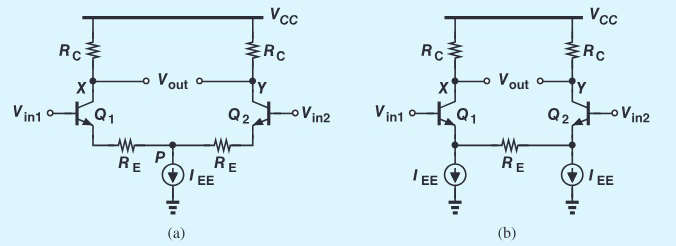
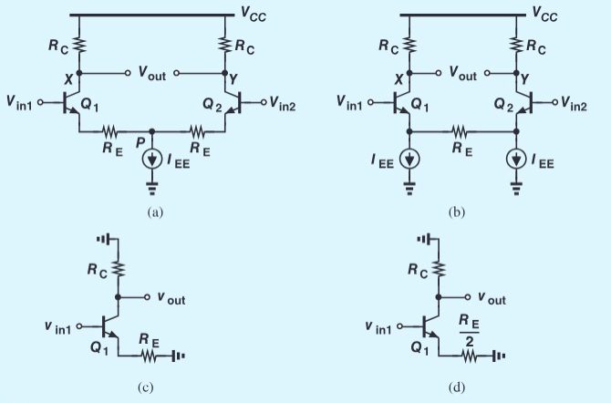

# 예제 10.14 — 이미터 축퇴 차동쌍 두 가지의 이득

## 원문
그림 10.23(a)와 (b)에 보인 축퇴된 차동쌍의 이득을 구하라. $V_A = \infty$로 가정한다.

## 조건
- 회로: Fig 10.23(a) — 각 이미터에 $R_E$를 달고 두 $R_E$의 공통 노드 $P$에 테일 전류원 $I_{EE}$ 하나
- 회로: Fig 10.23(b) — 두 이미터 사이에 $R_E$ 하나, 각 이미터에 테일 전류원 $I_{EE}$ 하나씩
- 두 회로 모두 컬렉터 저항 $R_C$, 출력 $V_{out}$은 $X$와 $Y$ 사이
- $V_A = \infty$
- 소자 값은 주어지지 않음 (답은 기호로) (원문에 없음)

## 구할 것
- Fig 10.23(a)와 (b) 각각의 (차동) 이득

## 상속·참조
- 차동 소신호 입력에서 대칭축 위의 노드는 가상 접지 → 절반 회로 해석 (본문 10.2.3)
- 5장: 이미터 축퇴 CE 단의 이득 $A_v = -\dfrac{R_C}{R_E + 1/g_m}$ ($V_A = \infty$)

## 회로 — Fig 10.23(a)
```spice
RC1  VCC  X     {R_C}   ; 두 컬렉터 저항 모두 R_C로 인쇄
RC2  VCC  Y     {R_C}
Q1   X    Vin1  n1  npn
Q2   Y    Vin2  n2  npn
RE1  n1   P     {R_E}   ; 두 이미터 저항 모두 R_E로 인쇄
RE2  P    n2    {R_E}
IEE  P    0     {I_EE}
* X, Y에서 각각 가로선이 가운데 출력 원으로. 두 원 사이에 V_out 라벨 하나 (차동 출력)
```
- 단자: VCC = 전원, 값 미지정 (가로 레일) / Vin1, Vin2 = 입력 (개방 원) / X, Y 쪽 출력 원 두 개 = 차동 출력 V_out의 두 단자 (개방 원)
- 표시: 노드 라벨 VCC (레일 오른쪽 끝), X (X 점 왼쪽 아래), Y (Y 점 오른쪽 아래), V_out (두 출력 원 사이), V_in1 (왼쪽 입력 원 왼쪽), V_in2 (오른쪽 입력 원 오른쪽), P (P 점 왼쪽 아래) / 소자 라벨 R_C (왼쪽 저항 왼쪽), R_C (오른쪽 저항 오른쪽), Q1 (Q1 오른쪽), Q2 (Q2 왼쪽), R_E (왼쪽 이미터 저항 아래), R_E (오른쪽 이미터 저항 아래), I_EE (전류원 오른쪽) / 부호 없음 / 화살표 없음 / 수치·면적 라벨 없음
- 배치: 맨 위 굵은 가로 레일 VCC, 왼쪽 R_C보다 조금 왼쪽에서 오른쪽 R_C보다 조금 오른쪽까지 / 왼쪽 세로줄 위→아래 R_C, X 점, Q1 / 오른쪽 세로줄 위→아래 R_C, Y 점, Q2 (두 줄 사이가 넓음) / X 점에서 긴 가로선이 오른쪽 출력 원, Y 점에서 긴 가로선이 왼쪽 출력 원 (두 원이 가운데에서 마주 보고 그 사이에 V_out) / Q1 npn 보통 방향(베이스 왼쪽), Q2 npn 좌우 반전(베이스 오른쪽, 컬렉터 왼쪽 위, 이미터 왼쪽 아래) / V_in1 원 → Q1 베이스, V_in2 원 → Q2 베이스 / Q1 이미터는 아래로 내려가 오른쪽으로 꺾여 가로 R_E → 가운데 P 점, Q2 이미터도 아래로 내려가 왼쪽으로 꺾여 가로 R_E → P 점 / P에서 아래로 I_EE(화살표 아래), 그 아래 접지 / 접속점 (세 갈래 이상, 3곳): ① X = 위 R_C + 아래 Q1 컬렉터 + 오른쪽 출력선 (점) ② Y = 위 R_C + 아래 Q2 컬렉터 + 왼쪽 출력선 (점) ③ P = 왼쪽 R_E + 오른쪽 R_E + 아래 I_EE (점) / 교차: 없음

## 회로 — Fig 10.23(b)
```spice
RC1   VCC  X     {R_C}   ; 두 컬렉터 저항 모두 R_C로 인쇄
RC2   VCC  Y     {R_C}
Q1    X    Vin1  n1  npn
Q2    Y    Vin2  n2  npn
RE    n1   n2    {R_E}
IEE1  n1   0     {I_EE}  ; 두 전류원 모두 I_EE로 인쇄
IEE2  n2   0     {I_EE}
* X, Y에서 각각 가로선이 가운데 출력 원으로. 두 원 사이에 V_out 라벨 하나 (차동 출력)
```
- 단자: VCC = 전원, 값 미지정 (가로 레일) / Vin1, Vin2 = 입력 (개방 원) / X, Y 쪽 출력 원 두 개 = 차동 출력 V_out의 두 단자 (개방 원)
- 표시: 노드 라벨 VCC (레일 오른쪽 끝), X (X 점 왼쪽 아래), Y (Y 점 오른쪽 아래), V_out (두 출력 원 사이), V_in1 (왼쪽 입력 원 왼쪽), V_in2 (오른쪽 입력 원 오른쪽) / 소자 라벨 R_C (왼쪽 저항 왼쪽), R_C (오른쪽 저항 오른쪽), Q1 (Q1 오른쪽), Q2 (Q2 왼쪽), R_E (R_E 아래), I_EE (왼쪽 전류원 왼쪽), I_EE (오른쪽 전류원 오른쪽) / 부호 없음 / 화살표 없음 / 수치·면적 라벨 없음
- 배치: 맨 위 굵은 가로 레일 VCC, 왼쪽 R_C보다 조금 왼쪽에서 오른쪽 R_C보다 조금 오른쪽까지 / 왼쪽 세로줄 위→아래 R_C, X 점, Q1, 이미터 접속점, I_EE(화살표 아래), 접지 / 오른쪽 세로줄 위→아래 R_C, Y 점, Q2, 이미터 접속점, I_EE(화살표 아래), 접지 / X 점에서 가로선이 오른쪽 출력 원, Y 점에서 가로선이 왼쪽 출력 원 (두 원이 가운데에서 마주 보고 그 사이에 V_out) / Q1 npn 보통 방향(베이스 왼쪽), Q2 npn 좌우 반전(베이스 오른쪽) / V_in1 원 → Q1 베이스, V_in2 원 → Q2 베이스 / 두 이미터 접속점 사이를 가로 R_E 하나가 이음 / 접속점 (세 갈래 이상, 4곳): ① X = 위 R_C + 아래 Q1 컬렉터 + 오른쪽 출력선 (점) ② Y = 위 R_C + 아래 Q2 컬렉터 + 왼쪽 출력선 (점) ③ 왼쪽 이미터 접속점 = 위 Q1 이미터 + 오른쪽 R_E + 아래 I_EE (점) ④ 오른쪽 이미터 접속점 = 위 Q2 이미터 + 왼쪽 R_E + 아래 I_EE (점) / 교차: 없음



## 답 (검증용)
- (a): $P$ 노드가 가상 접지 → 절반 회로 Fig 10.23(c) → $A_v = -\dfrac{R_C}{R_E + \dfrac{1}{g_m}}$ (식 10.102)
- (b): 대칭선이 $R_E$의 '중간점'을 지남 → $R_E$를 $R_E/2$ 두 개의 직렬로 보면 그 사이 노드가 가상 접지 (Fig 10.23(d)) → $A_v = -\dfrac{R_C}{\dfrac{R_E}{2} + \dfrac{1}{g_m}}$ (식 10.103). (b)의 쌍이 총 $2R_E$의 축퇴 저항을 가지면 두 회로의 이득이 같음

### 정답 회로 — Fig 10.23(c)
```spice
RC   0     vout  {R_C}   ; 위 끝은 옆으로 누운 접지 기호(교류 접지)
Q1   vout  vin1  n1  npn
RE   n1    0     {R_E}   ; 오른쪽 끝은 옆으로 누운 접지 기호
```
- 단자: vin1 = 소신호 입력 (개방 원) / vout = 출력 (개방 원)
- 표시: 노드 라벨 v_out (출력 원 오른쪽), v_in1 (입력 원 왼쪽) / 소자 라벨 R_C (R_C 왼쪽), Q1 (Q1 아래 왼쪽), R_E (R_E 위) / 부호 없음 / 화살표 없음 / 수치·면적 라벨 없음
- 배치: 한 세로줄 위→아래 옆으로 누운 접지 기호, R_C, vout 접속점, Q1 / R_C 위 끝은 위로 올라가 왼쪽으로 꺾여 옆으로 누운 접지 기호(막대가 세로, 왼쪽을 향함) / vout 접속점에서 가로선이 오른쪽 출력 원 / Q1 npn 보통 방향(베이스 왼쪽), v_in1 원 → 가로선 → 베이스 / Q1 이미터는 아래로 내려가 오른쪽으로 꺾여 가로 R_E → 옆으로 누운 접지 기호(막대가 세로, 오른쪽을 향함) / 접속점 (세 갈래 이상, 1곳): vout = 위 R_C + 아래 Q1 컬렉터 + 오른쪽 출력선 (점) / 교차: 없음

### 정답 회로 — Fig 10.23(d)
```spice
RC   0     vout  {R_C}     ; 위 끝은 옆으로 누운 접지 기호(교류 접지)
Q1   vout  vin1  n1  npn
RE   n1    0     {R_E/2}   ; 인쇄 라벨은 분수 R_E/2. 오른쪽 끝은 옆으로 누운 접지 기호
```
- 단자: vin1 = 소신호 입력 (개방 원) / vout = 출력 (개방 원)
- 표시: 노드 라벨 v_out (출력 원 오른쪽), v_in1 (입력 원 왼쪽) / 소자 라벨 R_C (R_C 왼쪽), Q1 (Q1 아래 왼쪽), R_E/2 (저항 위, R_E 위·2 아래 분수 꼴) / 부호 없음 / 화살표 없음 / 수치·면적 라벨 없음
- 배치: (c)와 같음 — 옆으로 누운 접지 기호(막대 세로, 왼쪽을 향함), R_C, vout 접속점(오른쪽 출력 원), Q1 npn 보통 방향, 이미터 아래로 내려가 오른쪽으로 꺾여 가로 R_E/2 → 옆으로 누운 접지 기호(막대 세로, 오른쪽을 향함) / 접속점 (세 갈래 이상, 1곳): vout = 위 R_C + 아래 Q1 컬렉터 + 오른쪽 출력선 (점) / 교차: 없음



## 힌트
### (b)는 $R_E$ 한가운데가 가상 접지
- (b)에는 대칭축 위에 노드가 없지만, 대칭축이 $R_E$의 한가운데를 지난다
- $R_E$를 똑같은 두 반쪽의 직렬로 보면 그 사이 노드는 차동 신호에서 움직이지 않으므로, 각 절반 회로는 반쪽 저항으로 축퇴된 CE 단이 된다
