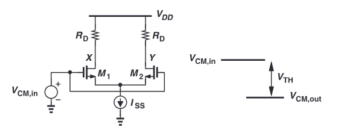

# 예제 10.17 — V_TH = 0.4 V일 때 허용 가능한 최대 입력 CM 레벨

## 조건
- 이전 예제(예제 10.16)의 NMOS 차동쌍 설계
- $V_{TH} = 0.4\ \text{V}$

## 구할 것
- 허용 가능한 최대 입력 공통 모드 레벨 $V_{CM,in}$

## 상속·참조
- 예제 10.16 (E10.16): $V_{DD} = 1.8\ \text{V}$, $\mu_n C_{ox} = 100\ \mu\text{A/V}^2$, $\lambda = 0$, 전력 $2\ \text{mW}$ → $I_{SS} = 1.11\ \text{mA}$, 출력 CM 레벨 $V_{CM,out} = V_{DD} - R_D \dfrac{I_{SS}}{2} = 1.6\ \text{V}$ → $R_D = 360\ \Omega$, $W/L = 1738$
- 식 (10.112): $M_1$, $M_2$ 포화 조건 $V_{DD} - R_D \dfrac{I_{SS}}{2} > V_{CM} - V_{TH}$

## 회로 — 없음 (문제 그림 없음, 그림 10.29는 풀이에만 있음)

## 답 (검증용)
- 식 (10.112)를 다시 쓰면 $V_{CM,in} < V_{DD} - R_D \dfrac{I_{SS}}{2} + V_{TH} < V_{CM,out} + V_{TH}$ (식 10.128–10.129, Fig 10.29) → $V_{CM,in} < 2\ \text{V}$ (식 10.130). 입력 CM 레벨은 $V_{DD}$에 있어도 됨. 예제 10.5와 달리 부하 저항 제한은 출력 CM 레벨 조건에서 나옴

### 정답 회로 — Fig 10.29
```spice
VCMIN  n1   0    {V_CM,in}   ; 전압원, + 쪽이 위
RD1    VDD  X    {R_D}
RD2    VDD  Y    {R_D}
M1     X    n1   n2  nmos
M2     Y    n1   n2  nmos
ISS    n2   0    {I_SS}
* n1 = 두 게이트를 묶은 노드, n2 = 공통 소스 노드. 둘 다 그림에 라벨 없음
```
- 단자: VDD = 전원, 값 미지정 (가로 레일) / 입력은 전압원 V_CM,in이 두 게이트를 직접 구동 (개방 단자 없음)
- 표시: 노드 라벨 VDD (레일 오른쪽 끝), X (M1 드레인 선 왼쪽, M1 바로 위), Y (M2 드레인 선 오른쪽, M2 바로 위) / 소자 라벨 R_D (왼쪽 저항 왼쪽), R_D (오른쪽 저항 오른쪽), M1 (M1 오른쪽), M2 (M2 왼쪽), V_CM,in (전압원 왼쪽), I_SS (전류원 오른쪽) / 부호 + (전압원 오른쪽 위), − (전압원 오른쪽 아래) / 화살표 없음 / 수치·면적 라벨 없음
- 배치: 맨 위 굵은 가로 레일 VDD / 왼쪽 세로줄 위→아래 R_D, X, M1, 오른쪽 세로줄 위→아래 R_D, Y, M2 / M1 nmos 보통 방향(게이트 왼쪽), M2 nmos 좌우 반전(게이트 오른쪽) / 전압원은 M1 왼쪽 아래, + 단자 → 위로 → 오른쪽 가로선 → n1 접속점 → 오른쪽 M1 게이트 / n1 접속점에서 아래로 내려가 맨 아래 가로선(게이트 공통선, 소스 공통선보다 낮음)이 오른쪽으로 M2 게이트보다 오른쪽까지 간 뒤 위로 꺾여 왼쪽으로 M2 게이트 / 두 소스는 아래로 내려가 가로선으로 가운데 n2 점, n2에서 아래로 I_SS(화살표 아래), 그 아래 접지 / 전압원 − 단자 아래 접지 / 접속점 (세 갈래 이상, 2곳): ① n1 = 왼쪽 전압원 선 + 오른쪽 M1 게이트 + 아래 게이트 공통선 (점) ② n2 = 왼쪽 M1 소스 선 + 오른쪽 M2 소스 선 + 아래 I_SS (점) / 교차: n2 → I_SS 세로선이 게이트 공통선(맨 아래 가로선)과 점 없이 교차 (1곳)


> 참고: 크롭 이미지 오른쪽은 같은 그림의 레벨 도해 — 위 가로 막대(왼쪽 라벨 "V_CM,in")와 그보다 조금 오른쪽으로 치우친 아래 가로 막대(오른쪽 라벨 "V_CM,out") 사이에 세로 양방향 화살표, 화살표 오른쪽 라벨 "V_TH"
