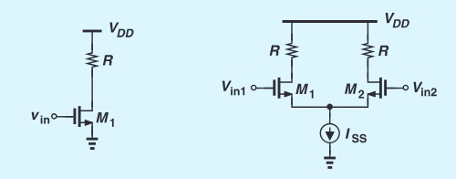

# 예제 10.18 — 같은 부하 저항의 CS 단과 차동쌍 비교: 트랜지스터 크기와 전력 소모

## 조건
- 회로: Fig 10.30 — 왼쪽 공통 소스(CS) 단, 오른쪽 NMOS 차동쌍. 두 회로는 동일한 부하 저항 $R$로 구성됨
- 두 회로는 전압 이득과 공급 전압이 같도록 설계됨
- 그림 라벨: CS 트랜지스터와 차동쌍 왼쪽 트랜지스터에 모두 $M_1$이 인쇄됨. 풀이는 CS 트랜지스터 전류를 $I_{D1}$, 차동쌍 트랜지스터 전류를 $I_{D2}$, $I_{D3}$로 적고 "$M_1$~$M_3$"라 부름 (그림 라벨과 맞지 않음, 원문에 없음)
- 소자 값은 주어지지 않음 (답은 비교 서술) (원문에 없음)

## 구할 것
- (a) 주어진 한계 전력 소모에 대한 트랜지스터 크기에 대해 토의
- (b) 주어진 트랜지스터 크기를 위한 전력 소모의 선택에 대해 토의

## 상속·참조
- 식 (10.126): 포화 영역 MOSFET의 트랜스컨덕턴스 $g_m = \sqrt{2\mu_n C_{ox}\tfrac{W}{L} I_D}$ (차동쌍의 각 트랜지스터는 $I_D = I_{SS}/2$)
- 전압 이득: CS 단 $-g_m R$, 차동쌍 $-g_m R$ (식 10.122, 부하가 같으면 같은 $g_m$이 필요) (원문에 없음)

## 회로 — Fig 10.30
```spice
* 왼쪽 회로: 공통 소스(CS) 단
RCS   VDD  n1    {R}
M1CS  n1   vin   0   nmos   ; 그림 라벨 M_1 (오른쪽 차동쌍의 M_1과 같은 라벨이 인쇄됨)
* 오른쪽 회로: 차동쌍 (왼쪽 회로와 선으로 이어지지 않음)
R1    VDD  n2    {R}
R2    VDD  n3    {R}
M1    n2   Vin1  n4  nmos
M2    n3   Vin2  n4  nmos
ISS   n4   0     {I_SS}
* n1, n2, n3 = 드레인 노드 (원·라벨 없음), n4 = 공통 소스 노드 (라벨 없음)
```
- 단자: VDD = 전원, 값 미지정 (왼쪽 회로는 T 전원 기호, 오른쪽 회로는 가로 레일) / vin = CS 단 입력 (개방 원) / Vin1, Vin2 = 차동쌍 입력 (개방 원) / 출력 단자는 그려져 있지 않음
- 표시: 노드 라벨 VDD (T 기호 오른쪽), VDD (레일 오른쪽 끝), v_in (CS 입력 원 왼쪽, 소문자 v), V_in1 (왼쪽 입력 원 왼쪽), V_in2 (오른쪽 입력 원 오른쪽) / 소자 라벨 R (CS 저항 오른쪽), M1 (CS 트랜지스터 오른쪽), R (차동쌍 왼쪽 저항 왼쪽), R (차동쌍 오른쪽 저항 오른쪽), M1 (차동쌍 왼쪽 트랜지스터 오른쪽), M2 (차동쌍 오른쪽 트랜지스터 왼쪽), I_SS (전류원 오른쪽) — M1 라벨이 두 회로에 한 번씩, 두 번 인쇄됨 / 부호 없음 / 화살표 없음 / 수치·면적 라벨 없음
- 배치: 왼쪽 CS 단, 오른쪽 차동쌍이 나란히 놓임 (CS 단이 조금 아래로 내려와 있음) / CS 단: 한 세로줄 위→아래 VDD T 기호, R, M1, 접지. M1 nmos 보통 방향(게이트 왼쪽), v_in 원 → 가로선 → 게이트 / 차동쌍: 맨 위 굵은 가로 레일 VDD, 왼쪽 세로줄 R → M1 드레인, 오른쪽 세로줄 R → M2 드레인. M1 nmos 보통 방향(게이트 왼쪽), M2 nmos 좌우 반전(게이트 오른쪽). V_in1 원 → 가로선 → M1 게이트, V_in2 원 → 가로선 → M2 게이트. 두 소스는 아래로 내려가 가로선으로 가운데 n4 점, n4에서 아래로 I_SS(화살표 아래), 그 아래 접지 / 접속점 (세 갈래 이상, 1곳): n4 = 왼쪽 M1 소스 선 + 오른쪽 M2 소스 선 + 아래 I_SS (점) / 교차: 없음



## 답 (검증용)
- (a) 같은 전력을 소모하려면 $I_{D1} = I_{SS} = 2I_{D2} = 2I_{D3}$ → 차동쌍의 각 트랜지스터는 CS 트랜지스터 드레인 전류의 절반을 흘림. 식 (10.126)에 따라 같은 전압 이득을 얻으려면 차동쌍 트랜지스터가 CS 소자보다 2배 넓어야 함
- (b) 양쪽 트랜지스터 크기가 같다면, 차동쌍 트랜지스터가 CS 단과 같은 트랜스컨덕턴스를 가지려면 차동쌍의 테일 전류가 CS 단 바이어스 전류의 2배여야 함 → 차동쌍의 전력 소모가 2배
