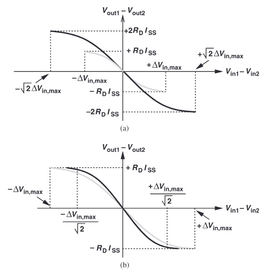

# 예제 10.19 — 테일 전류 2배 또는 종횡비 2배일 때 MOS 차동쌍의 입출력 특성

## 조건
- MOS 차동쌍 (본문 Fig 10.31의 쌍: 부하 $R_D$ 두 개, $M_1$, $M_2$, 테일 전류원 $I_{SS}$) (원문에 없음, 예제는 "MOS 차동쌍"만 적음)
- (a) 테일 전류 $I_{SS}$가 2배
- (b) 트랜지스터 종횡비 $W/L$이 2배
- 소자 값은 주어지지 않음 (답은 특성 곡선 모양으로) (원문에 없음)

## 구할 것
- (a), (b) 각각에서 MOS 차동쌍의 입출력 특성 고찰

## 상속·참조
- 본문 Fig 10.31 (교재 530쪽, 크롭 안 함): 연결 `RD(왼쪽): VDD – Vout1`, `RD(오른쪽): VDD – Vout2`, `M1: D = Vout1, G = Vin1, S = 공통 소스 노드`, `M2: D = Vout2, G = Vin2, S = 공통 소스 노드`, `I_SS: 공통 소스 노드 → 접지`, 두 출력 사이 $V_{out}$(+ 왼쪽, − 오른쪽)
- 식 (10.147): $I_{D1} - I_{D2} = \tfrac{1}{2}\mu_n C_{ox}\tfrac{W}{L}(V_{in1} - V_{in2})\sqrt{\dfrac{4I_{SS}}{\mu_n C_{ox}\frac{W}{L}} - (V_{in1} - V_{in2})^2}$, $V_{out1} - V_{out2} = -R_D(I_{D1} - I_{D2})$ (식 10.132)
- 식 (10.150): 한쪽 트랜지스터가 전도의 끝에 놓이는 차동 입력 $\Delta V_{in,max} = |V_{in1} - V_{in2}|_{max} = \sqrt{\dfrac{2I_{SS}}{\mu_n C_{ox}\frac{W}{L}}}$
- 본문 Fig 10.33(c) (교재 533쪽, 크롭 안 함): 가로축 $V_{in1} - V_{in2}$, 세로 라벨 $V_{out1} - V_{out2}$. 곡선은 $-\Delta V_{in,max}$에서 $+R_D I_{SS}$로 평탄하다가 원점을 지나 내려가 $+\Delta V_{in,max}$에서 $-R_D I_{SS}$로 평탄해짐 (원점 대칭 S자, 기울기 음)

## 회로 — 없음 (그림 없는 글 문제, 풀이는 본문 그림 10.33(c)의 특성을 씀)

## 답 (검증용)
- (a) 식 (10.150)에서 $2I_{SS}$는 $\Delta V_{in,max}$를 $\sqrt{2}$배로 늘림 → Fig 10.33(c)의 특성이 수평으로 확장. $I_{SS}R_D$도 2배가 되어 수직으로도 확장 → Fig 10.34(a), 기울기가 더 커짐
- (b) $I_{SS}R_D$가 일정한 동안 $2W/L$은 $\Delta V_{in,max}$를 $\sqrt{2}$배만큼 줄임 → 특성이 수평으로 줄어들고 (Fig 10.34(b)) $\Delta V_{in} = 0$ 부근 기울기가 더 급해짐
- Fig 10.34(a): 세로축 화살표 "V_out1 − V_out2", 가로축 화살표 "V_in1 − V_in2". 흐린 회색 곡선(원래 특성)은 "−ΔV_in,max"에서 "+R_D I_SS", "+ΔV_in,max"에서 "−R_D I_SS"로 평탄. 검은 굵은 곡선은 "−√2 ΔV_in,max"에서 "+2R_D I_SS", "+√2 ΔV_in,max"에서 "−2R_D I_SS"로 평탄. 각 끝점에서 가로축까지, 세로축까지 점선. "±√2 ΔV_in,max" 라벨은 가로축의 끝점을 가리키는 짧은 비스듬한 화살표와 함께
- Fig 10.34(b): 같은 축. 흐린 회색 곡선(원래 특성)은 "−ΔV_in,max"와 "+ΔV_in,max"에서 평탄(두 라벨은 비스듬한 화살표로 가로축 끝점을 가리킴), 검은 굵은 곡선은 "−ΔV_in,max/√2"와 "+ΔV_in,max/√2"에서 평탄. 두 곡선 모두 높이 "+R_D I_SS", "−R_D I_SS"

