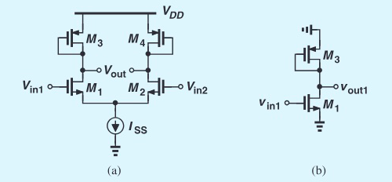

# 예제 10.22 — 다이오드 연결 PMOS 부하 MOS 차동쌍의 전압 이득

## 조건
- 회로: Fig 10.36(a) — NMOS 차동쌍($M_1$, $M_2$, 테일 $I_{SS}$), 부하는 다이오드 연결 PMOS $M_3$, $M_4$
- $\lambda \ne 0$
- 소자 값은 주어지지 않음 (답은 기호로) (원문에 없음)

## 구할 것
- 전압 이득

## 상속·참조
- 차동 소신호 입력에서 공통 소스 노드는 가상 접지 → 절반 회로 해석 (본문 10.3.3절, 식 10.157–10.162)
- 다이오드 연결 MOSFET의 소신호 임피던스 $(1/g_m) \| r_O$ (원문에 없음)

## 회로 — Fig 10.36(a)
```spice
M3   out1  out1  VDD  pmos
M4   out2  out2  VDD  pmos
M1   out1  Vin1  n1   nmos
M2   out2  Vin2  n1   nmos
ISS  n1    0     {I_SS}
* out1, out2 = 두 출력 원이 달린 드레인 노드. 원 사이에 V_out 라벨 하나 (차동 출력)
* n1 = 공통 소스 노드 (라벨 없음)
```
- 단자: VDD = 전원, 값 미지정 (가로 레일) / Vin1, Vin2 = 입력 (개방 원) / out1, out2 = 차동 출력 V_out의 두 단자 (개방 원, 각각에는 라벨 없음)
- 표시: 노드 라벨 VDD (레일 오른쪽 끝), V_out (두 출력 원 사이), V_in1 (왼쪽 입력 원 왼쪽), V_in2 (오른쪽 입력 원 오른쪽) / 소자 라벨 M3 (M3 오른쪽), M4 (M4 왼쪽), M1 (M1 오른쪽), M2 (M2 왼쪽), I_SS (전류원 오른쪽) / 부호 없음 / 화살표 없음 / 수치·면적 라벨 없음
- 배치: 맨 위 굵은 가로 레일 VDD / 왼쪽 세로줄 위→아래 M3, 위 접속점, 아래 접속점, M1 / 오른쪽 세로줄 위→아래 M4, 위 접속점, 아래 접속점, M2 / M3 pmos 보통 방향(게이트 왼쪽, 소스 위 → 레일), M4 pmos 좌우 반전(게이트 오른쪽, 소스 위 → 레일) / 다이오드 연결: M3 게이트 → 왼쪽 → 아래로 → 오른쪽으로 꺾여 M3 드레인 아래 위 접속점, M4 게이트 → 오른쪽 → 아래로 → 왼쪽으로 꺾여 M4 드레인 아래 위 접속점 / 아래 접속점에서 가로선이 가운데 쪽으로 출력 원 (두 원이 마주 보고 그 사이에 V_out) / M1 nmos 보통 방향(게이트 왼쪽), M2 nmos 좌우 반전(게이트 오른쪽) / V_in1 원 → 가로선 → M1 게이트, V_in2 원 → 가로선 → M2 게이트 / 두 소스는 아래로 내려가 가로선으로 가운데 n1 점, n1에서 아래로 I_SS(화살표 아래), 그 아래 접지 / 접속점 (세 갈래 이상, 5곳): ① 왼쪽 위 = 위 M3 드레인 + 왼쪽 게이트 되먹임 선 + 아래 세로선 (점) ② 오른쪽 위 = 위 M4 드레인 + 오른쪽 게이트 되먹임 선 + 아래 세로선 (점) ③ 왼쪽 아래 = 위 세로선 + 아래 M1 드레인 + 오른쪽 출력선 (점) ④ 오른쪽 아래 = 위 세로선 + 아래 M2 드레인 + 왼쪽 출력선 (점) ⑤ n1 = 왼쪽 M1 소스 선 + 오른쪽 M2 소스 선 + 아래 I_SS (점) / 교차: 없음


> 참고: 크롭 이미지 오른쪽 (b)는 예제 풀이 그림 (답 절 참고)

## 답 (검증용)
- 절반 회로 Fig 10.36(b)에서 $M_1$ 드레인에서 보이는 전체 저항은 $(1/g_{m3}) \| r_{O3} \| r_{O1}$ → $A_v = -g_{m1}\left(\dfrac{1}{g_{m3}} \| r_{O3} \| r_{O1}\right)$ (식 10.168)

### 정답 회로 — Fig 10.36(b)
```spice
* 노드 0 = 교류 접지. M3 소스는 옆으로 누운 접지 기호에 바로 이어짐 (전류 화살표 없음)
M3   vout1  vout1  0  pmos
M1   vout1  vin1   0  nmos
```
- 단자: vin1 = 소신호 입력 (개방 원) / vout1 = 출력 (개방 원)
- 표시: 노드 라벨 v_out1 (출력 원 오른쪽), v_in1 (입력 원 왼쪽) / 소자 라벨 M3 (M3 오른쪽), M1 (M1 오른쪽) / 부호 없음 / 화살표 없음 / 수치·면적 라벨 없음
- 배치: 한 세로줄 위→아래 옆으로 누운 접지 기호(막대가 세로, 왼쪽을 향함), M3, 위 접속점, 아래 접속점(출력), M1, 접지 / M3 pmos 보통 방향(게이트 왼쪽): 소스는 위로 올라가 왼쪽으로 꺾여 누운 접지 기호 / M3 게이트 → 왼쪽 → 아래로 → 오른쪽으로 꺾여 위 접속점 (다이오드 연결) / 아래 접속점에서 가로선이 오른쪽 v_out1 원 / M1 nmos 보통 방향(게이트 왼쪽), v_in1 원 → 가로선 → 게이트, 소스 아래 접지 / 접속점 (세 갈래 이상, 2곳): ① 위 = 위 M3 드레인 + 왼쪽 게이트 되먹임 선 + 아래 세로선 (점) ② 아래 = 위 세로선 + 아래 M1 드레인 + 오른쪽 출력선 (점) / 교차: 없음


