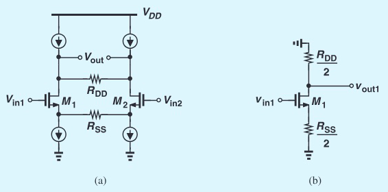

# 예제 10.24 — 출력 사이 R_DD, 소스 사이 R_SS를 가진 차동쌍의 전압 이득

## 조건
- 회로: Fig 10.38(a) — NMOS 차동쌍 $M_1$, $M_2$. 두 드레인은 각각 이상적 전류원으로 $V_{DD}$에서 바이어스되고 드레인 사이에 저항 $R_{DD}$, 두 소스는 각각 이상적 전류원으로 접지되고 소스 사이에 저항 $R_{SS}$
- $\lambda = 0$
- 소자 값은 주어지지 않음 (답은 기호로) (원문에 없음)

## 구할 것
- 전압 이득

## 상속·참조
- 차동 소신호 입력에서 대칭축 위의 노드는 가상 접지 (본문 Fig 10.20의 성질: 같은 두 저항의 양 끝이 같은 크기로 반대 방향으로 변하면 가운데 노드는 가상 접지) → 절반 회로 해석
- 소스 축퇴 CS 단의 이득 $-\dfrac{R_D}{R_S + 1/g_m}$ ($\lambda = 0$) (원문에 없음)

## 회로 — Fig 10.38(a)
```spice
I1   VDD   out1   ; 이상적 전류원 (라벨·값 없음)
I2   VDD   out2   ; 이상적 전류원 (라벨·값 없음)
RDD  out1  out2   {R_DD}
M1   out1  Vin1   n1  nmos
M2   out2  Vin2   n2  nmos
RSS  n1    n2     {R_SS}
I3   n1    0      ; 이상적 전류원 (라벨·값 없음)
I4   n2    0      ; 이상적 전류원 (라벨·값 없음)
* out1, out2 = 두 출력 원이 달린 드레인 노드. 원 사이에 V_out 라벨 하나 (차동 출력)
* n1, n2 = 소스 노드 (라벨 없음)
```
- 단자: VDD = 전원, 값 미지정 (가로 레일) / Vin1, Vin2 = 입력 (개방 원) / out1, out2 = 차동 출력 V_out의 두 단자 (개방 원, 각각에는 라벨 없음)
- 표시: 노드 라벨 VDD (레일 오른쪽 끝), V_out (두 출력 원 사이), V_in1 (왼쪽 입력 원 왼쪽), V_in2 (오른쪽 입력 원 오른쪽) / 소자 라벨 R_DD (R_DD 아래), R_SS (R_SS 아래), M1 (M1 오른쪽), M2 (M2 왼쪽), 전류원 네 개 (라벨 없음) / 부호 없음 / 화살표 없음 / 수치·면적 라벨 없음
- 배치: 맨 위 굵은 가로 레일 VDD / 왼쪽 세로줄 위→아래 전류원(화살표 아래), 출력 접속점, R_DD 접속점, M1, 소스 접속점, 전류원(화살표 아래), 접지 / 오른쪽 세로줄도 같은 순서 (M2) / 출력 접속점에서 가로선이 가운데 쪽으로 출력 원 (두 원이 마주 보고 그 사이에 V_out) / R_DD는 두 R_DD 접속점 사이의 가로 저항 (출력 원 줄 바로 아래 높이), R_SS는 두 소스 접속점 사이의 가로 저항 / M1 nmos 보통 방향(게이트 왼쪽), M2 nmos 좌우 반전(게이트 오른쪽) / V_in1 원 → 가로선 → M1 게이트, V_in2 원 → 가로선 → M2 게이트 / 꼬리 전류원 대신 소스마다 전류원이 하나씩 (공통 소스 노드 없음) / 접속점 (세 갈래 이상, 6곳): ① 왼쪽 출력 = 위 전류원 + 아래 세로선 + 오른쪽 출력선 (점) ② 오른쪽 출력 = 위 전류원 + 아래 세로선 + 왼쪽 출력선 (점) ③ 왼쪽 R_DD = 위 세로선 + 아래 M1 드레인 + 오른쪽 R_DD (점) ④ 오른쪽 R_DD = 위 세로선 + 아래 M2 드레인 + 왼쪽 R_DD (점) ⑤ 왼쪽 소스 = 위 M1 소스 + 아래 전류원 + 오른쪽 R_SS (점) ⑥ 오른쪽 소스 = 위 M2 소스 + 아래 전류원 + 왼쪽 R_SS (점) / 교차: 없음


> 참고: 크롭 이미지 오른쪽 (b)는 예제 풀이 그림 (답 절 참고)

## 답 (검증용)
- $R_{SS}$와 $R_{DD}$의 중점을 접지시키면 절반 회로 Fig 10.38(b) → $A_v = -\dfrac{R_{DD}/2}{\dfrac{R_{SS}}{2} + \dfrac{1}{g_m}}$ (식 10.170)

### 정답 회로 — Fig 10.38(b)
```spice
* 노드 0 = 교류 접지. R_DD/2 위쪽 끝은 옆으로 누운 접지 기호에 바로 이어짐 (전류 화살표 없음)
RDD2  0      vout1  {R_DD/2}   ; 라벨은 R_DD 위, 2 아래의 분수 꼴로 인쇄
M1    vout1  vin1   n1  nmos
RSS2  n1     0      {R_SS/2}   ; 라벨은 R_SS 위, 2 아래의 분수 꼴로 인쇄
```
- 단자: vin1 = 소신호 입력 (개방 원) / vout1 = 출력 (개방 원)
- 표시: 노드 라벨 v_in1 (입력 원 왼쪽), v_out1 (출력 원 오른쪽) / 소자 라벨 R_DD/2 (위 저항 오른쪽, 분수 꼴), M1 (M1 오른쪽), R_SS/2 (아래 저항 오른쪽, 분수 꼴) / 부호 없음 / 화살표 없음 / 수치·면적 라벨 없음
- 배치: 한 세로줄 위→아래 옆으로 누운 접지 기호(막대가 세로, 왼쪽을 향함), R_DD/2, 드레인 접속점, M1, R_SS/2, 접지 / 누운 접지에서 선이 오른쪽으로 갔다가 아래로 꺾여 R_DD/2 / 드레인 접속점에서 가로선이 오른쪽 v_out1 원 / M1 nmos 보통 방향(게이트 왼쪽), v_in1 원 → 가로선 → 게이트 / 접속점 (세 갈래 이상, 1곳): 드레인 = 위 R_DD/2 + 아래 M1 드레인 + 오른쪽 출력선 (점) / 교차: 없음


