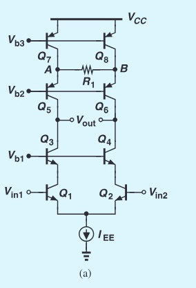
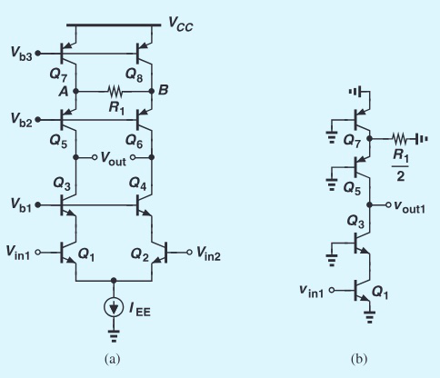

# 예제 10.25 — A, B 노드 사이 기생 저항 R1이 생긴 바이폴라 텔레스코픽 캐스코드의 전압 이득

## 원문
제조 결함 때문에 그림 10.41(a)의 회로에 있는 $A$ 노드와 $B$ 노드 사이에 기생 저항이 나타났다. 회로의 전압 이득을 구하라.

## 조건
- 회로: Fig 10.41(a) — pnp 캐스코드 부하($Q_5$–$Q_8$)를 가진 바이폴라 캐스코드 차동쌍($Q_1$–$Q_4$, 테일 $I_{EE}$)
- 제조 결함 때문에 $A$ 노드와 $B$ 노드 사이에 기생 저항 $R_1$이 나타남
- $R_1$ 값과 소자 값은 주어지지 않음 (답은 기호로) (원문에 없음)

## 구할 것
- 회로의 전압 이득

## 상속·참조
- 회로가 대칭이므로 대칭축 위의 노드($R_1$의 중점 포함)는 차동 입력에서 가상 접지 → 절반 회로 해석
- 본문 Fig 10.40(a) (교재 539쪽, 이 파일의 그림 목록에는 넣지 않음, 크롭은 fig10-40.png): pnp 캐스코드 부하를 가진 바이폴라 캐스코드 차동쌍. Fig 10.41(a)에서 $R_1$만 뺀 회로 (라벨 $Q_1$–$Q_8$, $V_{b1}$–$V_{b3}$ 같음, A·B 라벨 없음). 절반 회로 이득 $A_v \approx -g_{m1}[g_{m3} r_{O3}(r_{O1} \| r_{\pi 3})] \| [g_{m5} r_{O5}(r_{O7} \| r_{\pi 5})]$ (식 10.172)
- 식 (9.1): 이미터 축퇴된 트랜지스터의 컬렉터 쪽 출력 저항 $R_{out} = \left[1 + g_m (R_E \parallel r_\pi)\right] r_O + R_E \parallel r_\pi$

## 회로 — Fig 10.41(a)
```spice
Q7   A     Vb3   VCC  pnp
Q8   B     Vb3   VCC  pnp
R1   A     B     {R_1}
Q5   out1  Vb2   A    pnp
Q6   out2  Vb2   B    pnp
Q3   out1  Vb1   n2   npn
Q4   out2  Vb1   n3   npn
Q1   n2    Vin1  n1   npn
Q2   n3    Vin2  n1   npn
IEE  n1    0     {I_EE}
* out1, out2 = 두 출력 원이 달린 컬렉터 노드. 원 사이에 V_out 라벨 하나 (차동 출력)
* n1 = 공통 이미터 노드 (라벨 없음), n2, n3 = 캐스코드 중간 노드 (라벨 없음)
```
- 단자: VCC = 전원, 값 미지정 (가로 레일) / Vb3, Vb2, Vb1 = 이상적 DC 바이어스, 값 미지정 (점 단자) / Vin1, Vin2 = 입력 (개방 원) / out1, out2 = 차동 출력 V_out의 두 단자 (개방 원, 각각에는 라벨 없음)
- 표시: 노드 라벨 VCC (레일 오른쪽 끝), V_b3, V_b2, V_b1 (각 점 단자 왼쪽), A (A 점 왼쪽), B (B 점 오른쪽), V_out (두 출력 원 사이), V_in1 (왼쪽 입력 원 왼쪽), V_in2 (오른쪽 입력 원 오른쪽) / 소자 라벨 Q7, Q8 (각 트랜지스터 아래), R1 (R1 아래), Q5, Q6 (각 트랜지스터 아래), Q3, Q4 (각 트랜지스터 위), Q1 (Q1 오른쪽), Q2 (Q2 왼쪽), I_EE (전류원 오른쪽) / 부호 없음 / 화살표 없음 / 수치·면적 라벨 없음
- 배치: 맨 위 굵은 가로 레일 VCC / 두 세로줄에 위→아래 Q7–A–Q5–출력 접속점–Q3–Q1 (왼쪽), Q8–B–Q6–출력 접속점–Q4–Q2 (오른쪽) / Q7, Q8, Q5, Q6 pnp 모두 보통 방향(베이스 막대 왼쪽, 이미터 오른쪽 위, 컬렉터 오른쪽 아래), Q7·Q8 이미터는 위로 레일 / Q3, Q4 npn 보통 방향(베이스 왼쪽, 컬렉터 오른쪽 위, 이미터 오른쪽 아래), Q1 npn 보통 방향(베이스 왼쪽), Q2 npn 좌우 반전(베이스 오른쪽) / 베이스 공통선 세 개: Vb3 점에서 오른쪽으로 Q7 막대에 닿고 계속 Q8 막대까지, Vb2 점에서 Q5 막대를 지나 Q6 막대까지, Vb1 점에서 Q3 막대를 지나 Q4 막대까지 (각각 왼쪽 트랜지스터 막대 가운데 높이, 그 트랜지스터의 이미터·컬렉터 인출선 사이로 지남) / A–B 사이 가로 R1 (A, B 점 높이) / 출력 접속점에서 가로선이 가운데 쪽으로 출력 원 (두 원이 마주 보고 그 사이에 V_out) / V_in1 원 → Q1 베이스, V_in2 원 → Q2 베이스 / Q1, Q2 이미터는 아래로 내려가 가로선으로 가운데 n1 점, n1에서 아래로 I_EE(화살표 아래), 그 아래 접지 / 접속점 (세 갈래 이상, 5곳 + 점 없는 3곳): ① A = 위 Q7 컬렉터 + 아래 Q5 이미터 + 오른쪽 R1 (점) ② B = 위 Q8 컬렉터 + 아래 Q6 이미터 + 왼쪽 R1 (점) ③ 왼쪽 출력 = 위 Q5 컬렉터 + 아래 Q3 컬렉터 + 오른쪽 출력선 (점) ④ 오른쪽 출력 = 위 Q6 컬렉터 + 아래 Q4 컬렉터 + 왼쪽 출력선 (점) ⑤ n1 = 왼쪽 Q1 이미터 선 + 오른쪽 Q2 이미터 선 + 아래 I_EE (점) ⑥–⑧ 베이스 공통선이 Q7, Q5, Q3 막대에 닿는 곳, 왼쪽 선 + 오른쪽 선 + 베이스 (점 없음) / 교차: 없음



## 답 (검증용)
- 대칭성 → $R_1$의 중점이 가상 접지 → 절반 회로 Fig 10.41(b). $R_1/2$가 $r_{O7}$과 병렬로 나타나 pnp 캐스코드의 출력 임피던스를 낮춤. $R_1$ 값이 없으므로 식 (9.1)로: $R_{op} = \left[1 + g_{m5}\left(r_{O7} \| r_{\pi 5} \| \dfrac{R_1}{2}\right)\right] r_{O5} + r_{O7} \| r_{\pi 5} \| \dfrac{R_1}{2}$ (식 10.173)
- npn 캐스코드 쪽 저항은 그대로 $\approx g_{m3} r_{O3}(r_{O1} \| r_{\pi 3})$ → $A_v = -g_{m1}[g_{m3} r_{O3}(r_{O1} \| r_{\pi 3})] \| R_{op}$ (식 10.174)

### 정답 회로 — Fig 10.41(b)
```spice
* 노드 0 = 교류 접지. 옆으로 누운 접지 기호와 아래 방향 접지 기호 모두 노드 0 (전류 화살표 없음)
Q7   n1     0     0    pnp   ; B = 아래 방향 접지, E = 옆으로 누운 접지
RH   n1     0     {R_1/2}    ; 라벨은 R_1 위, 2 아래의 분수 꼴로 인쇄. 오른쪽 끝이 옆으로 누운 접지
Q5   vout1  0     n1   pnp   ; B = 아래 방향 접지
Q3   vout1  0     n2   npn   ; B = 아래 방향 접지
Q1   n2     vin1  0    npn
* n1 = Q7 컬렉터·Q5 이미터 접속점, n2 = Q3 이미터·Q1 컬렉터 (라벨 없음)
```
- 단자: vin1 = 소신호 입력 (개방 원) / vout1 = 출력 (개방 원)
- 표시: 노드 라벨 v_in1 (입력 원 왼쪽), v_out1 (출력 원 오른쪽) / 소자 라벨 Q7, Q5 (각 베이스 막대 아래), R_1/2 (저항 아래, 분수 꼴), Q3 (Q3 위), Q1 (Q1 오른쪽) / 부호 없음 / 화살표 없음 / 수치·면적 라벨 없음
- 배치: 한 세로줄 위→아래 Q7, n1 접속점, Q5, 출력 접속점, Q3, Q1, 접지 / Q7 pnp 보통 방향(베이스 막대 왼쪽): 이미터는 오른쪽 위로 나가 위로 올라가 왼쪽으로 꺾여 옆으로 누운 접지 기호(막대가 세로, 왼쪽을 향함) / Q7, Q5, Q3 베이스는 각각 왼쪽 가로선 → 아래로 꺾여 접지 기호 / n1 접속점에서 가로선이 오른쪽으로 R_1/2 → 옆으로 누운 접지 기호(막대가 세로, 오른쪽을 향함) / 출력 접속점에서 가로선이 오른쪽 v_out1 원 / Q5 pnp 보통 방향, Q3·Q1 npn 보통 방향(베이스 왼쪽), v_in1 원 → 가로선 → Q1 베이스, Q1 이미터 아래 접지 / 접속점 (세 갈래 이상, 2곳): ① n1 = 위 Q7 컬렉터 + 아래 Q5 이미터 + 오른쪽 R_1/2 (점) ② 출력 = 위 Q5 컬렉터 + 아래 Q3 컬렉터 + 오른쪽 출력선 (점) / 교차: 없음



## 힌트
### $R_1/2$는 $Q_5$ 축퇴 저항에 병렬
- 대칭이므로 $R_1$의 한가운데는 차동 신호에서 움직이지 않아, 절반 회로에서는 $A$ 노드와 AC 접지 사이에 $R_1$의 반쪽이 달린다
- $A$는 출력이 아니라 $Q_7$ 컬렉터와 $Q_5$ 이미터가 만나는 캐스코드 중간 노드라서, 이 저항은 출력에 바로 병렬로 붙지 않고 $Q_5$ 이미터에서 본 축퇴 저항($r_{O7}$ 쪽)을 줄인다

## 풀이
### 절반 회로
- 회로가 대칭이므로 차동 입력에서 $A$와 $B$는 같은 크기로 반대 방향으로 움직이고, $R_1$의 한가운데는 가상 접지다
- 절반 회로에서는 $A$와 AC 접지 사이에 $R_1/2$가 달리고 $P$(테일 노드)도 가상 접지다
### npn 캐스코드 쪽 저항
- $Q_3$의 이미터 축퇴 저항은 $r_{O1} \parallel r_{\pi 3}$로 $r_O$ 수준이므로
- $R_{on} \approx g_{m3} r_{O3} (r_{O1} \parallel r_{\pi 3})$ ($R_{on}$: 출력에서 아래로 본 저항)
### pnp 캐스코드 쪽 저항
- $A$는 $Q_7$ 컬렉터와 $Q_5$ 이미터가 만나는 노드라, $R_1/2$는 $Q_5$ 이미터에서 본 축퇴 저항 $r_{O7} \parallel r_{\pi 5}$에 병렬로 붙는다
- $R_1$ 값이 없어 축퇴 저항이 작을 수 있으므로 1을 남긴다: $R_{op} = \left[1 + g_{m5}\left(r_{O7} \parallel r_{\pi 5} \parallel \dfrac{R_1}{2}\right)\right] r_{O5}$ ($R_{op}$: 출력에서 위로 본 저항)
- $R_1$이 작을수록 $R_{op}$가 줄어 이득이 떨어진다
### 전압 이득
- 출력 노드의 전체 저항은 $R_{on} \parallel R_{op}$이므로 $A_v = -g_{m1}(R_{on} \parallel R_{op})$
### 답
- $A_v = -g_{m1}\left\{[g_{m3} r_{O3}(r_{O1} \parallel r_{\pi 3})] \parallel \left[1 + g_{m5}\left(r_{O7} \parallel r_{\pi 5} \parallel \dfrac{R_1}{2}\right)\right] r_{O5}\right\}$
