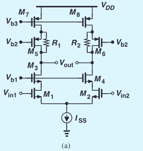
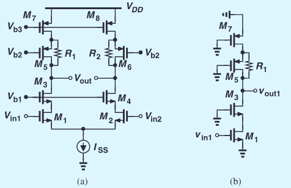

# 예제 10.26 — M5, M6에 병렬로 기생 저항 R1, R2가 생긴 MOS 텔레스코픽 캐스코드의 전압 이득

## 원문
제조 결함으로 2개의 같은 기생 저항 $R_1$, $R_2$가 그림 10.44(a)에 보이는 것처럼 나타났다. 이 회로의 전압 이득을 구하라.

## 조건
- 회로: Fig 10.44(a) — PMOS 캐스코드 부하($M_5$–$M_8$)를 가진 NMOS 캐스코드 차동쌍($M_1$–$M_4$, 테일 $I_{SS}$)
- 제조 결함으로 2개의 같은 기생 저항 $R_1$, $R_2$가 나타남: $R_1$은 $M_5$의 소스–드레인 사이, $R_2$는 $M_6$의 소스–드레인 사이
- "같은" → $R_1 = R_2$, 회로 대칭으로 해석 (원문에 없음)
- $R_1$ 값과 소자 값은 주어지지 않음 (답은 기호로) (원문에 없음)

## 구할 것
- 회로의 전압 이득

## 상속·참조
- 대칭 차동쌍의 차동 입력에서 공통 소스 노드는 가상 접지 → 절반 회로 해석
- 본문 Fig 10.43(a) (교재 541쪽, 이 파일의 그림 목록에는 넣지 않음, 크롭은 fig10-43.png): MOS 텔레스코픽 캐스코드 증폭기. Fig 10.44(a)에서 $R_1$, $R_2$를 빼고 $M_6$ 게이트를 $V_{b2}$ 공통선으로 이은 회로. 이득 $A_v \approx -g_{m1}[(g_{m3} r_{O3} r_{O1}) \| (g_{m5} r_{O5} r_{O7})]$ (식 10.176)
- 식 (9.3): 소스 축퇴된 MOSFET의 드레인 쪽 출력 저항 $R_{out} = (1 + g_m R_S) r_O + R_S$

## 회로 — Fig 10.44(a)
```spice
M7   n1    Vb3   VDD  pmos
M8   n2    Vb3   VDD  pmos
M5   out1  Vb2   n1   pmos
R1   n1    out1  {R_1}   ; M5 소스–드레인 사이에 병렬
M6   out2  Vb2   n2   pmos   ; 게이트의 V_b2 점 단자는 오른쪽에 따로 인쇄 (왼쪽 V_b2와 같은 라벨)
R2   n2    out2  {R_2}   ; M6 소스–드레인 사이에 병렬
M3   out1  Vb1   n3   nmos
M4   out2  Vb1   n4   nmos
M1   n3    Vin1  n5   nmos
M2   n4    Vin2  n5   nmos
ISS  n5    0     {I_SS}
* out1, out2 = 두 출력 원이 달린 드레인 노드. 원 사이에 V_out 라벨 하나 (차동 출력)
* n1, n2 = M7·M8 드레인 노드, n3, n4 = 캐스코드 중간 노드, n5 = 공통 소스 노드 (모두 라벨 없음)
```
- 단자: VDD = 전원, 값 미지정 (가로 레일) / Vb3, Vb1 = 이상적 DC 바이어스, 값 미지정 (점 단자, 왼쪽) / Vb2 = 이상적 DC 바이어스, 값 미지정 (점 단자 두 개: 왼쪽 M5 게이트, 오른쪽 M6 게이트, 같은 라벨) / Vin1, Vin2 = 입력 (개방 원) / out1, out2 = 차동 출력 V_out의 두 단자 (개방 원, 각각에는 라벨 없음)
- 표시: 노드 라벨 VDD (레일 오른쪽 끝), V_b3 (왼쪽 점 단자 왼쪽), V_b2 (왼쪽 점 단자 왼쪽), V_b2 (오른쪽 점 단자 오른쪽), V_b1 (왼쪽 점 단자 왼쪽), V_out (두 출력 원 사이), V_in1 (왼쪽 입력 원 왼쪽), V_in2 (오른쪽 입력 원 오른쪽) / 소자 라벨 M7 (M7 왼쪽 위), M8 (M8 왼쪽 위), M5 (M5 왼쪽 아래), R1 (R1 오른쪽), R2 (R2 왼쪽), M6 (M6 드레인 접속점 오른쪽), M3 (M3 왼쪽 위), M4 (M4 오른쪽), M1 (M1 오른쪽), M2 (M2 왼쪽), I_SS (전류원 오른쪽) / 부호 없음 / 화살표 없음 / 수치·면적 라벨 없음
- 배치: 맨 위 굵은 가로 레일 VDD / 두 세로줄에 위→아래 M7–n1 접속점–M5(R1 병렬)–M5 드레인 접속점–출력 접속점–M3–M1 (왼쪽), M8–n2 접속점–M6(R2 병렬)–M6 드레인 접속점–출력 접속점–M4–M2 (오른쪽) / M7, M8, M5 pmos 보통 방향(게이트 왼쪽, 소스 위), M6 pmos 좌우 반전(게이트 오른쪽, 소스 위) / R1은 M5 오른쪽에 세로로, R2는 M6 왼쪽에 세로로 (두 저항이 가운데 쪽을 향해 마주 봄) / M3, M4 nmos 보통 방향(게이트 왼쪽), M1 nmos 보통 방향(게이트 왼쪽), M2 nmos 좌우 반전(게이트 오른쪽) / 게이트 공통선 두 개: Vb3 점에서 오른쪽으로 M7 게이트에 닿고 계속 M8 게이트까지, Vb1 점에서 M3 게이트를 지나 M4 게이트까지 (왼쪽 트랜지스터의 소스·드레인 인출선 사이로 지남) / 출력 접속점에서 가로선이 가운데 쪽으로 출력 원 (두 원이 마주 보고 그 사이에 V_out) / V_in1 원 → M1 게이트, V_in2 원 → M2 게이트 / M1, M2 소스는 아래로 내려가 가로선으로 가운데 n5 점, n5에서 아래로 I_SS(화살표 아래), 그 아래 접지 / 접속점 (세 갈래 이상, 7곳 + 점 없는 2곳): ① n1 = 위 M7 드레인 + 아래 M5 소스 + R1 위 끝 (점) ② n2 = 위 M8 드레인 + 아래 M6 소스 + R2 위 끝 (점) ③ M5 드레인 = 위 M5 드레인 + R1 아래 끝 + 아래 세로선 (점) ④ M6 드레인 = 위 M6 드레인 + R2 아래 끝 + 아래 세로선 (점) ⑤ 왼쪽 출력 = 위 세로선 + 아래 M3 드레인 + 오른쪽 출력선 (점) ⑥ 오른쪽 출력 = 위 세로선 + 아래 M4 드레인 + 왼쪽 출력선 (점) ⑦ n5 = 왼쪽 M1 소스 선 + 오른쪽 M2 소스 선 + 아래 I_SS (점) ⑧⑨ 게이트 공통선이 M7, M3 게이트에 닿는 곳, 왼쪽 선 + 오른쪽 선 + 게이트 (점 없음) / 교차: 없음



## 답 (검증용)
- $R_1$, $R_2$가 각각 $r_{O5}$, $r_{O6}$와 병렬로 나타남 → 절반 회로 Fig 10.44(b). $R_1$ 값이 없으므로 식 (9.3)으로: $R_p = [1 + g_{m5}(r_{O5} \| R_1)] r_{O7} + r_{O5} \| R_1$ (식 10.177)
  - 식 (9.3)에 $R_S = r_{O7}$, $r_O = r_{O5} \| R_1$을 넣은 것과 같은 식 (식 9.4 꼴 $(1 + g_m r_O)R_S + r_O$) (원문에 없음)
- NMOS 캐스코드 쪽 $R_n \approx g_{m3} r_{O3} r_{O1}$ (식 10.178) → $A_v = -g_{m1}(R_p \| R_n)$ (식 10.179)

### 정답 회로 — Fig 10.44(b)
```spice
* 노드 0 = 교류 접지. 옆으로 누운 접지 기호와 아래 방향 접지 기호 모두 노드 0 (전류 화살표 없음)
M7   n1     0     0    pmos   ; G = 아래 방향 접지, S = 옆으로 누운 접지
M5   vout1  0     n1   pmos   ; G = 아래 방향 접지
R1   n1     vout1 {R_1}       ; M5 소스–드레인 사이에 병렬
M3   vout1  0     n2   nmos   ; G = 아래 방향 접지
M1   n2     vin1  0    nmos
* n1 = M7 드레인·M5 소스, n2 = M3 소스·M1 드레인 (라벨 없음)
```
- 단자: vin1 = 소신호 입력 (개방 원) / vout1 = 출력 (개방 원)
- 표시: 노드 라벨 v_in1 (입력 원 왼쪽), v_out1 (출력 원 오른쪽) / 소자 라벨 M7 (M7 왼쪽 위), R1 (R1 오른쪽), M5 (M5 왼쪽 아래), M3 (M3 왼쪽 위), M1 (M1 오른쪽) / 부호 없음 / 화살표 없음 / 수치·면적 라벨 없음
- 배치: 한 세로줄 위→아래 M7, n1 접속점, M5(R1 병렬), M5 드레인 접속점, 출력 접속점, M3, M1, 접지 / M7 pmos 보통 방향(게이트 왼쪽): 소스는 위로 올라가 왼쪽으로 꺾여 옆으로 누운 접지 기호(막대가 세로, 왼쪽을 향함) / M7, M5, M3 게이트는 각각 왼쪽 가로선 → 아래로 꺾여 접지 기호 / R1은 M5 오른쪽에 세로로 (위 끝 n1 접속점, 아래 끝 M5 드레인 접속점) / 출력 접속점에서 가로선이 오른쪽 v_out1 원 / M5 pmos 보통 방향, M3·M1 nmos 보통 방향(게이트 왼쪽), v_in1 원 → 가로선 → M1 게이트, M1 소스 아래 접지 / 접속점 (세 갈래 이상, 3곳): ① n1 = 위 M7 드레인 + 아래 M5 소스 + R1 위 끝 (점) ② M5 드레인 = 위 M5 드레인 + R1 아래 끝 + 아래 세로선 (점) ③ 출력 = 위 세로선 + 아래 M3 드레인 + 오른쪽 출력선 (점) / 교차: 없음



## 힌트
### $R_1$은 $M_5$의 $r_O$에 합치기
- $R_1$은 $M_5$의 드레인과 소스 사이에 걸려 있어, 소신호 모델에서 $M_5$의 $r_O$와 똑같은 두 노드를 잇는다
- 그러므로 $M_5$를 출력 저항이 줄어든 트랜지스터 하나로 보면 PMOS 캐스코드 부하의 모양이 그대로 남는다

## 풀이
### 절반 회로
- $R_1 = R_2$라 회로가 대칭이므로 차동 입력에서 공통 소스 노드는 가상 접지다
- $R_1$은 $M_5$의 드레인과 소스 사이에 걸려, 소신호 모델에서 $r_{O5}$와 같은 두 노드를 잇는다. $M_5$를 출력 저항이 $r_{O5} \parallel R_1$인 트랜지스터로 본다
### PMOS 캐스코드 쪽 저항
- $M_5$($g_{m5}$, 출력 저항 $r_{O5} \parallel R_1$)의 소스 축퇴 저항은 $M_7$의 $r_{O7}$이다
- $R_1$ 값이 없어 $r_{O5} \parallel R_1$이 작을 수 있으므로 1을 남긴다: $R_p \approx [1 + g_{m5}(r_{O5} \parallel R_1)]\, r_{O7}$ ($R_p$: 출력에서 위로 본 저항)
  - $R_1 \to 0$이면 $R_p \to r_{O7}$로, $M_5$가 단락된 실제 회로와 맞는다
### NMOS 캐스코드 쪽 저항
- $M_3$($g_{m3}$, $r_{O3}$)의 소스 축퇴 저항 $M_1$의 $r_{O1}$은 $r_O$ 수준이므로 $R_n \approx g_{m3} r_{O3} r_{O1}$ ($R_n$: 출력에서 아래로 본 저항)
### 전압 이득
- $A_v = -g_{m1}(R_p \parallel R_n)$ ($g_{m1}$: $M_1$의 트랜스컨덕턴스)
- $R_1$이 $r_{O5}$보다 작으면 $R_p$가 크게 줄어 이득이 떨어진다
### 답
- $A_v = -g_{m1}\{[1 + g_{m5}(r_{O5} \parallel R_1)]\, r_{O7} \parallel (g_{m3} r_{O3} r_{O1})\}$
