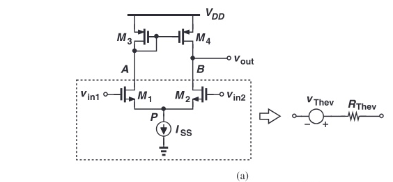
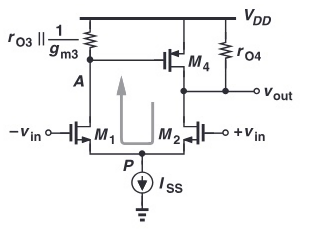

# 예제 10.29 — 능동 부하 MOS 쌍에서 A 노드 스윙이 출력 스윙보다 훨씬 작음을 증명

## 원문
이전 관찰에서, 그림 10.58에서 $A$ 노드의 전압 스윙이 출력 노드의 스윙보다 훨씬 작다고 추측했다. 이 점을 증명하라.

## 조건
- 회로: Fig 10.58(a) — 전류 거울 부하($M_3$ 다이오드 연결, $M_4$)를 가진 NMOS 차동쌍($M_1$, $M_2$, 테일 $I_{SS}$), 싱글엔디드 출력 $v_{out}$
- 이전 관찰에서 Fig 10.58의 $A$ 노드 전압 스윙이 출력 노드 스윙보다 훨씬 작다고 추측했음
- 소자 값은 주어지지 않음 (답은 기호로) (원문에 없음)

## 구할 것
- $A$ 노드의 전압 스윙이 출력 노드의 스윙보다 훨씬 작다는 것을 증명

## 상속·참조
- 본문 551쪽 (Fig 10.56, 이 파일의 그림 목록에는 넣지 않음, 크롭은 fig10-56.png — Fig 10.58(a)와 같은 능동 부하 MOS 쌍): $A$ 노드에는 작은 임피던스를 만드는 다이오드 연결 소자 $M_3$가 있어 상대적으로 작은 전압 스윙(입력 스윙의 차수 정도)이 예상되고, $M_2$와 $M_4$는 높은 임피던스를 제공해 출력 노드에서 높은 전압 스윙이 생김 (예제의 "이전 관찰")
- 식 (10.214): $\dfrac{v_{out}}{v_{in1} - v_{in2}} = g_{mN}(r_{ON} \| r_{OP})$ (아래첨자 $N$ = NMOS, $P$ = PMOS)
- 본문 554쪽 가정: $1/g_{m3} \ll r_{O3}$, $g_{m3} = g_{m4} = g_{mP}$, $r_{O3} = r_{O4} = r_{OP}$

## 회로 — Fig 10.58(a)
```spice
M3   A     A     VDD  pmos   ; 다이오드 연결 (게이트 = 드레인)
M4   vout  A     VDD  pmos
M1   A     vin1  P    nmos
M2   vout  vin2  P    nmos
ISS  P     0     {I_SS}
* vout = 라벨 B가 인쇄된 M4·M2 드레인 노드. 출력 원 v_out이 이 노드에서 가로선으로 나감
```
- 단자: VDD = 전원, 값 미지정 (가로 레일) / vin1, vin2 = 소신호 입력 (개방 원) / vout = 출력 (개방 원)
- 표시: 노드 라벨 VDD (레일 오른쪽 끝), A (A 접속점 아래 세로선 왼쪽), B (출력 접속점 아래 세로선 오른쪽), v_out (출력 원 오른쪽), v_in1 (왼쪽 입력 원 왼쪽), v_in2 (오른쪽 입력 원 오른쪽), P (P 점 왼쪽 아래) / 소자 라벨 M3 (M3 왼쪽), M4 (M4 오른쪽), M1 (M1 오른쪽), M2 (M2 왼쪽), I_SS (전류원 오른쪽) / 부호 없음 / 화살표 없음 / 수치·면적 라벨 없음
- 배치: 맨 위 굵은 가로 레일 VDD / M3 pmos 좌우 반전(게이트 오른쪽, 소스 왼쪽 위 → 레일, 드레인 왼쪽 아래), M4 pmos 보통 방향(게이트 왼쪽, 소스 오른쪽 위 → 레일, 드레인 오른쪽 아래) / 게이트 가로선: M3 게이트에서 오른쪽으로 게이트 접속점 → 계속 오른쪽 M4 게이트. 게이트 접속점에서 아래로 내려가 왼쪽으로 꺾여 A 접속점 (다이오드 연결) / 왼쪽 세로줄 위→아래 M3 드레인, A 접속점, M1 드레인 / 오른쪽 세로줄 위→아래 M4 드레인, 출력 접속점, M2 드레인 / 출력 접속점에서 가로선이 오른쪽 v_out 원 / M1 nmos 보통 방향(게이트 왼쪽), M2 nmos 좌우 반전(게이트 오른쪽) / v_in1 원 → 가로선 → M1 게이트, v_in2 원 → 가로선 → M2 게이트 / 두 소스는 아래로 내려가 가로선으로 가운데 P 점, P에서 아래로 I_SS(화살표 아래), 그 아래 접지 / 점선 사각형 상자가 M1, M2, 두 입력 원, P, I_SS, 접지를 둘러쌈 (A, B 라벨은 상자 윗변 바로 위, 상자 밖) / 상자 오른쪽에 속이 빈 굵은 화살표(⇨)가 오른쪽 등가회로 (a-eq)를 가리킴 / 접속점 (세 갈래 이상, 4곳): ① 게이트 접속점 = 왼쪽 M3 게이트 선 + 오른쪽 M4 게이트 선 + 아래 되먹임 선 (점) ② A = 위 M3 드레인 + 오른쪽 되먹임 선 + 아래 M1 드레인 선 (점) ③ 출력 = 위 M4 드레인 + 오른쪽 출력선 + 아래 M2 드레인 선 (점) ④ P = 왼쪽 M1 소스 선 + 오른쪽 M2 소스 선 + 아래 I_SS (점) / 교차: 도선끼리의 교차 없음 (점선 상자 윗변이 A 세로선, B 세로선 위를 지나감)

## 회로 — Fig 10.58(a-eq)
```spice
VThev  n1  out1  {v_Thev}   ; + 오른쪽(n1), − 왼쪽(out1)
RThev  n1  out2  {R_Thev}
* out1, out2 = 등가회로 양 끝의 개방 원 (라벨 없음), n1 = 전압원–저항 사이 (라벨 없음)
```
- 단자: out1, out2 = 테브냉 등가회로의 두 단자 (개방 원, 각각 라벨 없음)
- 표시: 노드 라벨 없음 / 소자 라벨 v_Thev (전압원 위), R_Thev (저항 위) / 부호 전압원 원의 왼쪽 아래에 −, 오른쪽 아래에 + / 화살표 없음 / 수치·면적 라벨 없음
- 배치: 한 가로줄 왼쪽→오른쪽 개방 원, 전압원(원), R_Thev, 개방 원 / (a)의 ⇨ 오른쪽, 점선 상자 세로 가운데 높이 / 교차: 없음



## 답 (검증용)
- Fig 10.60에서 출력 노드의 KCL: $M_2$가 빼내는 전체 전류는 $-v_{out}/r_{O4} - g_{m4} v_A$. 이 전류가 $M_1$을 거쳐 $M_3$(등가 $(1/g_{m3}) \| r_{O3}$)로 흐름 → $v_A = -(v_{out}/r_{O4} + g_{m4} v_A)\left(\dfrac{1}{g_{m3}} \| r_{O3}\right)$ (식 10.215) → $v_A \approx -\dfrac{v_{out}}{2 g_{mP} r_{OP}}$ (식 10.216). 즉 $v_A$는 $v_{out}$보다 훨씬 작음

### 정답 회로 — Fig 10.60
```spice
R3   VDD   A     {r_O3||(1/g_m3)}   ; 다이오드 연결 M3를 저항으로 대체. 라벨 "r_O3 || 1/g_m3" (1/g_m3는 분수 꼴)
M4   vout  A     VDD  pmos
R4   VDD   vout  {r_O4}
M1   A     vinm  P    nmos
M2   vout  vinp  P    nmos
ISS  P     0     {I_SS}
* vinm = 인쇄 라벨 "−v_in" (M1 게이트), vinp = 인쇄 라벨 "+v_in" (M2 게이트)
```
- 단자: VDD = 전원, 값 미지정 (가로 레일) / vinm, vinp = 소신호 차동 입력 −v_in, +v_in (개방 원) / vout = 출력 (개방 원)
- 표시: 노드 라벨 VDD (레일 오른쪽 끝), A (A 접속점 아래 세로선 왼쪽), v_out (출력 원 오른쪽), −v_in (왼쪽 입력 원 왼쪽), +v_in (오른쪽 입력 원 오른쪽), P (P 점 왼쪽 아래) / 소자 라벨 r_O3 || 1/g_m3 (왼쪽 저항 왼쪽), r_O4 (오른쪽 저항 오른쪽), M4 (M4 오른쪽), M1 (M1 오른쪽), M2 (M2 왼쪽), I_SS (전류원 오른쪽) / 부호 입력 라벨 앞의 −, + (−v_in, +v_in) / 화살표 전류 경로 (라벨 없음): M1과 M2 사이 빈 곳, 오른쪽 위에서 아래로 내려가 왼쪽으로 가서 위로 올라가는 U자, 화살촉은 왼쪽 위 끝(A 쪽, 위 방향), 도선 옆 별도 화살표 (U자, 회색) — 출력 쪽 M2에서 P를 거쳐 M1로 A 노드 쪽으로 흐르는 전류를 나타냄 / 수치·면적 라벨 없음
- 배치: 맨 위 굵은 가로 레일 VDD / 왼쪽 세로줄 위→아래 r_O3 || 1/g_m3 저항, A 접속점, M1 / 가운데 M4 pmos 보통 방향(게이트 왼쪽, 소스 위 → 레일), A 접속점에서 가로선이 오른쪽 M4 게이트 / M4 드레인 아래 → M4 드레인 접속점 → M2 드레인 / 맨 오른쪽 r_O4가 레일에서 내려와 r_O4 접속점, M4 드레인 접속점에서 가로선이 오른쪽으로 r_O4 접속점을 지나 v_out 원 / M1 nmos 보통 방향(게이트 왼쪽), M2 nmos 좌우 반전(게이트 오른쪽) / −v_in 원 → M1 게이트, +v_in 원 → M2 게이트 / 두 소스는 아래로 내려가 가로선으로 가운데 P 점, P에서 아래로 I_SS(화살표 아래), 그 아래 접지 / 접속점 (세 갈래 이상, 4곳): ① A = 위 저항 + 오른쪽 M4 게이트 선 + 아래 M1 드레인 선 (점) ② M4 드레인 접속점 = 위 M4 드레인 + 아래 M2 드레인 선 + 오른쪽 가로선 (점) ③ r_O4 접속점 = 위 r_O4 + 왼쪽 가로선 + 오른쪽 출력선 (점) ④ P = 왼쪽 M1 소스 선 + 오른쪽 M2 소스 선 + 아래 I_SS (점) / 교차: 없음



## 힌트
### 두 입력 소자 소신호 전류 합은 0
- 테일이 이상적 전류원이라 소신호에서 $M_1$과 $M_2$의 전류 변화는 크기가 같고 방향이 반대다
- 그래서 출력 노드에서 $M_2$로 빠지는 전류($r_{O4}$와 $M_4$가 대는 전류)가 그대로 $M_1$ 가지의 전류 변화가 되고, 이것이 다이오드 연결 $M_3$의 작은 임피던스에 걸려 $v_A$를 만든다
