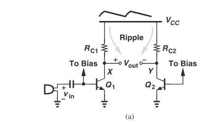

# 장말문제 10.2 — 두 CE 단(Fig 10.2(a))에서 V_CC → V_out 소신호 이득

## 원문
Repeat Problem 10.1 for the circuit of Fig. 10.2(a), assuming $R_{C1} = R_{C2}$.

## 조건
- 회로: Fig 10.2(a) — 같은 CE 단 두 개, 출력 $V_{out}$은 $X$와 $Y$ 사이에서 측정
- $R_{C1} = R_{C2}$
- 문제 10.1의 가정을 이어받음: $V_{CC}$를 소신호 "입력"으로 봄, $V_A < \infty$
- $Q_1$, $Q_2$는 같은 소자에 같은 바이어스 전류로 봄 (곧 $r_{O1} = r_{O2}$) (원문에 없음)

## 구할 것
- 이 회로에 대해 문제 10.1을 다시 풂: $V_{CC}$에서 $V_{out}$까지의 (소신호) 이득

## 상속·참조
- 문제 10.1 (P10.01): Fig 10.1(a)의 CE 단 출력에 나타나는 리플의 영향을 계산하려고 $V_{CC}$를 소신호 "입력"으로 보고 $V_{CC}$에서 $V_{out}$까지의 (소신호) 이득을 구함. $V_A < \infty$로 가정

## 회로 — Fig 10.2(a)
```spice
RC1   VCC  X    {R_C1}
RC2   VCC  Y    {R_C2}
Q1    X    n2   0  npn
Q2    Y    n3   0  npn        ; 좌우 반전 (베이스 오른쪽)
XMIC  n1   0    box "마이크"   ; 그림은 D자 모양 마이크 기호, 글자 없음. 상자 라벨은 원문에 없음
CC    n1   n2                 ; 결합 커패시터 (라벨·값 없음)
* V_out = X와 Y 사이의 차동 출력. X에서 오른쪽으로 개방 원(+), Y에서 왼쪽으로 개방 원(−), 두 원 사이에 V_out 라벨
* n2, n3 = 두 베이스 노드. 각각 "To Bias" 화살표로 바이어스 회로에 연결 (바이어스 회로는 그림에 없음)
* 노드 0 = 접지 (Q1 이미터, Q2 이미터, 마이크 아래 인출선에 각각 접지 기호)
```
- 단자: VCC = 전원, 리플을 포함, 값 미지정 (가로 레일) / X, Y 쪽 개방 원 두 개 = 차동 출력 V_out의 두 단자 (개방 원, 원 자체에는 라벨 없음, 노드는 X, Y) / n2, n3 = 각 베이스에서 바이어스 회로로 가는 "To Bias" 연결 (선 끝, 끝에 위쪽 화살촉)
- 표시: 노드 라벨 VCC (레일 오른쪽 끝), X (Q1 컬렉터 선 오른쪽, X 점 아래), Y (Q2 컬렉터 선 왼쪽, Y 점 아래), V_out (두 출력 원 사이), v_in (마이크 오른쪽, 두 인출선 사이, 소문자) / 소자 라벨 R_C1 (저항 왼쪽), R_C2 (저항 오른쪽), Q1 (Q1 오른쪽), Q2 (Q2 왼쪽), 마이크·결합 커패시터 (라벨 없음) / 부호 + (왼쪽 출력 원 왼쪽 위), − (오른쪽 출력 원 오른쪽 위), + (v_in 위, 마이크 위 인출선 옆), − (v_in 아래, 마이크 아래 인출선 옆) / 화살표 "To Bias" (왼쪽): n2 점에서 위로 뻗은 짧은 도선, 위 방향, 도선 위 (도선 끝에 화살촉, 글자는 화살표 위 왼쪽); "To Bias" (오른쪽): Q2 베이스에서 오른쪽으로 나가 위로 꺾인 도선 끝, 위 방향, 도선 위 (글자는 화살표 위); "Ripple": 레일 바로 아래에서 두 출력 원 쪽으로 휘어 내려오는 회색 곡선 화살표 두 개 (왼쪽 것은 X 쪽 원, 오른쪽 것은 Y 쪽 원을 향함), 도선 옆 별도 화살표 (곡선, 회색), 글자 "Ripple"은 두 화살표 사이 / 수치·면적 라벨 없음
- 배치: 맨 위 굵은 가로 레일 VCC, 그 위에 톱니 모양 리플 파형 그림(레일 전압의 리플을 나타냄) / 레일에서 R_C1, R_C2가 세로로 내려와 각각 X 점, Y 점 / X 점 → 아래 Q1 컬렉터, Y 점 → 아래 Q2 컬렉터 / X 점에서 가로선이 오른쪽으로 개방 원, Y 점에서 가로선이 왼쪽으로 개방 원 (두 원이 가운데에서 마주 봄) / Q1 npn 보통 방향(베이스 왼쪽), Q2 npn 좌우 반전(베이스 오른쪽) / 두 이미터는 각각 아래로 곧장 접지 / 왼쪽 끝 마이크(D자, 평평한 쪽 왼쪽): 오른쪽에 위·아래 두 짧은 가로 인출선. 위 인출선 → 조금 위로 꺾여 → 오른쪽 결합 커패시터(가로 방향) → n2 점 → 오른쪽 Q1 베이스. 아래 인출선 → 아래로 접지 / n2 점에서 위로 To Bias 화살표 / Q2 베이스에서 가로선이 오른쪽으로 나가 위로 꺾여 To Bias 화살표 / 접속점 (세 갈래 이상, 3곳): ① X = 위 R_C1 + 아래 Q1 컬렉터 + 오른쪽 출력선 (점) ② Y = 위 R_C2 + 아래 Q2 컬렉터 + 왼쪽 출력선 (점) ③ n2 = 왼쪽 결합 커패시터 + 오른쪽 Q1 베이스 + 위 To Bias 선 (점) / 교차: 없음 (회색 Ripple 화살표는 도선이 아님)


> 참고: Fig 10.2는 본문 그림(교재 499쪽, PDF 2). 크롭은 (a)만 담음
