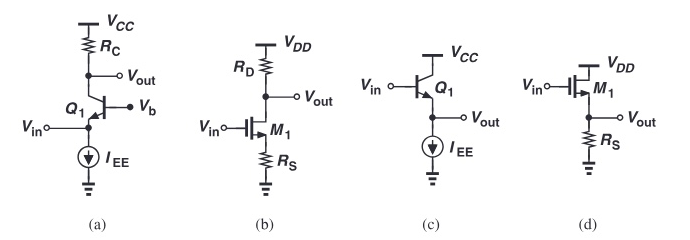

# 장말문제 10.3 — 네 단일 단(Fig 10.61)의 전원 → 출력 소신호 이득

## 원문
Repeat Problem 10.1 for the stages shown in Fig. 10.61. Assume $V_A < \infty$ and $\lambda > 0$.

## 조건
- 회로: Fig 10.61 (a)–(d)의 네 단
- $V_A < \infty$, $\lambda > 0$
- 문제 10.1의 방법을 이어받음: 전원을 소신호 "입력"으로 봄. (b), (d)의 전원은 $V_{DD}$ (원문에 없음)
- 소자 값은 주어지지 않음 (답은 기호로) (원문에 없음)

## 구할 것
- (a)–(d) 각 단에 대해 문제 10.1을 다시 풂: 전원($V_{CC}$ 또는 $V_{DD}$)에서 $V_{out}$까지의 (소신호) 이득

## 상속·참조
- 문제 10.1 (P10.01): Fig 10.1(a)의 CE 단 출력에 나타나는 리플의 영향을 계산하려고 $V_{CC}$를 소신호 "입력"으로 보고 $V_{CC}$에서 $V_{out}$까지의 (소신호) 이득을 구함. $V_A < \infty$로 가정

## 회로 — Fig 10.61(a)
```spice
RC   VCC   Vout  {R_C}
Q1   Vout  Vb    Vin  npn    ; 좌우 반전 (베이스 오른쪽), 이미터 = Vin
IEE  Vin   0
```
- 단자: VCC = 전원, 값 미지정 (T 전원 기호) / Vb = 베이스 바이어스, 값 미지정 (점 단자) / Vin = 입력 (개방 원) / Vout = 출력 (개방 원)
- 표시: 노드 라벨 VCC (T 기호 오른쪽), V_out (출력 원 오른쪽), V_b (점 단자 오른쪽), V_in (입력 원 왼쪽) / 소자 라벨 R_C (저항 오른쪽), Q1 (Q1 왼쪽), I_EE (전류원 오른쪽) / 부호 없음 / 화살표 없음 / 수치·면적 라벨 없음
- 배치: 한 세로줄 위→아래 VCC T 기호, R_C, Vout 접속점, Q1, Vin 접속점, I_EE(화살표 아래), 접지 / Q1 npn 좌우 반전(베이스 막대 오른쪽, 컬렉터 왼쪽 위, 이미터 왼쪽 아래·화살표 바깥) / Q1 베이스에서 가로선이 오른쪽으로 V_b 점 단자 / Vout 접속점에서 가로선이 오른쪽으로 출력 원 / Vin 접속점에서 가로선이 왼쪽으로 입력 원 / 접속점 (세 갈래 이상, 2곳): ① Vout = 위 R_C + 아래 Q1 컬렉터 + 오른쪽 출력선 (점) ② Vin = 위 Q1 이미터 + 아래 I_EE + 왼쪽 입력선 (점) / 교차: 없음

## 회로 — Fig 10.61(b)
```spice
RD   VDD   Vout  {R_D}
M1   Vout  Vin   n1  nmos
RS   n1    0     {R_S}
```
- 단자: VDD = 전원, 값 미지정 (T 전원 기호) / Vin = 입력 (개방 원) / Vout = 출력 (개방 원)
- 표시: 노드 라벨 VDD (T 기호 오른쪽), V_out (출력 원 오른쪽), V_in (입력 원 왼쪽) / 소자 라벨 R_D (저항 왼쪽), M1 (M1 오른쪽), R_S (저항 오른쪽) / 부호 없음 / 화살표 없음 / 수치·면적 라벨 없음
- 배치: 한 세로줄 위→아래 VDD T 기호, R_D, Vout 접속점, M1, R_S, 접지 / M1 nmos 보통 방향(게이트 왼쪽) / Vin 원 → 가로선 → M1 게이트 / Vout 접속점에서 가로선이 오른쪽으로 출력 원 / M1 소스 → 세로선 → R_S (n1, 라벨 없음) / 접속점 (세 갈래 이상, 1곳): Vout = 위 R_D + 아래 M1 드레인 + 오른쪽 출력선 (점) / 교차: 없음

## 회로 — Fig 10.61(c)
```spice
Q1   VCC   Vin   Vout  npn
IEE  Vout  0
```
- 단자: VCC = 전원, 값 미지정 (T 전원 기호) / Vin = 입력 (개방 원) / Vout = 출력 (개방 원)
- 표시: 노드 라벨 VCC (T 기호 오른쪽), V_in (입력 원 왼쪽), V_out (출력 원 오른쪽) / 소자 라벨 Q1 (Q1 오른쪽), I_EE (전류원 오른쪽) / 부호 없음 / 화살표 없음 / 수치·면적 라벨 없음
- 배치: 한 세로줄 위→아래 VCC T 기호, Q1, Vout 접속점, I_EE(화살표 아래), 접지 / Q1 npn 보통 방향(베이스 왼쪽) / Q1 컬렉터에서 세로선이 위로 VCC T 기호 / Vin 원 → 가로선 → Q1 베이스 / Vout 접속점에서 가로선이 오른쪽으로 출력 원 / 접속점 (세 갈래 이상, 1곳): Vout = 위 Q1 이미터 + 아래 I_EE + 오른쪽 출력선 (점) / 교차: 없음

## 회로 — Fig 10.61(d)
```spice
M1   VDD   Vin   Vout  nmos
RS   Vout  0     {R_S}
```
- 단자: VDD = 전원, 값 미지정 (T 전원 기호) / Vin = 입력 (개방 원) / Vout = 출력 (개방 원)
- 표시: 노드 라벨 VDD (T 기호 오른쪽), V_in (입력 원 왼쪽), V_out (출력 원 오른쪽) / 소자 라벨 M1 (M1 오른쪽), R_S (저항 오른쪽) / 부호 없음 / 화살표 없음 / 수치·면적 라벨 없음
- 배치: 한 세로줄 위→아래 VDD T 기호, M1, Vout 접속점, R_S, 접지 / M1 nmos 보통 방향(게이트 왼쪽) / M1 드레인에서 세로선이 위로 VDD T 기호 / Vin 원 → 가로선 → M1 게이트 / Vout 접속점에서 가로선이 오른쪽으로 출력 원 / 접속점 (세 갈래 이상, 1곳): Vout = 위 M1 소스 + 아래 R_S + 오른쪽 출력선 (점) / 교차: 없음



## 힌트
### (c) 전원은 $r_O$로만 출력에 닿는다
- 베이스(게이트)가 고정이면 $g_m$ 전류원은 출력 전압에만 반응하므로, 출력 노드에서 보면 접지로 가는 저항처럼 행동한다
- 그래서 전원 변동은 컬렉터–이미터(드레인–소스) 사이 $r_O$ 하나를 거쳐 들어오고, 출력 노드에서 아래로 보이는 저항과 나눠진다. (d)도 같다
