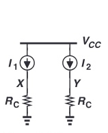

# 장말문제 10.4 — 두 전류원 + R_C 회로(Fig 10.62)의 X, Y 파형·스윙·CM 레벨

## 조건
- 회로: Fig 10.62
- $I_1 = I_0 \cos\omega t + I_0$
- $I_2 = -I_0 \cos\omega t + I_0$
- 소자 값은 주어지지 않음 (답은 $I_0$, $R_C$ 기호로) (원문에 없음)

## 구할 것
- $X$와 $Y$의 파형을 그림
- 두 파형의 피크-투-피크 스윙과 공통 모드 레벨

## 회로 — Fig 10.62
```spice
I1   VCC  X
RC1  X    0    {R_C}
I2   VCC  Y
RC2  Y    0    {R_C}
```
- 단자: VCC = 전원, 값 미지정 (가로 레일) / 그 밖에 개방 단자 없음 (X, Y는 선 옆 라벨만)
- 표시: 노드 라벨 VCC (레일 오른쪽 끝), X (왼쪽 가지 선 왼쪽), Y (오른쪽 가지 선 오른쪽) / 소자 라벨 I_1 (왼쪽 전류원 왼쪽), I_2 (오른쪽 전류원 오른쪽), R_C (왼쪽 저항 왼쪽), R_C (오른쪽 저항 오른쪽) / 부호 없음 / 화살표 없음 / 수치·면적 라벨 없음
- 배치: 맨 위 굵은 가로 레일 VCC / 두 세로 가지가 레일에 매달림. 왼쪽 가지 위→아래 I_1(화살표 아래), X, R_C, 접지 / 오른쪽 가지 위→아래 I_2(화살표 아래), Y, R_C, 접지 / 접속점: 없음 / 교차: 없음


