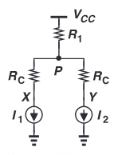

# 장말문제 10.5 — 공통 저항 R_1이 있는 회로(Fig 10.63)의 X, Y, P 파형

## 원문
Repeat Problem 10.4 for the circuit depicted in Fig. 10.63. Also, plot the voltage at node $P$ as a function of time.

## 조건
- 회로: Fig 10.63
- 문제 10.4의 조건을 이어받음: $I_1 = I_0 \cos\omega t + I_0$, $I_2 = -I_0 \cos\omega t + I_0$
- 소자 값은 주어지지 않음 (답은 기호로) (원문에 없음)

## 구할 것
- 이 회로에 대해 문제 10.4를 다시 풂: $X$와 $Y$의 파형, 피크-투-피크 스윙, 공통 모드 레벨
- 노드 $P$의 전압을 시간의 함수로 그림

## 상속·참조
- 문제 10.4 (P10.04): Fig 10.62 회로에서 $I_1 = I_0 \cos\omega t + I_0$, $I_2 = -I_0 \cos\omega t + I_0$일 때 $X$와 $Y$의 파형을 그리고, 그 피크-투-피크 스윙과 공통 모드 레벨을 구함

## 회로 — Fig 10.63
```spice
R1   VCC  P    {R_1}
RC1  P    X    {R_C}
RC2  P    Y    {R_C}
I1   X    0
I2   Y    0
```
- 단자: VCC = 전원, 값 미지정 (T 전원 기호) / 그 밖에 개방 단자 없음 (X, Y, P는 선 옆 라벨만)
- 표시: 노드 라벨 VCC (T 기호 오른쪽), P (P 점 아래), X (왼쪽 가지 선 왼쪽), Y (오른쪽 가지 선 오른쪽) / 소자 라벨 R_1 (저항 오른쪽), R_C (왼쪽 저항 왼쪽), R_C (오른쪽 저항 오른쪽), I_1 (왼쪽 전류원 왼쪽), I_2 (오른쪽 전류원 오른쪽) / 부호 없음 / 화살표 없음 / 수치·면적 라벨 없음
- 배치: 가운데 위→아래 VCC T 기호, R_1(세로), P 점 / P 점에서 가로선이 왼쪽·오른쪽으로 뻗어 각각 아래로 꺾임 / 왼쪽 가지 위→아래 R_C, X, I_1(화살표 아래), 접지 / 오른쪽 가지 위→아래 R_C, Y, I_2(화살표 아래), 접지 / 접속점 (세 갈래 이상, 1곳): P = 위 R_1 + 왼쪽 가지 + 오른쪽 가지 (점) / 교차: 없음



## 풀이
### $P$의 전압
- $R_1$에는 두 가지의 전류 합 $I_1 + I_2 = 2I_0$이 흐르고, 이 합은 시간에 따라 변하지 않는다
- $V_P = V_{CC} - 2I_0 R_1$, 일정한 직류(가로 직선)
### $X$와 $Y$의 파형
- $V_X = V_P - I_1 R_C = V_{CC} - 2I_0 R_1 - I_0 R_C - I_0 R_C \cos\omega t$
- $V_Y = V_P - I_2 R_C = V_{CC} - 2I_0 R_1 - I_0 R_C + I_0 R_C \cos\omega t$
- 두 파형은 크기가 같고 위상이 반대다
### 스윙과 공통 모드 레벨
- 각 노드의 피크-투-피크 스윙: $2I_0 R_C$
- 공통 모드 레벨: $V_{CC} - 2I_0 R_1 - I_0 R_C$ ($R_1$ 때문에 $2I_0 R_1$만큼 내려감)
### 답
- $V_X = V_{CC} - 2I_0 R_1 - I_0 R_C(1 + \cos\omega t)$, $V_Y = V_{CC} - 2I_0 R_1 - I_0 R_C(1 - \cos\omega t)$
- 스윙은 각각 $2I_0 R_C$(피크-투-피크), 공통 모드 레벨은 $V_{CC} - 2I_0 R_1 - I_0 R_C$
- $V_P = V_{CC} - 2I_0 R_1$로 시간에 따라 변하지 않는다
