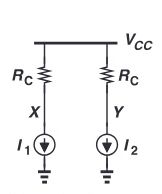

# 장말문제 10.6 — R_C 부하 아래 전류원 회로(Fig 10.64)의 X, Y 파형

## 원문
Repeat Problem 10.4 for the topology shown in Fig. 10.64.

## 조건
- 회로: Fig 10.64
- 문제 10.4의 조건을 이어받음: $I_1 = I_0 \cos\omega t + I_0$, $I_2 = -I_0 \cos\omega t + I_0$
- 소자 값은 주어지지 않음 (답은 기호로) (원문에 없음)

## 구할 것
- 이 구성에 대해 문제 10.4를 다시 풂: $X$와 $Y$의 파형, 피크-투-피크 스윙, 공통 모드 레벨

## 상속·참조
- 문제 10.4 (P10.04): Fig 10.62 회로에서 $I_1 = I_0 \cos\omega t + I_0$, $I_2 = -I_0 \cos\omega t + I_0$일 때 $X$와 $Y$의 파형을 그리고, 그 피크-투-피크 스윙과 공통 모드 레벨을 구함

## 회로 — Fig 10.64
```spice
RC1  VCC  X    {R_C}
RC2  VCC  Y    {R_C}
I1   X    0
I2   Y    0
```
- 단자: VCC = 전원, 값 미지정 (가로 레일) / 그 밖에 개방 단자 없음 (X, Y는 선 옆 라벨만)
- 표시: 노드 라벨 VCC (레일 오른쪽 끝), X (왼쪽 가지 선 왼쪽), Y (오른쪽 가지 선 오른쪽) / 소자 라벨 R_C (왼쪽 저항 왼쪽), R_C (오른쪽 저항 오른쪽), I_1 (왼쪽 전류원 왼쪽), I_2 (오른쪽 전류원 오른쪽) / 부호 없음 / 화살표 없음 / 수치·면적 라벨 없음
- 배치: 맨 위 굵은 가로 레일 VCC / 두 세로 가지가 레일에 매달림. 왼쪽 가지 위→아래 R_C, X, I_1(화살표 아래), 접지 / 오른쪽 가지 위→아래 R_C, Y, I_2(화살표 아래), 접지 / 접속점: 없음 / 교차: 없음



## 풀이
### $X$의 파형
- $I_1$이 $V_{CC}$에서 $R_C$를 거쳐 흘러내리므로 $V_X = V_{CC} - I_1 R_C = V_{CC} - I_0 R_C - I_0 R_C \cos\omega t$
- $I_1$이 최대인 순간 $V_X$는 최소 $V_{CC} - 2I_0 R_C$이다
### $Y$의 파형
- $V_Y = V_{CC} - I_2 R_C = V_{CC} - I_0 R_C + I_0 R_C \cos\omega t$
- $X$와 크기는 같고 위상이 반대다
### 스윙과 공통 모드 레벨
- 각 노드의 피크-투-피크 스윙: $2I_0 R_C$
- 공통 모드 레벨: $\dfrac{V_X + V_Y}{2} = V_{CC} - I_0 R_C$
### 답
- $V_X = V_{CC} - I_0 R_C(1 + \cos\omega t)$, $V_Y = V_{CC} - I_0 R_C(1 - \cos\omega t)$
- 스윙은 각각 $2I_0 R_C$(피크-투-피크), 공통 모드 레벨은 $V_{CC} - I_0 R_C$
