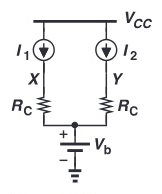

# 장말문제 10.7 — R_C 아래가 배터리 V_b로 묶인 회로(Fig 10.65)의 X, Y 파형

## 조건
- 회로: Fig 10.65
- 문제 10.4의 조건을 이어받음: $I_1 = I_0 \cos\omega t + I_0$, $I_2 = -I_0 \cos\omega t + I_0$
- $V_b$는 직류 전압원(배터리), 값 미지정 (원문에 없음)

## 구할 것
- 이 구성에 대해 문제 10.4를 다시 풂: $X$와 $Y$의 파형, 피크-투-피크 스윙, 공통 모드 레벨

## 상속·참조
- 문제 10.4 (P10.04): Fig 10.62 회로에서 $I_1 = I_0 \cos\omega t + I_0$, $I_2 = -I_0 \cos\omega t + I_0$일 때 $X$와 $Y$의 파형을 그리고, 그 피크-투-피크 스윙과 공통 모드 레벨을 구함

## 회로 — Fig 10.65
```spice
I1   VCC  X
I2   VCC  Y
RC1  X    n1   {R_C}
RC2  Y    n1   {R_C}
Vb   n1   0    {V_b}      ; 배터리, + = n1 (위)
* n1 = 두 R_C 아래 끝을 묶은 노드. 그림에 라벨 없음
```
- 단자: VCC = 전원, 값 미지정 (가로 레일) / 그 밖에 개방 단자 없음 (X, Y는 선 옆 라벨만)
- 표시: 노드 라벨 VCC (레일 오른쪽 끝), X (왼쪽 가지 선 왼쪽), Y (오른쪽 가지 선 오른쪽) / 소자 라벨 I_1 (왼쪽 전류원 왼쪽), I_2 (오른쪽 전류원 오른쪽), R_C (왼쪽 저항 왼쪽), R_C (오른쪽 저항 오른쪽), V_b (배터리 오른쪽) / 부호 + (배터리 왼쪽 위), − (배터리 왼쪽 아래) / 화살표 없음 / 수치·면적 라벨 없음
- 배치: 맨 위 굵은 가로 레일 VCC / 두 세로 가지가 레일에 매달림. 왼쪽 가지 위→아래 I_1(화살표 아래), X, R_C / 오른쪽 가지 위→아래 I_2(화살표 아래), Y, R_C / 두 R_C 아래 끝은 각각 아래로 내려가 한 가로선으로 이어지고, 그 가운데 n1 점 / n1에서 아래로 배터리 V_b(긴 판 위, 짧은 판 아래), 그 아래 접지 / 접속점 (세 갈래 이상, 1곳): n1 = 왼쪽 R_C 선 + 오른쪽 R_C 선 + 아래 배터리 (점) / 교차: 없음


