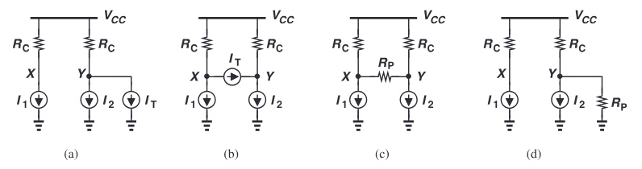

# 장말문제 10.9 — 네 전류원·저항 회로(Fig 10.66)의 V_X, V_Y 시간 파형

## 원문
Assuming $I_1 = I_0 \cos\omega t + I_0$ and $I_2 = -I_0 \cos\omega t + I_0$, plot $V_X$ and $V_Y$ as a function of time for the circuits illustrated in Fig. 10.66. Assume $I_0$ is constant.

## 조건
- 회로: Fig 10.66 (a)–(d)
- $I_1 = I_0 \cos\omega t + I_0$
- $I_2 = -I_0 \cos\omega t + I_0$
- 원문: "Assume $I_0$ is constant." ($I_0$는 일정)
- (a), (b)의 $I_T$는 일정한 직류 전류원으로 봄 (원문에 없음, 원문은 $I_T$의 성질을 적지 않음)
- 소자 값은 주어지지 않음 (답은 기호로) (원문에 없음)

## 구할 것
- (a)–(d) 각 회로에서 $V_X$와 $V_Y$를 시간의 함수로 그림

## 회로 — Fig 10.66(a)
```spice
RC1  VCC  X    {R_C}
RC2  VCC  Y    {R_C}
I1   X    0
I2   Y    0
IT   Y    0
```
- 단자: VCC = 전원, 값 미지정 (가로 레일) / 그 밖에 개방 단자 없음 (X, Y는 선 옆 라벨만)
- 표시: 노드 라벨 VCC (레일 오른쪽 끝), X (왼쪽 가지 선 왼쪽), Y (Y 점 왼쪽) / 소자 라벨 R_C (왼쪽 저항 왼쪽), R_C (오른쪽 저항 오른쪽), I_1 (왼쪽 전류원 왼쪽), I_2 (가운데 전류원 오른쪽), I_T (오른쪽 전류원 오른쪽) / 부호 없음 / 화살표 없음 / 수치·면적 라벨 없음
- 배치: 맨 위 굵은 가로 레일 VCC / 두 세로 가지가 레일에 매달림. 왼쪽 가지 위→아래 R_C, X, I_1(화살표 아래), 접지 / 오른쪽 가지 위→아래 R_C, Y 점, I_2(화살표 아래), 접지 / Y 점에서 가로선이 오른쪽으로 나가 아래로 꺾여 I_T(화살표 아래), 접지 (I_T 가지는 레일 오른쪽 끝보다 더 오른쪽) / 접속점 (세 갈래 이상, 1곳): Y = 위 R_C + 아래 I_2 + 오른쪽 I_T 가지 (점) / 교차: 없음

## 회로 — Fig 10.66(b)
```spice
RC1  VCC  X    {R_C}
RC2  VCC  Y    {R_C}
I1   X    0
I2   Y    0
IT   X    Y          ; 가로로 놓인 전류원, 화살표 오른쪽 (X → Y)
```
- 단자: VCC = 전원, 값 미지정 (가로 레일) / 그 밖에 개방 단자 없음
- 표시: 노드 라벨 VCC (레일 오른쪽 끝), X (X 점 왼쪽), Y (Y 점 오른쪽) / 소자 라벨 R_C (왼쪽 저항 왼쪽), R_C (오른쪽 저항 오른쪽), I_T (가로 전류원 위), I_1 (왼쪽 전류원 왼쪽), I_2 (오른쪽 전류원 오른쪽) / 부호 없음 / 화살표 없음 / 수치·면적 라벨 없음
- 배치: 맨 위 굵은 가로 레일 VCC / 두 세로 가지 위→아래: 왼쪽 R_C, X 점, I_1(화살표 아래), 접지 / 오른쪽 R_C, Y 점, I_2(화살표 아래), 접지 / X 점과 Y 점 사이 가로선 가운데에 I_T 전류원(원 안 화살표 오른쪽) / 접속점 (세 갈래 이상, 2곳): ① X = 위 R_C + 아래 I_1 + 오른쪽 I_T (점) ② Y = 위 R_C + 아래 I_2 + 왼쪽 I_T (점) / 교차: 없음

## 회로 — Fig 10.66(c)
```spice
RC1  VCC  X    {R_C}
RC2  VCC  Y    {R_C}
RP   X    Y    {R_P}
I1   X    0
I2   Y    0
```
- 단자: VCC = 전원, 값 미지정 (가로 레일) / 그 밖에 개방 단자 없음
- 표시: 노드 라벨 VCC (레일 오른쪽 끝), X (X 점 왼쪽), Y (Y 점 오른쪽) / 소자 라벨 R_C (왼쪽 저항 왼쪽), R_C (오른쪽 저항 오른쪽), R_P (가로 저항 위), I_1 (왼쪽 전류원 왼쪽), I_2 (오른쪽 전류원 오른쪽) / 부호 없음 / 화살표 없음 / 수치·면적 라벨 없음
- 배치: 맨 위 굵은 가로 레일 VCC / 두 세로 가지 위→아래: 왼쪽 R_C, X 점, I_1(화살표 아래), 접지 / 오른쪽 R_C, Y 점, I_2(화살표 아래), 접지 / X 점과 Y 점 사이 가로선 가운데에 가로 저항 R_P / 접속점 (세 갈래 이상, 2곳): ① X = 위 R_C + 아래 I_1 + 오른쪽 R_P (점) ② Y = 위 R_C + 아래 I_2 + 왼쪽 R_P (점) / 교차: 없음

## 회로 — Fig 10.66(d)
```spice
RC1  VCC  X    {R_C}
RC2  VCC  Y    {R_C}
I1   X    0
I2   Y    0
RP   Y    0    {R_P}
```
- 단자: VCC = 전원, 값 미지정 (가로 레일) / 그 밖에 개방 단자 없음 (X는 선 옆 라벨만)
- 표시: 노드 라벨 VCC (레일 오른쪽 끝), X (왼쪽 가지 선 왼쪽), Y (Y 점 왼쪽) / 소자 라벨 R_C (왼쪽 저항 왼쪽), R_C (오른쪽 저항 오른쪽), I_1 (왼쪽 전류원 왼쪽), I_2 (가운데 전류원 오른쪽), R_P (오른쪽 세로 저항 오른쪽) / 부호 없음 / 화살표 없음 / 수치·면적 라벨 없음
- 배치: 맨 위 굵은 가로 레일 VCC / 두 세로 가지가 레일에 매달림. 왼쪽 가지 위→아래 R_C, X, I_1(화살표 아래), 접지 / 오른쪽 가지 위→아래 R_C, Y 점, I_2(화살표 아래), 접지 / Y 점에서 가로선이 오른쪽으로 나가 아래로 꺾여 세로 저항 R_P, 접지 (R_P 가지는 레일 오른쪽 끝보다 더 오른쪽) / 접속점 (세 갈래 이상, 1곳): Y = 위 R_C + 아래 I_2 + 오른쪽 R_P 가지 (점) / 교차: 없음


> 참고: 문제 진술은 557쪽(PDF 32), 그림은 558쪽(PDF 33)에 있음

## 힌트
### (c) 전류를 공통·차동 성분으로 쪼개기
- 공통 성분만 있으면($V_{CC}$도 이쪽에 넣는다) $X$와 $Y$가 같은 전압이라 $R_P$에 전류가 흐르지 않는다
- 차동 성분만 있으면($V_{CC}$는 AC 접지) 대칭이라 $R_P$의 가운데가 움직이지 않으므로, 두 결과를 겹쳐 쓰면 된다

## 풀이
### (a) $Y$에 $I_T$가 더해짐
- $X$ 쪽 $R_C$에는 $I_1$, $Y$ 쪽에는 $I_2 + I_T$가 흐른다: $V_X = V_{CC} - I_1 R_C$, $V_Y = V_{CC} - (I_2 + I_T) R_C$
### (b) $X$에서 $Y$로 $I_T$가 흐름
- $R_C$ 전류가 $X$ 쪽 $I_1 + I_T$, $Y$ 쪽 $I_2 - I_T$: $V_X = V_{CC} - (I_1 + I_T) R_C$, $V_Y = V_{CC} - (I_2 - I_T) R_C$
### (c) 공통·차동 성분으로 나누기
- 공통 성분 $I_0$은 $V_X = V_Y$라 $R_P$ 전류가 0, 차동 성분 $\pm I_0 \cos\omega t$는 대칭이라 $R_P$ 가운데가 가상 접지(각 노드에 $R_C \parallel R_P/2$)
- 겹치면 $V_{X,Y} = V_{CC} - I_0 R_C \mp I_0 (R_C \parallel R_P/2) \cos\omega t$
### (d) $Y$에 $R_P$가 접지로 달림
- $V_X$는 (a)와 같고, $Y$에서 본 테브난 등가 $\frac{R_P}{R_C + R_P} V_{CC}$, $R_C \parallel R_P$로 $V_Y = \frac{R_P}{R_C + R_P} V_{CC} - I_2 (R_C \parallel R_P)$
### 답
- (a) $V_X = V_{CC} - I_0 R_C(1 + \cos\omega t)$, $V_Y = V_{CC} - I_T R_C - I_0 R_C(1 - \cos\omega t)$
- (b) $V_X = V_{CC} - I_T R_C - I_0 R_C(1 + \cos\omega t)$, $V_Y = V_{CC} + I_T R_C - I_0 R_C(1 - \cos\omega t)$
- (c) $V_{X,Y} = V_{CC} - I_0 R_C \mp I_0 (R_C \parallel R_P/2) \cos\omega t$
- (d) $V_X$는 (a)와 같고, $V_Y = \frac{R_P}{R_C + R_P}(V_{CC} - I_0 R_C) + I_0 (R_C \parallel R_P) \cos\omega t$
