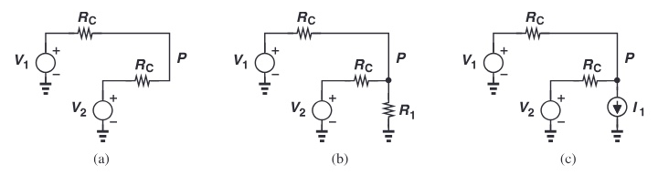

# 장말문제 10.10 — 두 전압원과 R_C로 묶인 노드 P(Fig 10.67)의 V_P 시간 파형

## 원문
Assuming $V_1 = V_0 \cos\omega t + V_0$ and $V_2 = -V_0 \cos\omega t + V_0$, plot $V_P$ as a function of time for the circuits shown in Fig. 10.67. Assume $I_T$ is constant.

## 조건
- 회로: Fig 10.67 (a)–(c)
- $V_1 = V_0 \cos\omega t + V_0$
- $V_2 = -V_0 \cos\omega t + V_0$
- 원문: "Assume $I_T$ is constant." 그림 10.67에는 $I_T$라는 소자가 없고 (c)의 전류원은 $I_1$로 인쇄됨. 문맥과 맞지 않음(오식으로 보임). (c)의 $I_1$을 일정한 직류 전류원으로 봄 (원문에 없음)
- 소자 값은 주어지지 않음 (답은 기호로) (원문에 없음)

## 구할 것
- (a)–(c) 각 회로에서 $V_P$를 시간의 함수로 그림

## 회로 — Fig 10.67(a)
```spice
V1   n1   0    {V_1}      ; + = n1 (위)
V2   n2   0    {V_2}      ; + = n2 (위)
RC1  n1   P    {R_C}
RC2  n2   P    {R_C}
* n1, n2 = 각 전압원 + 단자 노드. 그림에 라벨 없음
```
- 단자: 개방 단자 없음 (P는 선 옆 라벨만)
- 표시: 노드 라벨 P (오른쪽 세로선 오른쪽) / 소자 라벨 V_1 (V1 원 왼쪽), V_2 (V2 원 왼쪽), R_C (위 가로 저항 위), R_C (아래 가로 저항 위) / 부호 + (각 전압원 원 오른쪽 위), − (각 전압원 원 오른쪽 아래) / 화살표 없음 / 수치·면적 라벨 없음
- 배치: 왼쪽 위에 V1(원), 그 아래 접지. V1 + 단자에서 위로 올라가 오른쪽으로 꺾여 위 가로 저항 R_C, 계속 오른쪽 끝까지 가서 아래로 꺾임 (오른쪽 세로선) / V2(원)는 V1보다 오른쪽 아래, 그 아래 접지. V2 + 단자에서 위로 올라가 오른쪽으로 꺾여 아래 가로 저항 R_C, 계속 오른쪽으로 가서 오른쪽 세로선 아래 끝에 닿음 / P는 이 오른쪽 세로선 (두 R_C를 잇는 도선) / 접속점: 없음 (P는 두 선만 이어지는 꺾임) / 교차: 없음

## 회로 — Fig 10.67(b)
```spice
V1   n1   0    {V_1}      ; + = n1 (위)
V2   n2   0    {V_2}      ; + = n2 (위)
RC1  n1   P    {R_C}
RC2  n2   P    {R_C}
R1   P    0    {R_1}
* n1, n2 = 각 전압원 + 단자 노드. 그림에 라벨 없음
```
- 단자: 개방 단자 없음 (P는 선 옆 라벨만)
- 표시: 노드 라벨 P (오른쪽 세로선 오른쪽, P 점 위) / 소자 라벨 V_1 (V1 원 왼쪽), V_2 (V2 원 왼쪽), R_C (위 가로 저항 위), R_C (아래 가로 저항 위), R_1 (세로 저항 오른쪽) / 부호 + (각 전압원 원 오른쪽 위), − (각 전압원 원 오른쪽 아래) / 화살표 없음 / 수치·면적 라벨 없음
- 배치: (a)와 같은 모양에서, 위 R_C 선이 오른쪽 끝에서 아래로 꺾여 내려와 아래 R_C 선과 만나는 곳에 P 점 / P 점에서 계속 아래로 세로 저항 R_1, 그 아래 접지 / 접속점 (세 갈래 이상, 1곳): P = 위 세로선(위 R_C 쪽) + 왼쪽 아래 R_C + 아래 R_1 (점) / 교차: 없음

## 회로 — Fig 10.67(c)
```spice
V1   n1   0    {V_1}      ; + = n1 (위)
V2   n2   0    {V_2}      ; + = n2 (위)
RC1  n1   P    {R_C}
RC2  n2   P    {R_C}
I1   P    0
* n1, n2 = 각 전압원 + 단자 노드. 그림에 라벨 없음
```
- 단자: 개방 단자 없음 (P는 선 옆 라벨만)
- 표시: 노드 라벨 P (오른쪽 세로선 오른쪽, P 점 위) / 소자 라벨 V_1 (V1 원 왼쪽), V_2 (V2 원 왼쪽), R_C (위 가로 저항 위), R_C (아래 가로 저항 위), I_1 (전류원 오른쪽) / 부호 + (각 전압원 원 오른쪽 위), − (각 전압원 원 오른쪽 아래) / 화살표 없음 / 수치·면적 라벨 없음
- 배치: (b)와 같은 모양에서 R_1 대신 전류원 I_1(화살표 아래), 그 아래 접지 / 접속점 (세 갈래 이상, 1곳): P = 위 세로선(위 R_C 쪽) + 왼쪽 아래 R_C + 아래 I_1 (점) / 교차: 없음


> 참고: 문제 진술은 557쪽(PDF 32), 그림은 558쪽(PDF 33)에 있음
