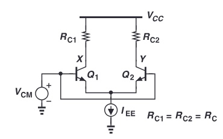

# 장말문제 10.11 — V_CC가 ΔV 오를 때 바이폴라 차동쌍(Fig 10.9)의 V_X, V_Y 변화

## 조건
- 회로: Fig 10.9 — 입력 공통 모드 전압 $V_{CM}$이 걸린 바이폴라 차동쌍, $R_{C1} = R_{C2} = R_C$ (그림 안 라벨)
- $V_{CC}$가 $\Delta V$만큼 오름
- Early 효과 무시

## 구할 것
- $V_X$, $V_Y$, $V_X - V_Y$의 변화
- 이 회로가 공급 전원 잡음을 "제거한다(rejects)"고 말하는 이유 설명

## 회로 — Fig 10.9
```spice
RC1  VCC  X    {R_C1}
RC2  VCC  Y    {R_C2}
Q1   X    n1   n2  npn
Q2   Y    n1   n2  npn    ; 좌우 반전 (베이스 오른쪽)
IEE  n2   0
VCM  n1   0               ; + = n1
* n1 = V_CM 전압원의 + 단자와 두 베이스를 묶은 공통 입력 노드, n2 = 공통 이미터(테일) 노드. 둘 다 그림에 라벨 없음
* 그림 안 라벨: R_C1 = R_C2 = R_C
```
- 단자: VCC = 전원, 값 미지정 (가로 레일) / 그 밖에 개방 단자 없음 (X, Y는 컬렉터 선 옆 라벨만, 원 없음)
- 표시: 노드 라벨 VCC (레일 오른쪽 끝), X (Q1 컬렉터 선 왼쪽), Y (Q2 컬렉터 선 오른쪽) / 소자 라벨 R_C1 (저항 왼쪽), R_C2 (저항 오른쪽), Q1 (Q1 오른쪽), Q2 (Q2 왼쪽), V_CM (전압원 왼쪽), I_EE (전류원 오른쪽) / 부호 + (V_CM 원 오른쪽 위), − (V_CM 원 오른쪽 아래) / 화살표 없음 / 수치·면적 라벨 "R_C1 = R_C2 = R_C" (I_EE 오른쪽, 그림 오른쪽 아래)
- 배치: 맨 위 굵은 가로 레일 VCC / 레일에서 R_C1, R_C2가 세로로 내려와 X, Y를 지나 Q1, Q2 컬렉터 / Q1 npn 보통 방향(베이스 왼쪽), Q2 npn 좌우 반전(베이스 오른쪽) / 두 이미터는 아래로 내려가 가로선으로 가운데 n2 점, n2에서 아래로 I_EE(화살표 아래), 그 아래 접지 / 왼쪽 끝 V_CM 전압원(원), 아래 접지. + 단자에서 위로 Q1 베이스 높이까지 올라가 오른쪽으로 꺾여 n1 점 → Q1 베이스 / n1 점에서 아래로 내려가 이미터 가로선보다 낮은 가로선(베이스 공통선)이 되어 오른쪽으로 Q2 오른쪽 바깥까지, 위로 꺾여 Q2 베이스 높이에서 왼쪽으로 Q2 베이스 / 접속점 (세 갈래 이상, 2곳): ① n1 = 왼쪽 V_CM 선 + 오른쪽 Q1 베이스 + 아래 베이스 공통선 (점) ② n2 = 왼쪽 Q1 이미터 선 + 오른쪽 Q2 이미터 선 + 아래 I_EE (점) / 교차: n2에서 I_EE로 내려가는 세로선이 아래 베이스 공통선과 점 없이 교차 (1곳)


> 참고: Fig 10.9는 본문 그림(교재 507쪽, PDF 6)
