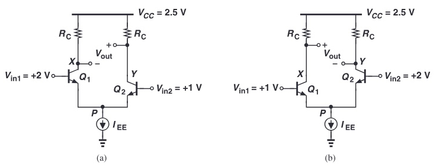

# 장말문제 10.16 — Fig 10.11(a)에서 I_EE = 1 mA, R_C = 800 Ω일 때 Q1의 동작 영역

## 원문
Suppose $I_{EE} = 1\ \text{mA}$ and $R_C = 800\ \Omega$ in Fig. 10.11(a). Determine the region of operation of $Q_1$.

## 조건
- 회로: Fig 10.11(a) — 큰 양의 차동 입력을 받는 바이폴라 차동쌍
- 그림 안 값: $V_{CC} = 2.5\ \text{V}$, $V_{in1} = +2\ \text{V}$, $V_{in2} = +1\ \text{V}$
- $I_{EE} = 1\ \text{mA}$, $R_C = 800\ \Omega$

## 구할 것
- $Q_1$의 동작 영역

## 회로 — Fig 10.11(a)
```spice
RC1  VCC  X     {R_C}    ; 두 저항 모두 R_C로 인쇄
RC2  VCC  Y     {R_C}
Q1   X    Vin1  P    npn
Q2   Y    Vin2  P    npn    ; 좌우 반전 (베이스 오른쪽)
IEE  P    0     {I_EE}
* 출력 V_out: + 원은 오른쪽 세로줄(Y 노드)의 R_C 바로 아래 점에서, − 원은 X 점에서 이어짐 → V_out = V_Y − V_X
* 그림 안 값: V_CC = 2.5 V, V_in1 = +2 V, V_in2 = +1 V
```
- 단자: VCC = 2.5 V 전원 (가로 레일) / Vin1 = +2 V 입력 (개방 원) / Vin2 = +1 V 입력 (개방 원) / V_out = 차동 출력, + 원은 Y 노드, − 원은 X 노드에 이어짐 (개방 원 두 개)
- 표시: 노드 라벨 V_CC (레일 오른쪽 끝), X (X 점 왼쪽 위), Y (오른쪽 세로줄 아래쪽, Q2 컬렉터 위 선 오른쪽), P (P 점 왼쪽 아래), V_out (두 출력 원 사이), V_in1 (왼쪽 입력 원 왼쪽), V_in2 (오른쪽 입력 원 오른쪽) / 소자 라벨 R_C (왼쪽 저항 왼쪽), R_C (오른쪽 저항 오른쪽), Q1 (Q1 오른쪽), Q2 (Q2 왼쪽), I_EE (전류원 오른쪽) / 부호 + (위 출력 원 왼쪽), − (아래 출력 원 오른쪽) / 화살표 없음 / 수치·면적 라벨 "= 2.5 V" (V_CC 뒤), "= +2 V" (V_in1 뒤), "= +1 V" (V_in2 뒤)
- 배치: 맨 위 굵은 가로 레일 V_CC / 왼쪽 세로줄 위→아래 R_C, X 점, Q1 컬렉터 / 오른쪽 세로줄 위→아래 R_C, + 출력 점, 긴 세로선(Y 라벨), Q2 컬렉터 / Q2가 Q1보다 아래로 내려 그려짐 (세로 오프셋) / + 출력 점에서 가로선이 왼쪽으로 + 원, X 점에서 가로선이 오른쪽으로 − 원. 두 원은 두 세로줄 사이에 위(+)·아래(−)로 놓이고 그 사이에 V_out 라벨 / Q1 npn 보통 방향(베이스 왼쪽), Q2 npn 좌우 반전(베이스 오른쪽) / V_in1 원 → 가로선 → Q1 베이스, V_in2 원 → 가로선 → Q2 베이스 / Q1 이미터는 아래로 내려가 꼬리 가로선, 가운데 P 점을 지나 오른쪽 끝에서 위로 꺾여 Q2 이미터 / P에서 아래로 I_EE(화살표 아래), 그 아래 접지 / 접속점 (세 갈래 이상, 3곳): ① X = 위 R_C + 아래 Q1 컬렉터 + 오른쪽 − 출력선 (점) ② + 출력 점 = 위 R_C + 아래 Q2 컬렉터 선(Y) + 왼쪽 + 출력선 (점) ③ P = 왼쪽 Q1 이미터 선 + 오른쪽 Q2 이미터 선 + 아래 I_EE (점) / 교차: 없음


> 참고: Fig 10.11은 본문 그림(교재 509쪽, PDF 7). 크롭 이미지 오른쪽 (b)는 문제 10.15의 회로
