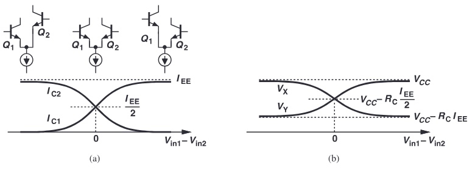

# 장말문제 10.17 — I_EE 반감, V_CC 상승, R_C 반감이 Fig 10.12 특성에 주는 영향

## 원문
What happens to the characteristics depicted in Fig. 10.12 if (a) $I_{EE}$ is halved, (b) $V_{CC}$ rises by $\Delta V$, or (c) $R_C$ is halved?

## 조건
- Fig 10.12의 특성: 바이폴라 차동쌍에서 차동 입력 $V_{in1} - V_{in2}$에 따른 (a) 컬렉터 전류 $I_{C1}$, $I_{C2}$, (b) 출력 전압 $V_X$, $V_Y$
- 세 경우: (a) $I_{EE}$가 절반이 됨, (b) $V_{CC}$가 $\Delta V$만큼 오름, (c) $R_C$가 절반이 됨

## 구할 것
- (a), (b), (c) 각 경우에 Fig 10.12의 특성이 어떻게 되는가?

## 상속·참조
- 본문 Fig 10.12 (교재 510쪽, PDF 8): 특성 그래프 (회로 그림 아님)
  - (a) 가로축 $V_{in1} - V_{in2}$ (가운데 0). $I_{C1}$은 왼쪽 끝 0에서 시작해 0 근처에서 올라가 오른쪽에서 점선 $I_{EE}$ 레벨로 포화, $I_{C2}$는 왼쪽 $I_{EE}$에서 시작해 오른쪽에서 0으로 내려감. 두 곡선은 $V_{in1} - V_{in2} = 0$에서 점선 $I_{EE}/2$ 레벨로 교차. 그래프 위에 차동쌍 스케치 세 개(왼쪽: $Q_2$가 $Q_1$보다 높게 그려짐, 가운데: 같은 높이, 오른쪽: $Q_1$이 높게 그려짐. 각각 두 이미터가 점에서 만나 아래 전류원)
  - (b) 같은 가로축. $V_X$는 왼쪽 점선 $V_{CC}$에서 오른쪽 점선 $V_{CC} - R_C I_{EE}$로 내려가고, $V_Y$는 왼쪽 $V_{CC} - R_C I_{EE}$에서 오른쪽 $V_{CC}$로 올라감. 두 곡선은 0에서 점선 $V_{CC} - R_C \dfrac{I_{EE}}{2}$ 레벨로 교차
- 본문 식 (10.24)–(10.31) (교재 509–510쪽, Fig 10.11): 큰 양의 차동 입력이면 $I_{C1} = I_{EE}$, $I_{C2} = 0$, $V_X = V_{CC} - R_C I_{EE}$, $V_Y = V_{CC}$. 큰 음의 차동 입력이면 $I_{C2} = I_{EE}$, $I_{C1} = 0$, $V_Y = V_{CC} - R_C I_{EE}$, $V_X = V_{CC}$

## 회로 — 없음 (특성 그래프 문제, 그림 10.12는 회로가 아닌 그래프로 상속·참조에 적음)

## 풀이
### 특성의 두 요소
- 전류 곡선은 $I_{EE}$가 두 트랜지스터로 나뉘는 비로 정해지고, 나뉘는 비는 $V_{in1} - V_{in2}$와 $V_T$로만 정해진다 (전이 폭은 몇 $V_T$)
- 전압 곡선은 $V_X = V_{CC} - R_C I_{C1}$, $V_Y = V_{CC} - R_C I_{C2}$로 전류 곡선을 옮긴 것이다
### (a) $I_{EE}$ 절반
- 전류 곡선: 위 레벨이 $I_{EE}/2$, 교차점이 $I_{EE}/4$로 내려간다. 전이 폭은 그대로라 기울기가 절반이 된다
- 전압 곡선: $V_{CC}$와 $V_{CC} - R_C I_{EE}/2$ 사이를 오가고 교차점은 $V_{CC} - R_C I_{EE}/4$. 출력 스윙이 절반이 된다
### (b) $V_{CC}$가 $\Delta V$ 상승
- 전류 곡선은 그대로다 (Early 효과를 무시하면 컬렉터 전압이 전류를 바꾸지 않음)
- 전압 곡선은 모양은 그대로 전체가 $\Delta V$만큼 위로 옮겨간다
### (c) $R_C$ 절반
- 전류 곡선은 그대로다
- 전압 곡선: 위 레벨 $V_{CC}$는 그대로, 아래 레벨이 $V_{CC} - R_C I_{EE}/2$, 교차점이 $V_{CC} - R_C I_{EE}/4$로 올라간다. 스윙과 기울기가 절반이 된다
### 답
- (a) 전류 곡선의 높이가 절반($I_{EE}/2$, 교차 $I_{EE}/4$), 전압 스윙도 $R_C I_{EE}/2$로 절반. 가로축 전이 폭은 그대로
- (b) 전류 곡선은 그대로, 전압 곡선 전체가 $\Delta V$만큼 위로 이동
- (c) 전류 곡선은 그대로, 전압 곡선은 위 레벨 $V_{CC}$를 두고 스윙이 $R_C I_{EE}/2$로 절반
