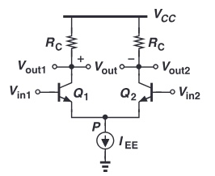

# 장말문제 10.18 — I_C1/I_C2 = 5에 해당하는 차동 입력과 온도 상승(27 °C → 100 °C) 시 전류비 변화

## 원문
In the differential pair of Fig. 10.14, $I_{C1}/I_{C2} = 5$. What is the corresponding input differential voltage? With this voltage applied, how does $I_{C1}/I_{C2}$ change if the temperature rises from $27\ ^\circ\text{C}$ to $100\ ^\circ\text{C}$?

## 조건
- 회로: Fig 10.14 바이폴라 차동쌍
- $I_{C1}/I_{C2} = 5$
- 이 차동 입력 전압을 그대로 건 채 온도가 $27\ ^\circ\text{C}$에서 $100\ ^\circ\text{C}$로 오름

## 구할 것
- $I_{C1}/I_{C2} = 5$에 해당하는 입력 차동 전압
- 그 전압을 건 상태에서 온도가 $27\ ^\circ\text{C}$ → $100\ ^\circ\text{C}$로 오를 때 $I_{C1}/I_{C2}$의 변화

## 상속·참조
- 식 (10.60)–(10.61) (교재 514쪽): $V_{in1} - V_{in2} = V_T \ln\dfrac{I_{C1}}{I_{C2}}$, $I_{C1} + I_{C2} = I_{EE}$. 식 (10.60)은 식 (10.59)에서 $I_{S1} = I_{S2}$로 둔 결과 (원문에 없음)
- $V_T = kT/q$ (온도에 비례) (원문에 없음)

## 회로 — Fig 10.14
```spice
RC1  VCC    Vout1  {R_C}    ; 두 저항 모두 R_C로 인쇄
RC2  VCC    Vout2  {R_C}
Q1   Vout1  Vin1   P    npn
Q2   Vout2  Vin2   P    npn    ; 좌우 반전 (베이스 오른쪽)
IEE  P      0      {I_EE}
* 가운데 개방 원 두 개: 왼쪽(+) 원은 Vout1 점, 오른쪽(−) 원은 Vout2 점에서 이어짐. 두 원 사이 라벨 V_out → V_out = V_out1 − V_out2
```
- 단자: VCC = 전원, 값 미지정 (가로 레일) / Vin1, Vin2 = 입력 (개방 원) / Vout1, Vout2 = 단일 출력 (개방 원, 바깥쪽) / V_out = 차동 출력, + 는 Vout1, − 는 Vout2 (개방 원 두 개, 안쪽)
- 표시: 노드 라벨 V_CC (레일 오른쪽 끝), V_out1 (왼쪽 바깥 원 왼쪽), V_out2 (오른쪽 바깥 원 오른쪽), V_out (안쪽 두 원 사이), V_in1 (왼쪽 입력 원 왼쪽), V_in2 (오른쪽 입력 원 오른쪽), P (P 점 왼쪽 아래) / 소자 라벨 R_C (왼쪽 저항 왼쪽), R_C (오른쪽 저항 오른쪽), Q1 (Q1 오른쪽), Q2 (Q2 왼쪽), I_EE (전류원 오른쪽) / 부호 + (Vout1 점과 안쪽 왼쪽 원 사이, 선 위), − (안쪽 오른쪽 원과 Vout2 점 사이, 선 위) / 화살표 없음 / 수치·면적 라벨 없음
- 배치: 맨 위 굵은 가로 레일 V_CC / 왼쪽 세로줄 위→아래 R_C, Vout1 점, Q1 / 오른쪽 세로줄 위→아래 R_C, Vout2 점, Q2 / 각 컬렉터 점에서 가로선이 양쪽으로: Vout1 점 → 왼쪽 V_out1 원, 오른쪽 안쪽 원(+); Vout2 점 → 왼쪽 안쪽 원(−), 오른쪽 V_out2 원 / Q1 npn 보통 방향(베이스 왼쪽), Q2 npn 좌우 반전(베이스 오른쪽) / V_in1 원 → 가로선 → Q1 베이스, V_in2 원 → 가로선 → Q2 베이스 / 두 이미터는 아래로 내려가 가로선으로 가운데 P 점, P에서 아래로 I_EE(화살표 아래), 그 아래 접지 / 접속점 (세 갈래 이상, 3곳): ① Vout1 = 위 R_C + 아래 Q1 컬렉터 + 왼쪽 출력선 + 오른쪽 출력선 (점) ② Vout2 = 위 R_C + 아래 Q2 컬렉터 + 왼쪽 출력선 + 오른쪽 출력선 (점) ③ P = 왼쪽 Q1 이미터 선 + 오른쪽 Q2 이미터 선 + 아래 I_EE (점) / 교차: 없음


> 참고: Fig 10.14는 본문 그림(교재 514쪽, PDF 10, "대신호 해석을 위한 바이폴라 차동쌍")
