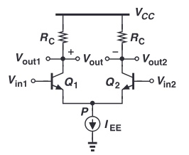

# 장말문제 10.19 — Q2의 트랜스컨덕턴스가 절반이 되는 입력 차(식 10.63 이용)

## 원문
In the circuit of Fig. 10.14, the small-signal transconductance of $Q_2$ falls as $V_{in1} - V_{in2}$ rises because $I_{C2}$ decreases. Using Eq. (10.63), determine the input difference at which the transconductance of $Q_2$ drops by a factor of 2.

## 조건
- 회로: Fig 10.14 바이폴라 차동쌍
- $V_{in1} - V_{in2}$가 커지면 $I_{C2}$가 줄어 $Q_2$의 소신호 트랜스컨덕턴스가 떨어짐
- 식 (10.63)을 이용

## 구할 것
- $Q_2$의 트랜스컨덕턴스가 2배만큼 떨어지는(절반이 되는) 입력 차 $V_{in1} - V_{in2}$

## 상속·참조
- 식 (10.63) (교재 514쪽, Fig 10.14, $\alpha = 1$, $V_A = \infty$ 가정):
  $$I_{C2} = \frac{I_{EE}}{1 + \exp\dfrac{V_{in1} - V_{in2}}{V_T}}$$
- 기준(비교 대상)은 평형 상태 $V_{in1} = V_{in2}$에서의 값 ($I_{C2} = I_{EE}/2$) (원문에 없음)
- $g_m = I_C/V_T$

## 회로 — Fig 10.14
```spice
RC1  VCC    Vout1  {R_C}    ; 두 저항 모두 R_C로 인쇄
RC2  VCC    Vout2  {R_C}
Q1   Vout1  Vin1   P    npn
Q2   Vout2  Vin2   P    npn    ; 좌우 반전 (베이스 오른쪽)
IEE  P      0      {I_EE}
* 가운데 개방 원 두 개: 왼쪽(+) 원은 Vout1 점, 오른쪽(−) 원은 Vout2 점에서 이어짐. 두 원 사이 라벨 V_out → V_out = V_out1 − V_out2
```
- 단자: VCC = 전원, 값 미지정 (가로 레일) / Vin1, Vin2 = 입력 (개방 원) / Vout1, Vout2 = 단일 출력 (개방 원, 바깥쪽) / V_out = 차동 출력, + 는 Vout1, − 는 Vout2 (개방 원 두 개, 안쪽)
- 표시: 노드 라벨 V_CC (레일 오른쪽 끝), V_out1 (왼쪽 바깥 원 왼쪽), V_out2 (오른쪽 바깥 원 오른쪽), V_out (안쪽 두 원 사이), V_in1 (왼쪽 입력 원 왼쪽), V_in2 (오른쪽 입력 원 오른쪽), P (P 점 왼쪽 아래) / 소자 라벨 R_C (왼쪽 저항 왼쪽), R_C (오른쪽 저항 오른쪽), Q1 (Q1 오른쪽), Q2 (Q2 왼쪽), I_EE (전류원 오른쪽) / 부호 + (Vout1 점과 안쪽 왼쪽 원 사이, 선 위), − (안쪽 오른쪽 원과 Vout2 점 사이, 선 위) / 화살표 없음 / 수치·면적 라벨 없음
- 배치: 맨 위 굵은 가로 레일 V_CC / 왼쪽 세로줄 위→아래 R_C, Vout1 점, Q1 / 오른쪽 세로줄 위→아래 R_C, Vout2 점, Q2 / 각 컬렉터 점에서 가로선이 양쪽으로: Vout1 점 → 왼쪽 V_out1 원, 오른쪽 안쪽 원(+); Vout2 점 → 왼쪽 안쪽 원(−), 오른쪽 V_out2 원 / Q1 npn 보통 방향(베이스 왼쪽), Q2 npn 좌우 반전(베이스 오른쪽) / V_in1 원 → 가로선 → Q1 베이스, V_in2 원 → 가로선 → Q2 베이스 / 두 이미터는 아래로 내려가 가로선으로 가운데 P 점, P에서 아래로 I_EE(화살표 아래), 그 아래 접지 / 접속점 (세 갈래 이상, 3곳): ① Vout1 = 위 R_C + 아래 Q1 컬렉터 + 왼쪽 출력선 + 오른쪽 출력선 (점) ② Vout2 = 위 R_C + 아래 Q2 컬렉터 + 왼쪽 출력선 + 오른쪽 출력선 (점) ③ P = 왼쪽 Q1 이미터 선 + 오른쪽 Q2 이미터 선 + 아래 I_EE (점) / 교차: 없음


> 참고: Fig 10.14는 본문 그림(교재 514쪽, PDF 10, "대신호 해석을 위한 바이폴라 차동쌍")

## 풀이
### 기준 트랜스컨덕턴스
- $g_{m2} = I_{C2}/V_T$이고, 평형($V_{in1} = V_{in2}$)에서 $I_{C2} = I_{EE}/2$이므로 $g_{m2} = I_{EE}/(2V_T)$
### 절반이 되는 조건
- $g_{m2}$가 절반이 되려면 $I_{C2} = I_{EE}/4$
- $I_{C2} = \dfrac{I_{EE}}{1 + \exp[(V_{in1} - V_{in2})/V_T]}$에 넣으면 $1 + \exp\dfrac{V_{in1} - V_{in2}}{V_T} = 4$
### 입력 차
- $V_{in1} - V_{in2} = V_T \ln 3 = 26\ \text{mV} \times 1.10 = 28.6\ \text{mV}$ ($V_T = 26\ \text{mV}$로 둠)
### 답
- $V_{in1} - V_{in2} = V_T \ln 3 \approx 28.6\ \text{mV}$
