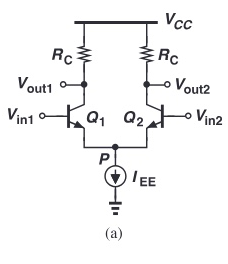

# 장말문제 10.23 — 예제 10.9 회로에 V_0 sin ωt 차동 입력: 출력 파형과 95 % 전환 시각 t_1

## 원문
In Example 10-9, $R_C = 500\ \Omega$, $I_{EE} = 1\ \text{mA}$, and $V_{CC} = 2.5\ \text{V}$. Assume

$$V_{in1} = V_0 \sin\omega t + V_{CM} \qquad (10.219)$$

$$V_{in2} = -V_0 \sin\omega t + V_{CM}, \qquad (10.220)$$

where $V_{CM} = 1\ \text{V}$ denotes the input common-mode level.

(a) If $V_0 = 2\ \text{mV}$, plot the output waveforms (as a function of time).

(b) If $V_0 = 50\ \text{mV}$, determine the time $t_1$ at which one transistor carries 95% of the tail current. Plot the output waveforms.

## 조건
- 회로: 예제 10.9의 바이폴라 차동쌍 (Fig 10.16(a)) (그림 번호는 원문에 없음, 원문은 "Example 10-9"만 적음)
- $R_C = 500\ \Omega$, $I_{EE} = 1\ \text{mA}$, $V_{CC} = 2.5\ \text{V}$
- 입력:
  $$V_{in1} = V_0 \sin\omega t + V_{CM} \qquad (10.219)$$
  $$V_{in2} = -V_0 \sin\omega t + V_{CM} \qquad (10.220)$$
- $V_{CM} = 1\ \text{V}$는 입력 공통 모드 레벨

## 구할 것
- (a) $V_0 = 2\ \text{mV}$일 때 출력 파형을 시간의 함수로 그림
- (b) $V_0 = 50\ \text{mV}$일 때 한 트랜지스터가 테일 전류의 $95\ \%$를 흘리는 시각 $t_1$을 구하고, 출력 파형을 그림

## 상속·참조
- 예제 10.9 (E10.09, 원문 표기 "Example 10-9"): Fig 10.16(a) 바이폴라 차동쌍($R_C$ 두 개, $Q_1$, $Q_2$, 테일 전류원 $I_{EE}$)에 $V_{CM}$을 중심으로 서로 반대 위상인 사인파 $V_{in1}$, $V_{in2}$를 넣고 출력 파형 $V_{out1}$, $V_{out2}$를 그림. $Q_1$과 $Q_2$는 순방향 활성 영역에 있다고 가정. 피크 차동 입력 $\pm 2\ \text{mV}$이면 선형 동작(출력 피크 $1\ \text{mV} \times g_m R_C$ 사인파), $\pm 200\ \text{mV}$이면 한쪽이 테일 전류 대부분을 흘려 출력이 $V_{CC}$와 $V_{CC} - R_C I_{EE}$에서 포화(제한기처럼 동작, 식 10.84–10.85)
- 식 (10.83) (교재 516쪽, Fig 10.14의 대신호 해석, $\alpha = 1$, $V_A = \infty$):
  $$V_{out1} - V_{out2} = -R_C I_{EE} \tanh\frac{V_{in1} - V_{in2}}{2V_T}$$

## 회로 — Fig 10.16(a)
```spice
RC1  VCC    Vout1  {R_C}   ; 두 저항 모두 R_C로 인쇄
RC2  VCC    Vout2  {R_C}
Q1   Vout1  Vin1   P  npn
Q2   Vout2  Vin2   P  npn
IEE  P      0      {I_EE}
```
- 단자: VCC = 전원 (가로 레일) / Vin1, Vin2 = 입력 (개방 원) / Vout1, Vout2 = 출력 (개방 원)
- 표시: 노드 라벨 VCC (레일 오른쪽 끝), V_out1 (왼쪽 출력 원 왼쪽), V_out2 (오른쪽 출력 원 오른쪽), V_in1 (왼쪽 입력 원 왼쪽), V_in2 (오른쪽 입력 원 오른쪽), P (P 점 왼쪽 아래) / 소자 라벨 R_C (왼쪽 저항 왼쪽), R_C (오른쪽 저항 오른쪽), Q1 (Q1 오른쪽), Q2 (Q2 왼쪽), I_EE (전류원 오른쪽) / 부호 없음 / 화살표 없음 / 수치·면적 라벨 없음
- 배치: 맨 위 굵은 가로 레일 VCC, 왼쪽 R_C보다 조금 왼쪽에서 오른쪽 R_C보다 조금 오른쪽까지 / 왼쪽 세로줄 위→아래 R_C, Vout1 접속점, Q1 / 오른쪽 세로줄 위→아래 R_C, Vout2 접속점, Q2 / Vout1 접속점에서 가로선이 왼쪽 Vout1 원, Vout2 접속점에서 가로선이 오른쪽 Vout2 원 / Q1 npn 보통 방향(베이스 왼쪽), Q2 npn 좌우 반전(베이스 오른쪽, 컬렉터 왼쪽 위, 이미터 왼쪽 아래) / V_in1 원 → 가로선 → Q1 베이스, V_in2 원 → 가로선 → Q2 베이스 / 두 이미터는 아래로 내려가 가로선으로 가운데 P 점에서 만남, P에서 아래로 I_EE 전류원(화살표 아래), 그 아래 접지 / 접속점 (세 갈래 이상, 3곳): ① Vout1 = 위 R_C + 아래 Q1 컬렉터 + 왼쪽 출력선 (점) ② Vout2 = 위 R_C + 아래 Q2 컬렉터 + 오른쪽 출력선 (점) ③ P = 왼쪽 Q1 이미터 선 + 오른쪽 Q2 이미터 선 + 아래 I_EE (점) / 교차: 없음


> 참고: Fig 10.16은 본문 예제 10.9의 그림(교재 517쪽, PDF 11)

## 풀이
### 바이어스와 소신호 이득
- 평형에서 $I_{C1} = I_{C2} = I_{EE}/2 = 0.5\ \text{mA}$, 출력 직류 레벨 $V_{CC} - R_C I_{EE}/2 = 2.25\ \text{V}$
- $g_m = (I_{EE}/2)/V_T = 0.5\ \text{mA}/26\ \text{mV} = 19.2\ \text{mS}$, $g_m R_C = 9.62$
### (a) $V_0 = 2\ \text{mV}$: 선형 동작
- 차동 입력 피크 $2V_0 = 4\ \text{mV} \ll 2V_T$이므로 소신호로 본다: 각 출력 진폭 $g_m R_C V_0 = 19.2\ \text{mV}$
- $V_{out1} = 2.25\ \text{V} - 19.2\ \text{mV}\,\sin\omega t$, $V_{out2} = 2.25\ \text{V} + 19.2\ \text{mV}\,\sin\omega t$ (서로 반대 위상의 사인파)
### (b) 95 % 전환 시각 $t_1$
- $I_{C1}/I_{C2} = \exp[(V_{in1} - V_{in2})/V_T] = 0.95/0.05 = 19$이므로 $V_{in1} - V_{in2} = V_T \ln 19 = 76.6\ \text{mV}$
- $2V_0 \sin\omega t_1 = 76.6\ \text{mV}$에서 $\sin\omega t_1 = 0.766$, $\omega t_1 = 0.872\ \text{rad}$ (주기의 $13.9\ \%$)
### (b) 출력 파형
- 피크 차동 입력 $100\ \text{mV}$에서 $I_{C1} = I_{EE}/[1 + \exp(-100\ \text{mV}/V_T)] = 0.979\ \text{mA}$
- $V_{out1} = V_{CC} - R_C I_{C1}$은 $2.01\ \text{V}$와 $2.49\ \text{V}$ 사이를 오가고, $\omega t_1 < \omega t < \pi - \omega t_1$ 동안 한계 근처에 머물러 꼭대기가 눌린 사인파가 된다. $V_{out2}$는 $2.25\ \text{V}$에 대해 대칭
### 답
- (a) $V_{out1,2} = 2.25\ \text{V} \mp 19.2\ \text{mV}\,\sin\omega t$ (반대 위상 사인파)
- (b) $t_1 = 0.872/\omega$ (다음 반주기의 $\omega t = \pi + 0.872$에서는 $Q_2$가 95 %). 출력은 $2.01$–$2.49\ \text{V}$ 사이에서 꼭대기가 평탄해진 사인파
