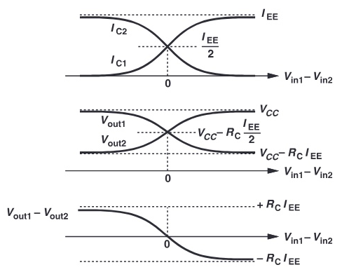

# 장말문제 10.24 — 주변 온도 27 °C → 100 °C일 때 Fig 10.15 특성의 변화

## 원문
Explain what happens to the characteristics shown in Fig. 10.15 if the ambient temperature goes from $27\ ^\circ\text{C}$ to $100\ ^\circ\text{C}$.

## 조건
- Fig 10.15의 특성: 바이폴라 차동쌍에서 입력 $V_{in1} - V_{in2}$에 따른 전류와 전압의 변화
- 주변 온도가 $27\ ^\circ\text{C}$에서 $100\ ^\circ\text{C}$로 오름

## 구할 것
- Fig 10.15의 특성이 어떻게 되는지 설명

## 상속·참조
- 본문 Fig 10.15 (교재 517쪽, PDF 11): 특성 그래프 세 개가 위아래로 놓임 (회로 그림 아님). 세 그래프 모두 가로축 $V_{in1} - V_{in2}$ (가운데 0)
  - 위: $I_{C1}$은 0에서 점선 $I_{EE}$로 올라가고 $I_{C2}$는 $I_{EE}$에서 0으로 내려감. 0에서 점선 $I_{EE}/2$ 레벨로 교차
  - 가운데: $V_{out1}$은 점선 $V_{CC}$에서 점선 $V_{CC} - R_C I_{EE}$로 내려가고 $V_{out2}$는 반대로 올라감. 0에서 점선 $V_{CC} - R_C \dfrac{I_{EE}}{2}$ 레벨로 교차
  - 아래: $V_{out1} - V_{out2}$가 왼쪽 점선 $+R_C I_{EE}$ 근처에서 시작해 0을 지나 오른쪽 점선 $-R_C I_{EE}$로 내려감
- 식 (10.63), (10.65) (Fig 10.14, $\alpha = 1$, $V_A = \infty$): $I_{C2} = \dfrac{I_{EE}}{1 + \exp[(V_{in1} - V_{in2})/V_T]}$, $I_{C1} = \dfrac{I_{EE} \exp[(V_{in1} - V_{in2})/V_T]}{1 + \exp[(V_{in1} - V_{in2})/V_T]}$
- 식 (10.83) (교재 516쪽, Fig 10.14의 대신호 해석, $\alpha = 1$, $V_A = \infty$):
  $$V_{out1} - V_{out2} = -R_C I_{EE} \tanh\frac{V_{in1} - V_{in2}}{2V_T}$$
- $V_T = kT/q$ (온도에 비례) (원문에 없음)

## 회로 — 없음 (특성 그래프 문제, 그림 10.15는 회로가 아닌 그래프로 상속·참조에 적음)
