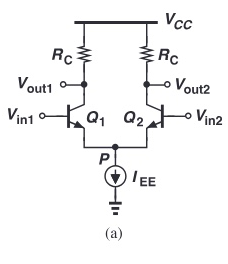

# 장말문제 10.25 — 차동쌍의 사인파→구형파 변환: V_0 = 80 mV, 160 mV의 출력 파형

## 원문
The study in Example 10-9 suggests that a differential pair can convert a sinusoid to a square wave. Using the circuit parameters given in Problem 10.23, plot the output waveforms if $V_0 = 80\ \text{mV}$ or $160\ \text{mV}$. Explain why the output square wave becomes "sharper" as the input amplitude increases.

## 조건
- 예제 10.9의 결과는 차동쌍이 사인파를 구형파로 바꿀 수 있음을 보여 줌
- 회로 파라미터: 문제 10.23과 같음 (Fig 10.16(a), $R_C = 500\ \Omega$, $I_{EE} = 1\ \text{mA}$, $V_{CC} = 2.5\ \text{V}$, $V_{CM} = 1\ \text{V}$)
- $V_0 = 80\ \text{mV}$ 또는 $160\ \text{mV}$

## 구할 것
- $V_0 = 80\ \text{mV}$, $160\ \text{mV}$ 각각의 출력 파형을 그림
- 입력 진폭이 커질수록 출력 구형파가 더 "날카로워지는(sharper)" 이유 설명

## 상속·참조
- 문제 10.23 (P10.23)의 회로 파라미터: 예제 10.9의 회로(Fig 10.16(a)), $R_C = 500\ \Omega$, $I_{EE} = 1\ \text{mA}$, $V_{CC} = 2.5\ \text{V}$, 입력 $V_{in1} = V_0 \sin\omega t + V_{CM}$ (10.219), $V_{in2} = -V_0 \sin\omega t + V_{CM}$ (10.220), $V_{CM} = 1\ \text{V}$
- 예제 10.9 (E10.09, 원문 표기 "Example 10-9"): Fig 10.16(a) 바이폴라 차동쌍($R_C$ 두 개, $Q_1$, $Q_2$, 테일 전류원 $I_{EE}$)에 $V_{CM}$을 중심으로 서로 반대 위상인 사인파 $V_{in1}$, $V_{in2}$를 넣고 출력 파형 $V_{out1}$, $V_{out2}$를 그림. $Q_1$과 $Q_2$는 순방향 활성 영역에 있다고 가정. 피크 차동 입력 $\pm 2\ \text{mV}$이면 선형 동작(출력 피크 $1\ \text{mV} \times g_m R_C$ 사인파), $\pm 200\ \text{mV}$이면 한쪽이 테일 전류 대부분을 흘려 출력이 $V_{CC}$와 $V_{CC} - R_C I_{EE}$에서 포화(제한기처럼 동작, 식 10.84–10.85)
- 식 (10.83) (교재 516쪽, Fig 10.14의 대신호 해석, $\alpha = 1$, $V_A = \infty$):
  $$V_{out1} - V_{out2} = -R_C I_{EE} \tanh\frac{V_{in1} - V_{in2}}{2V_T}$$

## 회로 — Fig 10.16(a)
```spice
RC1  VCC    Vout1  {R_C}   ; 두 저항 모두 R_C로 인쇄
RC2  VCC    Vout2  {R_C}
Q1   Vout1  Vin1   P  npn
Q2   Vout2  Vin2   P  npn
IEE  P      0      {I_EE}
```
- 단자: VCC = 전원 (가로 레일) / Vin1, Vin2 = 입력 (개방 원) / Vout1, Vout2 = 출력 (개방 원)
- 표시: 노드 라벨 VCC (레일 오른쪽 끝), V_out1 (왼쪽 출력 원 왼쪽), V_out2 (오른쪽 출력 원 오른쪽), V_in1 (왼쪽 입력 원 왼쪽), V_in2 (오른쪽 입력 원 오른쪽), P (P 점 왼쪽 아래) / 소자 라벨 R_C (왼쪽 저항 왼쪽), R_C (오른쪽 저항 오른쪽), Q1 (Q1 오른쪽), Q2 (Q2 왼쪽), I_EE (전류원 오른쪽) / 부호 없음 / 화살표 없음 / 수치·면적 라벨 없음
- 배치: 맨 위 굵은 가로 레일 VCC, 왼쪽 R_C보다 조금 왼쪽에서 오른쪽 R_C보다 조금 오른쪽까지 / 왼쪽 세로줄 위→아래 R_C, Vout1 접속점, Q1 / 오른쪽 세로줄 위→아래 R_C, Vout2 접속점, Q2 / Vout1 접속점에서 가로선이 왼쪽 Vout1 원, Vout2 접속점에서 가로선이 오른쪽 Vout2 원 / Q1 npn 보통 방향(베이스 왼쪽), Q2 npn 좌우 반전(베이스 오른쪽, 컬렉터 왼쪽 위, 이미터 왼쪽 아래) / V_in1 원 → 가로선 → Q1 베이스, V_in2 원 → 가로선 → Q2 베이스 / 두 이미터는 아래로 내려가 가로선으로 가운데 P 점에서 만남, P에서 아래로 I_EE 전류원(화살표 아래), 그 아래 접지 / 접속점 (세 갈래 이상, 3곳): ① Vout1 = 위 R_C + 아래 Q1 컬렉터 + 왼쪽 출력선 (점) ② Vout2 = 위 R_C + 아래 Q2 컬렉터 + 오른쪽 출력선 (점) ③ P = 왼쪽 Q1 이미터 선 + 오른쪽 Q2 이미터 선 + 아래 I_EE (점) / 교차: 없음


> 참고: Fig 10.16은 본문 예제 10.9의 그림(교재 517쪽, PDF 11)

## 풀이
### 출력의 한계값
- 한쪽이 테일 전류를 모두 흘리면 출력은 $V_{CC} = 2.5\ \text{V}$와 $V_{CC} - R_C I_{EE} = 2.0\ \text{V}$ 사이에 갇힌다
- 피크 차동 입력 $2V_0 = 160\ \text{mV}$, $320\ \text{mV}$에서 $\tanh(V_0/V_T) = 0.996$, $1.00$이라 두 경우 모두 한계에 거의 닿는다 ($V_T = 26\ \text{mV}$)
### 전환 구간의 길이
- 한 트랜지스터가 5 %에서 95 %로 넘어가는 구간은 $|V_{in1} - V_{in2}| < V_T \ln 19 = 76.6\ \text{mV}$, 곧 $|\sin\omega t| < 76.6\ \text{mV}/(2V_0)$
- $V_0 = 80\ \text{mV}$: $\omega t$ 폭 $0.998\ \text{rad}$ (주기의 $15.9\ \%$), $V_0 = 160\ \text{mV}$: $0.483\ \text{rad}$ (주기의 $7.69\ \%$)
### 출력 파형
- $V_{out1}$은 $2.0\ \text{V}$와 $2.5\ \text{V}$ 사이의 구형파에 가깝고, 입력 영점 교차($\omega t = 0, \pi$)에서 위 폭 동안 $2.25\ \text{V}$를 지나 전환한다. $V_{out2}$는 반대 위상
### 답
- 두 경우 모두 $2.0$–$2.5\ \text{V}$ 사이의 반대 위상 구형파에 가깝다. 전환 구간은 $V_0 = 80\ \text{mV}$에서 주기의 약 16 %, $160\ \text{mV}$에서 약 7.7 %
- 쌍은 차동 입력이 $\pm$수 $V_T$ 안에 있을 때만 전환하는데, 진폭이 크면 영점 교차에서 입력이 더 빨리 변해 이 좁은 구간을 더 짧은 시간에 지나가므로 모서리가 날카로워진다
