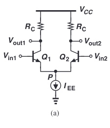

# 장말문제 10.26 — 문제 10.25의 출력 구형파 기울기 (ω = 2π × 100 MHz)

## 원문
In Problem 10.25, estimate the slope of the output square waves for $V_0 = 80\ \text{mV}$ or $160\ \text{mV}$ if $\omega = 2\pi \times (100\ \text{MHz})$.

## 조건
- 문제 10.25의 회로와 입력 (Fig 10.16(a), $R_C = 500\ \Omega$, $I_{EE} = 1\ \text{mA}$, $V_{CC} = 2.5\ \text{V}$, $V_{CM} = 1\ \text{V}$)
- $V_0 = 80\ \text{mV}$ 또는 $160\ \text{mV}$
- $\omega = 2\pi \times (100\ \text{MHz})$

## 구할 것
- $V_0 = 80\ \text{mV}$, $160\ \text{mV}$ 각각에서 출력 구형파의 기울기 추정

## 상속·참조
- 문제 10.25 (P10.25): 문제 10.23의 회로 파라미터로 $V_0 = 80\ \text{mV}$, $160\ \text{mV}$일 때 출력 파형(구형파에 가까움)을 그리고 입력 진폭이 커질수록 구형파가 날카로워지는 이유를 설명
- 문제 10.23 (P10.23)의 회로 파라미터: 예제 10.9의 회로(Fig 10.16(a)), $R_C = 500\ \Omega$, $I_{EE} = 1\ \text{mA}$, $V_{CC} = 2.5\ \text{V}$, 입력 $V_{in1} = V_0 \sin\omega t + V_{CM}$ (10.219), $V_{in2} = -V_0 \sin\omega t + V_{CM}$ (10.220), $V_{CM} = 1\ \text{V}$
- 식 (10.83) (교재 516쪽, Fig 10.14의 대신호 해석, $\alpha = 1$, $V_A = \infty$):
  $$V_{out1} - V_{out2} = -R_C I_{EE} \tanh\frac{V_{in1} - V_{in2}}{2V_T}$$

## 회로 — Fig 10.16(a)
```spice
RC1  VCC    Vout1  {R_C}   ; 두 저항 모두 R_C로 인쇄
RC2  VCC    Vout2  {R_C}
Q1   Vout1  Vin1   P  npn
Q2   Vout2  Vin2   P  npn
IEE  P      0      {I_EE}
```
- 단자: VCC = 전원 (가로 레일) / Vin1, Vin2 = 입력 (개방 원) / Vout1, Vout2 = 출력 (개방 원)
- 표시: 노드 라벨 VCC (레일 오른쪽 끝), V_out1 (왼쪽 출력 원 왼쪽), V_out2 (오른쪽 출력 원 오른쪽), V_in1 (왼쪽 입력 원 왼쪽), V_in2 (오른쪽 입력 원 오른쪽), P (P 점 왼쪽 아래) / 소자 라벨 R_C (왼쪽 저항 왼쪽), R_C (오른쪽 저항 오른쪽), Q1 (Q1 오른쪽), Q2 (Q2 왼쪽), I_EE (전류원 오른쪽) / 부호 없음 / 화살표 없음 / 수치·면적 라벨 없음
- 배치: 맨 위 굵은 가로 레일 VCC, 왼쪽 R_C보다 조금 왼쪽에서 오른쪽 R_C보다 조금 오른쪽까지 / 왼쪽 세로줄 위→아래 R_C, Vout1 접속점, Q1 / 오른쪽 세로줄 위→아래 R_C, Vout2 접속점, Q2 / Vout1 접속점에서 가로선이 왼쪽 Vout1 원, Vout2 접속점에서 가로선이 오른쪽 Vout2 원 / Q1 npn 보통 방향(베이스 왼쪽), Q2 npn 좌우 반전(베이스 오른쪽, 컬렉터 왼쪽 위, 이미터 왼쪽 아래) / V_in1 원 → 가로선 → Q1 베이스, V_in2 원 → 가로선 → Q2 베이스 / 두 이미터는 아래로 내려가 가로선으로 가운데 P 점에서 만남, P에서 아래로 I_EE 전류원(화살표 아래), 그 아래 접지 / 접속점 (세 갈래 이상, 3곳): ① Vout1 = 위 R_C + 아래 Q1 컬렉터 + 왼쪽 출력선 (점) ② Vout2 = 위 R_C + 아래 Q2 컬렉터 + 오른쪽 출력선 (점) ③ P = 왼쪽 Q1 이미터 선 + 오른쪽 Q2 이미터 선 + 아래 I_EE (점) / 교차: 없음


> 참고: Fig 10.16은 본문 예제 10.9의 그림(교재 517쪽, PDF 11)

## 힌트
### 영점 교차에서는 소신호 증폭기
- 출력이 가장 가파르게 바뀌는 곳은 두 입력이 같아지는 순간이고, 그때 쌍은 평형 바이어스에 있어 소신호 증폭기처럼 동작한다
- 그래서 출력 기울기는 그 순간의 입력 기울기에 소신호 이득을 곱해 추정할 수 있다

## 풀이
### 가장 가파른 곳은 영점 교차
- 출력은 두 입력이 같아지는 순간 가장 빨리 변하고, 그때 쌍은 평형 바이어스($I_C = I_{EE}/2$)에 있어 소신호 증폭기처럼 동작하므로 출력 기울기 = 소신호 이득 × 입력 기울기로 추정한다
- $g_m R_C = (0.5\ \text{mA}/26\ \text{mV}) \times 500\ \Omega = 9.62$
### 입력 기울기
- $V_{in1} = V_0 \sin\omega t + V_{CM}$의 영점 교차 기울기는 $V_0 \omega$, $\omega = 2\pi \times 100\ \text{MHz} = 6.28 \times 10^8\ \text{rad/s}$
### 출력 기울기
- 한쪽 출력: $g_m R_C V_0 \omega$. $V_0 = 80\ \text{mV}$이면 $4.83 \times 10^8\ \text{V/s}$, $160\ \text{mV}$이면 $9.67 \times 10^8\ \text{V/s}$
- 차동 출력 $V_{out1} - V_{out2}$는 그 두 배: $9.67 \times 10^8\ \text{V/s}$, $1.93 \times 10^9\ \text{V/s}$
### 답
- $V_0 = 80\ \text{mV}$: 각 출력 약 $4.83 \times 10^8\ \text{V/s}$ ($0.483\ \text{V/ns}$), 차동 출력 $0.967\ \text{V/ns}$
- $V_0 = 160\ \text{mV}$: 각 출력 약 $9.67 \times 10^8\ \text{V/s}$ ($0.967\ \text{V/ns}$), 차동 출력 $1.93\ \text{V/ns}$
