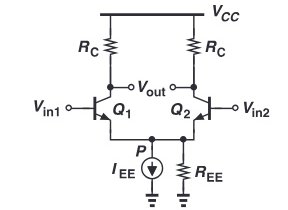

# 장말문제 10.27 — 테일에 R_EE가 병렬로 붙은 바이폴라 차동쌍(Fig 10.68)의 소신호 해석

## 조건
- 회로: Fig 10.68 — 바이폴라 차동쌍, 테일 노드 $P$에 전류원 $I_{EE}$와 저항 $R_{EE}$가 병렬로 접지에 연결
- Fig 10.17의 소신호 해석을 이 회로에 대해 다시 함

## 구할 것
- 먼저 $P$가 여전히 가상 접지임을 증명
- Fig 10.17과 같은 소신호 해석 (차동 전압 이득 등) (괄호 안은 원문에 없음)

## 상속·참조
- 본문 Fig 10.17(a) (교재 519쪽, PDF 12, 크롭 안 함): 바이폴라 쌍의 소신호 모델. 연결: `vin1 전압원: + = r_π1 위 끝, − = 접지`, `r_π1: 위 끝(+ v_π1) – P(− v_π1)`, `g_m1 v_π1 전류원: R_C 아래 끝(컬렉터) → P`, `R_C: 컬렉터 – 교류 접지`, 오른쪽도 대칭 (`vin2`, `r_π2`, `g_m2 v_π2`, `R_C`). 이상적 테일 전류원은 소신호에서 개방이라 그림에 없음. $V_A = \infty$
- 식 (10.86)–(10.91) (교재 519쪽): 완벽한 대칭, 이상적 테일 전류원, $V_A = \infty$, 차동 입력 $v_{in1} = -v_{in2}$일 때
  - KVL: $v_{in1} - v_{\pi 1} = v_P = v_{in2} - v_{\pi 2}$ (10.86)
  - $P$ 노드 KCL: $\dfrac{v_{\pi 1}}{r_{\pi 1}} + g_{m1} v_{\pi 1} + \dfrac{v_{\pi 2}}{r_{\pi 2}} + g_{m2} v_{\pi 2} = 0$ (10.87)
  - $r_{\pi 1} = r_{\pi 2}$, $g_{m1} = g_{m2}$ → $v_{\pi 1} = -v_{\pi 2}$ (10.88) → $2 v_{in1} = 2 v_{\pi 1}$ (10.89) → $v_P = v_{in1} - v_{\pi 1} = 0$ (10.90), (10.91): $P$는 가상 접지
- 이어지는 해석 (교재 520쪽): $v_P = 0$이므로 $P$를 교류 접지로 단락해 두 '절반 회로'(CE 단, Fig 10.17(b))로 나눔 → $v_{out1} = -g_m R_C v_{in1}$ (10.92), $v_{out2} = -g_m R_C v_{in2}$ (10.93), $\dfrac{v_{out1} - v_{out2}}{v_{in1} - v_{in2}} = -g_m R_C$ (10.94)

## 회로 — Fig 10.68
```spice
RC1  VCC   out1  {R_C}   ; 두 저항 모두 R_C로 인쇄
RC2  VCC   out2  {R_C}
Q1   out1  Vin1  P    npn
Q2   out2  Vin2  P    npn    ; 좌우 반전 (베이스 오른쪽)
IEE  P     0     {I_EE}
REE  P     0     {R_EE}   ; P 점보다 오른쪽, 꼬리 가로선 위의 별도 점에서 갈라짐 (같은 노드 P)
* out1, out2 = 두 컬렉터 점에서 안쪽으로 이어진 개방 원. 두 원 사이에 "V_out" 라벨 하나 (차동 출력)
```
- 단자: VCC = 전원, 값 미지정 (가로 레일) / Vin1, Vin2 = 입력 (개방 원) / out1, out2 = 차동 출력 V_out (개방 원 두 개, 각 원 옆 라벨 없음)
- 표시: 노드 라벨 V_CC (레일 오른쪽 끝), V_out (두 출력 원 사이), V_in1 (왼쪽 입력 원 왼쪽), V_in2 (오른쪽 입력 원 오른쪽), P (P 점 왼쪽 아래) / 소자 라벨 R_C (왼쪽 저항 왼쪽), R_C (오른쪽 저항 오른쪽), Q1 (Q1 오른쪽), Q2 (Q2 왼쪽), I_EE (전류원 왼쪽), R_EE (저항 오른쪽) / 부호 없음 / 화살표 없음 / 수치·면적 라벨 없음
- 배치: 맨 위 굵은 가로 레일 V_CC / 왼쪽 세로줄 위→아래 R_C, 컬렉터 점, Q1 / 오른쪽 세로줄 위→아래 R_C, 컬렉터 점, Q2 / 각 컬렉터 점에서 짧은 가로선이 안쪽으로 개방 원(두 원은 가운데에서 마주 보고 사이에 V_out 라벨) / Q1 npn 보통 방향(베이스 왼쪽), Q2 npn 좌우 반전(베이스 오른쪽) / V_in1 원 → 가로선 → Q1 베이스, V_in2 원 → 가로선 → Q2 베이스 / Q1 이미터는 아래로 내려가 꼬리 가로선, 오른쪽으로 P 점, 더 오른쪽 R_EE 분기 점(Q2 이미터 세로선 조금 왼쪽)을 지나 오른쪽 끝에서 위로 꺾여 Q2 이미터 / P에서 아래로 I_EE(화살표 아래), 그 아래 접지. R_EE 분기 점에서 아래로 R_EE, 그 아래 접지 (두 접지는 나란히) / 접속점 (세 갈래 이상, 4곳): ① Q1 컬렉터 = 위 R_C + 아래 Q1 컬렉터 + 오른쪽 출력선 (점) ② Q2 컬렉터 = 위 R_C + 아래 Q2 컬렉터 + 왼쪽 출력선 (점) ③ P = 왼쪽 Q1 이미터 선 + 오른쪽 꼬리선 + 아래 I_EE (점) ④ R_EE 분기 점 = 왼쪽 꼬리선 + 오른쪽 Q2 이미터 선 + 아래 R_EE (점) / 교차: 없음


