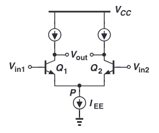

# 장말문제 10.29 — 전류원 부하 바이폴라 차동쌍(Fig 10.69)의 전압 이득

## 조건
- 회로: Fig 10.69 — 두 컬렉터에 $V_{CC}$에서 내려오는 전류원 부하가 달린 바이폴라 차동쌍, 테일 전류원 $I_{EE}$
- $I_{EE} = 1\ \text{mA}$, $V_A = 5\ \text{V}$

## 구할 것
- 회로의 전압 이득
- 이득이 테일 전류와 무관함에 주목 (원문의 "Note that…" 문장)

## 회로 — Fig 10.69
```spice
I1   VCC   out1  ; 라벨 없음, 화살표 아래
I2   VCC   out2  ; 라벨 없음, 화살표 아래
Q1   out1  Vin1  P  npn
Q2   out2  Vin2  P  npn    ; 좌우 반전 (베이스 오른쪽)
IEE  P     0     {I_EE}
* out1, out2 = 두 컬렉터 점에서 안쪽으로 이어진 개방 원. 두 원 사이에 "V_out" 라벨 하나 (차동 출력)
```
- 단자: VCC = 전원, 값 미지정 (가로 레일) / Vin1, Vin2 = 입력 (개방 원) / out1, out2 = 차동 출력 V_out (개방 원 두 개, 각 원 옆 라벨 없음)
- 표시: 노드 라벨 V_CC (레일 오른쪽 끝), V_out (두 출력 원 사이), V_in1 (왼쪽 입력 원 왼쪽), V_in2 (오른쪽 입력 원 오른쪽), P (P 점 왼쪽 아래) / 소자 라벨 Q1 (Q1 오른쪽), Q2 (Q2 왼쪽), I_EE (테일 전류원 오른쪽), 위 전류원 둘 I1, I2 (라벨 없음) / 부호 없음 / 화살표 없음 / 수치·면적 라벨 없음
- 배치: 맨 위 굵은 가로 레일 V_CC / 왼쪽 세로줄 위→아래 전류원(화살표 아래), 컬렉터 점, Q1 / 오른쪽 세로줄 위→아래 전류원(화살표 아래), 컬렉터 점, Q2 / 각 컬렉터 점에서 짧은 가로선이 안쪽으로 개방 원 (두 원은 가운데에서 마주 보고 사이에 V_out 라벨) / Q1 npn 보통 방향(베이스 왼쪽), Q2 npn 좌우 반전(베이스 오른쪽) / V_in1 원 → 가로선 → Q1 베이스, V_in2 원 → 가로선 → Q2 베이스 / 두 이미터는 아래로 내려가 꼬리 가로선 가운데 P 점에서 만남, P에서 아래로 I_EE(화살표 아래), 그 아래 접지 / 접속점 (세 갈래 이상, 3곳): ① Q1 컬렉터 = 위 전류원 + 아래 Q1 컬렉터 + 오른쪽 출력선 (점) ② Q2 컬렉터 = 위 전류원 + 아래 Q2 컬렉터 + 왼쪽 출력선 (점) ③ P = 왼쪽 Q1 이미터 선 + 오른쪽 Q2 이미터 선 + 아래 I_EE (점) / 교차: 없음


