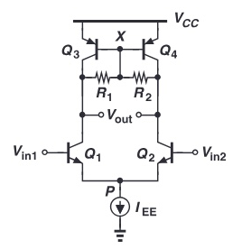

# 장말문제 10.30 — pnp 부하와 R_1, R_2를 가진 바이폴라 차동쌍(Fig 10.70)에서 이득 50을 주는 R_1 = R_2

## 원문
Consider the circuit shown in Fig. 10.70, where $I_{EE} = 2\ \text{mA}$, $V_{A,n} = 5\ \text{V}$ $V_{A,p} = 4\ \text{V}$. What value of $R_1 = R_2$ allows a voltage gain of 50?

## 조건
- 회로: Fig 10.70
- $I_{EE} = 2\ \text{mA}$, $V_{A,n} = 5\ \text{V}$, $V_{A,p} = 4\ \text{V}$ (원문은 두 값 사이에 쉼표 없이 "$V_{A,n} = 5$ V $V_{A,p} = 4$ V"로 인쇄)
- $V_{A,n}$은 npn($Q_1$, $Q_2$), $V_{A,p}$는 pnp($Q_3$, $Q_4$)의 Early 전압 (원문에 없음)

## 구할 것
- 전압 이득 $50$을 주는 $R_1 = R_2$의 값

## 회로 — Fig 10.70
```spice
Q3   out1  X     VCC  pnp    ; 좌우 반전 (베이스 오른쪽)
Q4   out2  X     VCC  pnp
R1   out1  X     {R_1}
R2   X     out2  {R_2}
Q1   out1  Vin1  P    npn
Q2   out2  Vin2  P    npn    ; 좌우 반전 (베이스 오른쪽)
IEE  P     0     {I_EE}
* X = 두 pnp 베이스를 잇는 선의 점. 이 점에서 아래로 내려온 선이 R1과 R2 사이 점에 닿음 (같은 노드)
* out1, out2 = 두 컬렉터 세로줄의 아래쪽 점에서 안쪽으로 이어진 개방 원. 두 원 사이에 "V_out" 라벨 하나 (차동 출력)
```
- 단자: VCC = 전원, 값 미지정 (가로 레일) / Vin1, Vin2 = 입력 (개방 원) / out1, out2 = 차동 출력 V_out (개방 원 두 개, 각 원 옆 라벨 없음)
- 표시: 노드 라벨 V_CC (레일 오른쪽 끝), X (베이스 공통선 점 위), V_out (두 출력 원 사이), V_in1 (왼쪽 입력 원 왼쪽), V_in2 (오른쪽 입력 원 오른쪽), P (P 점 왼쪽 아래) / 소자 라벨 Q3 (Q3 왼쪽), Q4 (Q4 오른쪽), R1 (R1 아래), R2 (R2 아래), Q1 (Q1 오른쪽), Q2 (Q2 왼쪽), I_EE (전류원 오른쪽) / 부호 없음 / 화살표 없음 / 수치·면적 라벨 없음
- 배치: 맨 위 굵은 가로 레일 V_CC / Q3 pnp 좌우 반전(베이스 오른쪽, 이미터 왼쪽 위에서 레일로, 컬렉터 왼쪽 아래), Q4 pnp 보통 방향(베이스 왼쪽, 이미터 오른쪽 위에서 레일로, 컬렉터 오른쪽 아래) / 두 베이스는 가로선으로 이어지고 가운데 X 점, X에서 세로선이 아래로 R1–R2 사이 점 / 그 아래 높이에서 가로로 왼쪽 컬렉터 세로줄 점 – R1 – 가운데 점 – R2 – 오른쪽 컬렉터 세로줄 점 / 두 컬렉터 세로줄은 더 내려가 각각 출력 점(안쪽으로 개방 원, 사이에 V_out 라벨)을 지나 Q1, Q2 컬렉터 / Q1 npn 보통 방향(베이스 왼쪽), Q2 npn 좌우 반전(베이스 오른쪽) / V_in1 원 → Q1 베이스, V_in2 원 → Q2 베이스 / 두 이미터는 꼬리 가로선 가운데 P 점에서 만남, P에서 아래로 I_EE(화살표 아래), 그 아래 접지 / 접속점 (세 갈래 이상, 7곳): ① X = 왼쪽 Q3 베이스 + 오른쪽 Q4 베이스 + 아래 세로선 (점) ② R1–R2 사이 = 위 X 세로선 + 왼쪽 R1 + 오른쪽 R2 (점) ③ 왼쪽 R1 끝 = 위 Q3 컬렉터 + 오른쪽 R1 + 아래 세로줄 (점) ④ 오른쪽 R2 끝 = 위 Q4 컬렉터 + 왼쪽 R2 + 아래 세로줄 (점) ⑤ 왼쪽 출력 점 = 위 세로줄 + 아래 Q1 컬렉터 + 오른쪽 출력선 (점) ⑥ 오른쪽 출력 점 = 위 세로줄 + 아래 Q2 컬렉터 + 왼쪽 출력선 (점) ⑦ P = 왼쪽 Q1 이미터 선 + 오른쪽 Q2 이미터 선 + 아래 I_EE (점) / 교차: 없음


