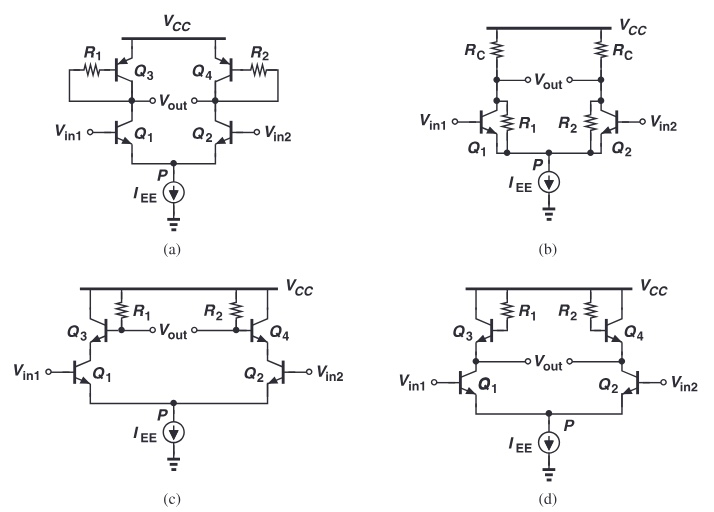

# 장말문제 10.32 — Fig 10.71 (a)–(d) 각 단의 차동 전압 이득 (V_A < ∞)

## 원문
Assuming perfect symmetry and $V_A < \infty$, compute the differential voltage gain of each stage depicted in Fig. 10.71.

## 조건
- 회로: Fig 10.71 (a)–(d)의 네 차동 단
- 완벽한 대칭
- $V_A < \infty$

## 구할 것
- (a)–(d) 각 단의 차동 전압 이득 (소문항 표기 없음, 원문은 "each stage depicted in Fig. 10.71"로 적음)

## 회로 — Fig 10.71(a)
```spice
Q3   out1  n1    VCC  pnp
Q4   out2  n2    VCC  pnp    ; 좌우 반전 (베이스 오른쪽)
R1   n1    out1  {R_1}
R2   n2    out2  {R_2}
Q1   out1  Vin1  P    npn
Q2   out2  Vin2  P    npn    ; 좌우 반전 (베이스 오른쪽)
IEE  P     0     {I_EE}
* n1 = Q3 베이스, n2 = Q4 베이스 (라벨 없음). R1은 Q3 베이스에서 왼쪽으로 나가 아래로 꺾여 왼쪽 컬렉터 점으로 돌아옴 (R2는 대칭)
* out1, out2 = 두 컬렉터 점에서 안쪽으로 이어진 개방 원. 두 원 사이에 "V_out" 라벨 하나 (차동 출력)
```
- 단자: VCC = 전원, 값 미지정 (가로 레일) / Vin1, Vin2 = 입력 (개방 원) / out1, out2 = 차동 출력 V_out (개방 원 두 개, 각 원 옆 라벨 없음)
- 표시: 노드 라벨 V_CC (레일 위 가운데), V_out (두 출력 원 사이), V_in1 (왼쪽 입력 원 왼쪽), V_in2 (오른쪽 입력 원 오른쪽), P (P 점 왼쪽 아래) / 소자 라벨 R1 (R1 위), R2 (R2 위), Q3 (Q3 오른쪽), Q4 (Q4 왼쪽), Q1 (Q1 오른쪽), Q2 (Q2 왼쪽), I_EE (전류원 왼쪽) / 부호 없음 / 화살표 없음 / 수치·면적 라벨 없음
- 배치: 맨 위 굵은 가로 레일 V_CC / Q3 pnp 보통 방향(베이스 왼쪽, 이미터 위에서 레일로), Q4 pnp 좌우 반전(베이스 오른쪽) / Q3 베이스 → 왼쪽 가로선 R1 → 왼쪽 끝에서 아래로 꺾여 → 컬렉터 점 높이에서 오른쪽으로 왼쪽 컬렉터 점 (오른쪽은 R2로 대칭) / Q3 컬렉터 아래로 컬렉터 점, 그 아래 Q1 컬렉터 (Q4, Q2도 같음) / 각 컬렉터 점에서 짧은 가로선이 안쪽으로 개방 원 / Q1 npn 보통 방향(베이스 왼쪽), Q2 npn 좌우 반전(베이스 오른쪽) / V_in1 원 → Q1 베이스, V_in2 원 → Q2 베이스 / 두 이미터는 꼬리 가로선 가운데 P 점에서 만남, P에서 아래로 I_EE(화살표 아래), 그 아래 접지 / 접속점 (세 갈래 이상, 3곳): ① 왼쪽 컬렉터 점 = 위 Q3 컬렉터 + 아래 Q1 컬렉터 + 왼쪽 R1 되돌림선 + 오른쪽 출력선 (점, 네 갈래) ② 오른쪽 컬렉터 점 = 위 Q4 컬렉터 + 아래 Q2 컬렉터 + 오른쪽 R2 되돌림선 + 왼쪽 출력선 (점, 네 갈래) ③ P = 왼쪽 Q1 이미터 선 + 오른쪽 Q2 이미터 선 + 아래 I_EE (점) / 교차: 없음

## 회로 — Fig 10.71(b)
```spice
RC1  VCC   out1  {R_C}   ; 두 저항 모두 R_C로 인쇄
RC2  VCC   out2  {R_C}
R1   out1  P     {R_1}
R2   out2  P     {R_2}
Q1   out1  Vin1  P  npn
Q2   out2  Vin2  P  npn    ; 좌우 반전 (베이스 오른쪽)
IEE  P     0     {I_EE}
* R1은 Q1 컬렉터와 꼬리 가로선 사이 (컬렉터–이미터 사이), R2는 대칭
* out1, out2 = 두 컬렉터 세로줄의 위쪽 점에서 안쪽으로 이어진 개방 원. 두 원 사이에 "V_out" 라벨 하나 (차동 출력)
```
- 단자: VCC = 전원, 값 미지정 (가로 레일) / Vin1, Vin2 = 입력 (개방 원) / out1, out2 = 차동 출력 V_out (개방 원 두 개, 각 원 옆 라벨 없음)
- 표시: 노드 라벨 V_CC (레일 오른쪽 끝), V_out (두 출력 원 사이), V_in1 (왼쪽 입력 원 왼쪽), V_in2 (오른쪽 입력 원 오른쪽), P (P 점 왼쪽 아래) / 소자 라벨 R_C (왼쪽 저항 왼쪽), R_C (오른쪽 저항 오른쪽), R1 (R1 오른쪽), R2 (R2 왼쪽), Q1 (Q1 왼쪽 아래), Q2 (Q2 오른쪽 아래), I_EE (전류원 왼쪽) / 부호 없음 / 화살표 없음 / 수치·면적 라벨 없음
- 배치: 맨 위 굵은 가로 레일 V_CC / 왼쪽 세로줄 위→아래 R_C, 출력 점, 두 번째 점, Q1 컬렉터 / 출력 점에서 가로선이 안쪽으로 개방 원 (오른쪽 대칭, 사이에 V_out 라벨) / 두 번째 점에서 오른쪽으로 짧게 나가 아래로 R1, R1 아래 끝은 꼬리 가로선 위 점 (Q1 이미터 세로선 바로 오른쪽) / Q1 npn 보통 방향(베이스 왼쪽), Q2 npn 좌우 반전(베이스 오른쪽), R2는 Q2 왼쪽에 대칭 / V_in1 원 → Q1 베이스, V_in2 원 → Q2 베이스 / Q1 이미터는 아래로 내려가 꼬리 가로선 왼쪽 끝, 가로선은 R1 점, 가운데 P 점, R2 점을 지나 오른쪽 끝에서 위로 Q2 이미터 / P에서 아래로 I_EE(화살표 아래), 그 아래 접지 / 접속점 (세 갈래 이상, 7곳): ① 왼쪽 출력 점 = 위 R_C + 아래 세로줄 + 오른쪽 출력선 (점) ② 왼쪽 두 번째 점 = 위 세로줄 + 아래 Q1 컬렉터 + 오른쪽 R1 선 (점) ③ R1 아래 점 = 위 R1 + 왼쪽 Q1 이미터 쪽 가로선 + 오른쪽 가로선 (점) ④ P = 왼쪽 가로선 + 오른쪽 가로선 + 아래 I_EE (점) ⑤ R2 아래 점 (점) ⑥ 오른쪽 두 번째 점 (점) ⑦ 오른쪽 출력 점 (점) (⑤–⑦은 ①–③의 좌우 대칭) / 교차: 없음

## 회로 — Fig 10.71(c)
```spice
R1   VCC   out1  {R_1}
Q3   VCC   out1  n1   npn    ; 좌우 반전 (베이스 오른쪽), 베이스 = out1
Q1   n1    Vin1  P    npn
R2   VCC   out2  {R_2}
Q4   VCC   out2  n2   npn    ; 베이스 = out2
Q2   n2    Vin2  P    npn    ; 좌우 반전 (베이스 오른쪽)
IEE  P     0     {I_EE}
* n1 = Q3 이미터–Q1 컬렉터, n2 = Q4 이미터–Q2 컬렉터 (라벨 없음)
* out1, out2 = Q3, Q4 베이스 점에서 안쪽으로 이어진 개방 원. 두 원 사이에 "V_out" 라벨 하나 (차동 출력)
```
- 단자: VCC = 전원, 값 미지정 (가로 레일) / Vin1, Vin2 = 입력 (개방 원) / out1, out2 = 차동 출력 V_out (개방 원 두 개, 각 원 옆 라벨 없음)
- 표시: 노드 라벨 V_CC (레일 오른쪽 끝), V_out (두 출력 원 사이), V_in1 (왼쪽 입력 원 왼쪽), V_in2 (오른쪽 입력 원 오른쪽), P (P 점 왼쪽 아래) / 소자 라벨 R1 (R1 오른쪽), R2 (R2 왼쪽), Q3 (Q3 왼쪽), Q4 (Q4 오른쪽), Q1 (Q1 오른쪽), Q2 (Q2 왼쪽), I_EE (전류원 왼쪽) / 부호 없음 / 화살표 없음 / 수치·면적 라벨 없음
- 배치: 맨 위 굵은 가로 레일 V_CC / 레일 왼쪽 끝에서 세로선이 Q3 컬렉터, 그 오른쪽에서 R1이 내려와 베이스 점 / Q3 npn 좌우 반전(베이스 오른쪽, 이미터 왼쪽 아래·화살표 바깥) / 베이스 점에서 왼쪽 Q3 베이스, 오른쪽 가로선 → 개방 원 / Q3 이미터 → 세로선 → Q1 컬렉터 (Q1은 Q3보다 왼쪽 아래) / 오른쪽은 대칭: Q4 npn 보통 방향(베이스 왼쪽), R2 → 베이스 점 → 왼쪽 개방 원, Q4 이미터 → Q2 컬렉터 / Q1 npn 보통 방향(베이스 왼쪽), Q2 npn 좌우 반전(베이스 오른쪽) / V_in1 원 → Q1 베이스, V_in2 원 → Q2 베이스 / 두 이미터는 긴 꼬리 가로선 가운데 P 점에서 만남, P에서 아래로 I_EE(화살표 아래), 그 아래 접지 / 접속점 (세 갈래 이상, 3곳): ① 왼쪽 베이스 점 = 위 R1 + 왼쪽 Q3 베이스 + 오른쪽 출력선 (점) ② 오른쪽 베이스 점 = 위 R2 + 오른쪽 Q4 베이스 + 왼쪽 출력선 (점) ③ P = 왼쪽 Q1 이미터 선 + 오른쪽 Q2 이미터 선 + 아래 I_EE (점) / 교차: 없음

## 회로 — Fig 10.71(d)
```spice
R1   VCC   n1    {R_1}
Q3   VCC   n1    out1  npn   ; 좌우 반전 (베이스 오른쪽)
Q1   out1  Vin1  P     npn
R2   VCC   n2    {R_2}
Q4   VCC   n2    out2  npn
Q2   out2  Vin2  P     npn   ; 좌우 반전 (베이스 오른쪽)
IEE  P     0     {I_EE}
* n1 = Q3 베이스, n2 = Q4 베이스 (라벨 없음)
* out1, out2 = Q3 이미터–Q1 컬렉터 점, Q4 이미터–Q2 컬렉터 점에서 안쪽으로 이어진 개방 원. 두 원 사이에 "V_out" 라벨 하나 (차동 출력)
```
- 단자: VCC = 전원, 값 미지정 (가로 레일) / Vin1, Vin2 = 입력 (개방 원) / out1, out2 = 차동 출력 V_out (개방 원 두 개, 각 원 옆 라벨 없음)
- 표시: 노드 라벨 V_CC (레일 오른쪽 끝), V_out (두 출력 원 사이), V_in1 (왼쪽 입력 원 왼쪽), V_in2 (오른쪽 입력 원 오른쪽), P (P 점 오른쪽 아래) / 소자 라벨 R1 (R1 오른쪽), R2 (R2 왼쪽), Q3 (Q3 왼쪽), Q4 (Q4 오른쪽), Q1 (Q1 오른쪽), Q2 (Q2 왼쪽), I_EE (전류원 왼쪽) / 부호 없음 / 화살표 없음 / 수치·면적 라벨 없음
- 배치: 맨 위 굵은 가로 레일 V_CC / 레일 왼쪽 끝에서 세로선이 Q3 컬렉터, 그 오른쪽에서 R1이 내려와 아래 끝이 L자를 좌우 반전한 꺾임으로 왼쪽으로 꺾여 Q3 베이스 (점 없음) / Q3 npn 좌우 반전(베이스 오른쪽, 이미터 왼쪽 아래·화살표 바깥) / Q3 이미터 → 아래 출력 점 → Q1 컬렉터, 출력 점에서 가로선이 안쪽으로 개방 원 / 오른쪽은 대칭: Q4 npn 보통 방향(베이스 왼쪽), R2 → 아래 끝이 L자로 오른쪽으로 꺾여 → Q4 베이스, Q4 이미터 → 출력 점 → Q2 컬렉터 / Q1 npn 보통 방향(베이스 왼쪽), Q2 npn 좌우 반전(베이스 오른쪽) / V_in1 원 → Q1 베이스, V_in2 원 → Q2 베이스 / 두 이미터는 꼬리 가로선 가운데 P 점에서 만남, P에서 아래로 I_EE(화살표 아래), 그 아래 접지 / 접속점 (세 갈래 이상, 3곳): ① 왼쪽 출력 점 = 위 Q3 이미터 + 아래 Q1 컬렉터 + 오른쪽 출력선 (점) ② 오른쪽 출력 점 = 위 Q4 이미터 + 아래 Q2 컬렉터 + 왼쪽 출력선 (점) ③ P = 왼쪽 Q1 이미터 선 + 오른쪽 Q2 이미터 선 + 아래 I_EE (점) / 교차: 없음


> 참고: 그림은 문제 진술(교재 559쪽, PDF 34) 다음 쪽인 교재 560쪽(PDF 35)에 인쇄

## 힌트
### $R_1$엔 $Q_3$ 베이스 전류만
- (c)의 출력 노드에는 $R_1$과 $Q_3$ 베이스만 달려 있으므로 $R_1$ 전류가 곧 $Q_3$ 베이스 전류다. $Q_1$의 신호 전류 가운데 $Q_3$ 이미터로 들어간 몫에서 그 베이스 몫만 $R_1$을 지난다
- (a), (d)에서도 $R_1$은 $Q_3$ 베이스 전류 길에만 있으므로, 출력 노드에서 본 $Q_3$ 쪽은 베이스에 저항이 달린 트랜지스터를 들여다보는 알려진 모양이 된다

## 풀이
### 공통: 절반 회로
- 대칭·차동 입력이면 $V_A < \infty$여도 $P$가 가상 접지다(문제 10.28). 이득은 $-g_{m1} \times$(출력 노드에서 본 저항), $r_{O1}$은 출력–교류 접지
- 컬렉터가 교류 접지이고 베이스에 저항 $R_1$만 달린 $Q_3$을 이미터에서 보면 $R_1 + r_{\pi 3}$로 든 전류가 $\beta + 1$배로 불어난다. $r_{O3}$, $r_{O1}$과 병렬로 출력 노드 저항 $R_X = r_{O1} \parallel r_{O3} \parallel \dfrac{R_1 + r_{\pi 3}}{\beta + 1}$ ($\beta = g_{m3} r_{\pi 3}$)
### (a) $R_1$이 $Q_3$ 베이스–컬렉터 사이
- $R_1$은 $Q_3$ 베이스 전류 길에만 있고 이미터가 교류 접지라, 출력(컬렉터)에서 본 모양이 위와 같다: $A_v = -g_{m1} R_X$
### (b) $R_1$이 컬렉터–$P$ 사이
- $P$가 가상 접지라 $R_1$도 출력–교류 접지: $A_v = -g_{m1}(R_C \parallel R_1 \parallel r_{O1})$
### (c) 출력이 $Q_3$ 베이스
- $Q_1$ 컬렉터 노드에서 본 저항이 $R_X$이고, 출력 노드에는 $R_1$과 $Q_3$ 베이스만 있어 $R_1$ 전류가 곧 베이스 전류다
- 출력은 $r_{\pi 3}$과 $R_1$의 분압: $A_v = -g_{m1} R_X \dfrac{R_1}{R_1 + r_{\pi 3}}$ ($r_O \to \infty$이면 $-g_{m1} R_1/(\beta + 1)$)
### (d) 출력이 $Q_3$ 이미터
- 베이스 저항 $R_1$인 폴로어를 이미터에서 본다: $A_v = -g_{m1} R_X$
### 답
- (a) $-g_{m1}\left[r_{O1} \parallel r_{O3} \parallel \dfrac{R_1 + r_{\pi 3}}{\beta + 1}\right]$
- (b) $-g_{m1}(R_C \parallel R_1 \parallel r_{O1})$
- (c) $-g_{m1}\left[r_{O1} \parallel r_{O3} \parallel \dfrac{R_1 + r_{\pi 3}}{\beta + 1}\right] \dfrac{R_1}{R_1 + r_{\pi 3}}$
- (d) $-g_{m1}\left[r_{O1} \parallel r_{O3} \parallel \dfrac{R_1 + r_{\pi 3}}{\beta + 1}\right]$
