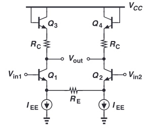

# 장말문제 10.33 — 다이오드 연결 부하와 이미터 저항 R_E를 가진 차동쌍(Fig 10.72)의 이득

## 원문
Consider the differential pair illustrated in Fig. 10.72. Assuming perfect symmetry and $V_A = \infty$,

(a) Determine the voltage gain.

(b) Under what condition does the gain become independent of the tail currents? This is an example of a very linear circuit because the gain does not vary with the input or output signal levels.

## 조건
- 회로: Fig 10.72 — 이미터 사이에 $R_E$가 있고 이미터마다 테일 전류원 $I_{EE}$가 달린 차동쌍, 부하는 $R_C$와 레일에 컬렉터·베이스가 붙은 $Q_3$, $Q_4$
- 완벽한 대칭
- $V_A = \infty$

## 구할 것
- (a) 전압 이득
- (b) 이득이 테일 전류와 무관해지는 조건. 원문 설명: 이득이 입력·출력 신호 레벨에 따라 변하지 않으므로 매우 선형적인 회로의 예

## 회로 — Fig 10.72
```spice
Q3   VCC   VCC   n1   npn    ; 컬렉터와 베이스가 모두 레일에 이어짐
RC1  n1    out1  {R_C}   ; 두 저항 모두 R_C로 인쇄
Q1   out1  Vin1  n3   npn
IEE1 n3    0     {I_EE}  ; 두 전류원 모두 I_EE로 인쇄
RE   n3    n4    {R_E}
Q2   out2  Vin2  n4   npn    ; 좌우 반전 (베이스 오른쪽)
IEE2 n4    0     {I_EE}
RC2  n2    out2  {R_C}
Q4   VCC   VCC   n2   npn    ; 좌우 반전 (베이스 오른쪽), 컬렉터와 베이스가 모두 레일에 이어짐
* n1, n2 = Q3, Q4 이미터, n3, n4 = Q1, Q2 이미터 (라벨 없음)
* out1, out2 = 두 컬렉터 점에서 안쪽으로 이어진 개방 원. 두 원 사이에 "V_out" 라벨 하나 (차동 출력)
```
- 단자: VCC = 전원, 값 미지정 (가로 레일) / Vin1, Vin2 = 입력 (개방 원) / out1, out2 = 차동 출력 V_out (개방 원 두 개, 각 원 옆 라벨 없음)
- 표시: 노드 라벨 V_CC (레일 오른쪽 끝), V_out (두 출력 원 사이), V_in1 (왼쪽 입력 원 왼쪽), V_in2 (오른쪽 입력 원 오른쪽) / 소자 라벨 Q3 (Q3 오른쪽), Q4 (Q4 왼쪽), R_C (왼쪽 저항 왼쪽), R_C (오른쪽 저항 오른쪽), Q1 (Q1 오른쪽), Q2 (Q2 왼쪽), R_E (R_E 아래), I_EE (왼쪽 전류원 왼쪽), I_EE (오른쪽 전류원 오른쪽) / 부호 없음 / 화살표 없음 / 수치·면적 라벨 없음
- 배치: 맨 위 굵은 가로 레일 V_CC / Q3 npn 보통 방향(베이스 왼쪽): 컬렉터에서 세로선이 위로 레일, 베이스에서 왼쪽으로 나가 위로 꺾여 레일 / Q4 npn 좌우 반전(베이스 오른쪽), 같은 방식으로 컬렉터·베이스가 레일 / 왼쪽 세로줄 위→아래 Q3 이미터, R_C, 출력 점, Q1 컬렉터 (오른쪽 대칭) / 각 출력 점에서 가로선이 안쪽으로 개방 원 (사이에 V_out 라벨) / Q1 npn 보통 방향(베이스 왼쪽), Q2 npn 좌우 반전(베이스 오른쪽) / V_in1 원 → Q1 베이스, V_in2 원 → Q2 베이스 / Q1 이미터 아래 점, 점에서 아래로 I_EE(화살표 아래) → 접지, 오른쪽으로 가로 R_E → Q2 이미터 아래 점, 그 점에서 아래로 I_EE(화살표 아래) → 접지 / 접속점 (세 갈래 이상, 4곳): ① 왼쪽 출력 점 = 위 R_C + 아래 Q1 컬렉터 + 오른쪽 출력선 (점) ② 오른쪽 출력 점 = 위 R_C + 아래 Q2 컬렉터 + 왼쪽 출력선 (점) ③ Q1 이미터 점 = 위 Q1 이미터 + 아래 I_EE + 오른쪽 R_E (점) ④ Q2 이미터 점 = 위 Q2 이미터 + 아래 I_EE + 왼쪽 R_E (점) / 교차: 없음


> 참고: 그림은 문제 진술(교재 559쪽, PDF 34) 다음 쪽인 교재 560쪽(PDF 35)에 인쇄

## 힌트
### (b) 부하와 이미터 쪽에 같은 $1/g_m$
- $Q_3$는 $R_C$를 거쳐 $Q_1$과 직렬이라 $Q_1$의 컬렉터 전류를 그대로 흘리므로, 다이오드 연결 $Q_3$의 $1/g_m$은 $Q_1$의 $1/g_m$과 같다
- 테일 전류가 바뀌면 부하 쪽 저항과 이미터 쪽 저항이 같은 $1/g_m$만큼 함께 바뀐다. 이득이 이 변화에 흔들리지 않으려면 나머지 저항이 어떤 관계여야 하는지 따진다
