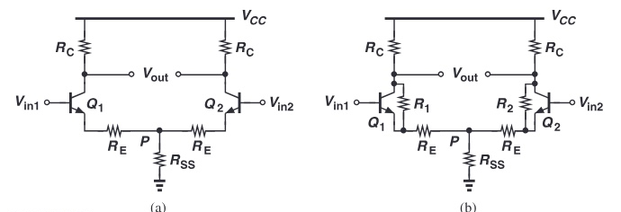

# 장말문제 10.34 — Fig 10.73 (a), (b) 각 단의 차동 전압 이득 (V_A < ∞)

## 조건
- 회로: Fig 10.73 (a), (b)의 두 차동 단 (테일은 $R_E$ 두 개와 $R_{SS}$)
- 완벽한 대칭
- $V_A < \infty$
- 경우에 따라 이득을 $A_v = -G_m R_{out}$으로 계산해야 할 수 있음

## 구할 것
- (a), (b) 각 단의 차동 전압 이득 (소문항 표기 없음, 원문은 "each stage depicted in Fig. 10.73"으로 적음)

## 회로 — Fig 10.73(a)
```spice
RC1  VCC   out1  {R_C}   ; 두 저항 모두 R_C로 인쇄
RC2  VCC   out2  {R_C}
Q1   out1  Vin1  n1   npn
Q2   out2  Vin2  n2   npn    ; 좌우 반전 (베이스 오른쪽)
RE1  n1    P     {R_E}   ; 두 저항 모두 R_E로 인쇄
RE2  n2    P     {R_E}
RSS  P     0     {R_SS}
* n1, n2 = Q1, Q2 이미터 (라벨 없음)
* out1, out2 = 두 컬렉터 점에서 안쪽으로 이어진 개방 원. 두 원 사이에 "V_out" 라벨 하나 (차동 출력)
```
- 단자: VCC = 전원, 값 미지정 (가로 레일) / Vin1, Vin2 = 입력 (개방 원) / out1, out2 = 차동 출력 V_out (개방 원 두 개, 각 원 옆 라벨 없음)
- 표시: 노드 라벨 V_CC (레일 오른쪽 끝), V_out (두 출력 원 사이), V_in1 (왼쪽 입력 원 왼쪽), V_in2 (오른쪽 입력 원 오른쪽), P (P 점 왼쪽 아래) / 소자 라벨 R_C (왼쪽 저항 왼쪽), R_C (오른쪽 저항 오른쪽), Q1 (Q1 오른쪽), Q2 (Q2 왼쪽), R_E (왼쪽 R_E 아래), R_E (오른쪽 R_E 아래), R_SS (R_SS 오른쪽) / 부호 없음 / 화살표 없음 / 수치·면적 라벨 없음
- 배치: 맨 위 굵은 가로 레일 V_CC / 왼쪽 세로줄 위→아래 R_C, 출력 점, Q1 / 오른쪽 세로줄 위→아래 R_C, 출력 점, Q2 / 각 출력 점에서 가로선이 안쪽으로 개방 원 (사이에 V_out 라벨) / Q1 npn 보통 방향(베이스 왼쪽), Q2 npn 좌우 반전(베이스 오른쪽) / V_in1 원 → Q1 베이스, V_in2 원 → Q2 베이스 / Q1 이미터는 아래로 내려가 오른쪽으로 꺾여 가로 R_E → 가운데 P 점 → 가로 R_E → 위로 꺾여 Q2 이미터 / P에서 아래로 R_SS, 그 아래 접지 / 접속점 (세 갈래 이상, 3곳): ① 왼쪽 출력 점 = 위 R_C + 아래 Q1 컬렉터 + 오른쪽 출력선 (점) ② 오른쪽 출력 점 = 위 R_C + 아래 Q2 컬렉터 + 왼쪽 출력선 (점) ③ P = 왼쪽 R_E + 오른쪽 R_E + 아래 R_SS (점) / 교차: 없음

## 회로 — Fig 10.73(b)
```spice
RC1  VCC   out1  {R_C}   ; 두 저항 모두 R_C로 인쇄
RC2  VCC   out2  {R_C}
Q1   out1  Vin1  n1   npn
R1   out1  n1    {R_1}   ; Q1 컬렉터–이미터 사이
Q2   out2  Vin2  n2   npn    ; 좌우 반전 (베이스 오른쪽)
R2   out2  n2    {R_2}   ; Q2 컬렉터–이미터 사이
RE1  n1    P     {R_E}   ; 두 저항 모두 R_E로 인쇄
RE2  n2    P     {R_E}
RSS  P     0     {R_SS}
* n1, n2 = Q1, Q2 이미터 (라벨 없음)
* out1, out2 = 두 컬렉터 세로줄의 위쪽 점에서 안쪽으로 이어진 개방 원. 두 원 사이에 "V_out" 라벨 하나 (차동 출력)
```
- 단자: VCC = 전원, 값 미지정 (가로 레일) / Vin1, Vin2 = 입력 (개방 원) / out1, out2 = 차동 출력 V_out (개방 원 두 개, 각 원 옆 라벨 없음)
- 표시: 노드 라벨 V_CC (레일 오른쪽 끝), V_out (두 출력 원 사이), V_in1 (왼쪽 입력 원 왼쪽), V_in2 (오른쪽 입력 원 오른쪽), P (P 점 왼쪽 아래) / 소자 라벨 R_C (왼쪽 저항 왼쪽), R_C (오른쪽 저항 오른쪽), R1 (R1 오른쪽), R2 (R2 왼쪽), Q1 (Q1 왼쪽 아래), Q2 (Q2 오른쪽 아래), R_E (왼쪽 R_E 아래), R_E (오른쪽 R_E 아래), R_SS (R_SS 오른쪽) / 부호 없음 / 화살표 없음 / 수치·면적 라벨 없음
- 배치: 맨 위 굵은 가로 레일 V_CC / 왼쪽 세로줄 위→아래 R_C, 출력 점, 두 번째 점, Q1 컬렉터 / 출력 점에서 가로선이 안쪽으로 개방 원 (오른쪽 대칭, 사이에 V_out 라벨) / 두 번째 점에서 오른쪽으로 짧게 나가 아래로 R1, R1 아래 끝은 이미터 점 / Q1 npn 보통 방향(베이스 왼쪽), Q2 npn 좌우 반전(베이스 오른쪽), R2는 Q2 왼쪽에 대칭 / V_in1 원 → Q1 베이스, V_in2 원 → Q2 베이스 / Q1 이미터는 아래로 내려가 오른쪽으로 꺾여 이미터 점 → 가로 R_E → 가운데 P 점 → 가로 R_E → 오른쪽 이미터 점 → 위로 꺾여 Q2 이미터 / P에서 아래로 R_SS, 그 아래 접지 / 접속점 (세 갈래 이상, 7곳): ① 왼쪽 출력 점 = 위 R_C + 아래 세로줄 + 오른쪽 출력선 (점) ② 왼쪽 두 번째 점 = 위 세로줄 + 아래 Q1 컬렉터 + 오른쪽 R1 선 (점) ③ 왼쪽 이미터 점 = 왼쪽 Q1 이미터 선 + 위 R1 + 오른쪽 R_E (점) ④ P = 왼쪽 R_E + 오른쪽 R_E + 아래 R_SS (점) ⑤ 오른쪽 이미터 점 (점) ⑥ 오른쪽 두 번째 점 (점) ⑦ 오른쪽 출력 점 (점) (⑤–⑦은 ③–①의 좌우 대칭) / 교차: 없음


> 참고: 크롭 이미지 왼쪽 아래 가장자리에 그림 캡션 "Figure 10.73" 글자 윗부분이 희미하게 걸림 (패널 글자 (a)(b)와 같은 높이)
