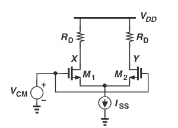

# 장말문제 10.35 — MOS 차동쌍(Fig 10.26)의 테일 노드 전압 변화 (W, I_SS, t_ox 두 배)

## 원문
Consider the MOS differential pair of Fig. 10.26. What happens to the tail node voltage if (a) the width of $M_1$ and $M_2$ is doubled, (b) $I_{SS}$ is doubled, (c) the gate oxide thickness is doubled?

## 조건
- 회로: 본문 Fig 10.26의 MOS 차동쌍 (두 게이트를 $V_{CM}$으로 묶음)

## 구할 것
- 다음 각 경우 테일 노드 전압이 어떻게 되는가?
- (a) $M_1$과 $M_2$의 폭이 두 배
- (b) $I_{SS}$가 두 배
- (c) 게이트 산화막 두께가 두 배

## 상속·참조
- 본문 Fig 10.26 (교재 525쪽): 두 입력을 $V_{CM}$으로 묶은 MOS 차동쌍. 평형에서 $I_{D1} = I_{D2} = \dfrac{I_{SS}}{2}$ (10.109), $V_X = V_Y = V_{DD} - R_D\dfrac{I_{SS}}{2}$ (10.110)
- 본문 가정 (교재 526쪽): $\lambda = 0$, $I_D = \tfrac{1}{2}\mu_n C_{ox}\tfrac{W}{L}(V_{GS} - V_{TH})^2$. 각 소자가 $I_{SS}/2$를 흘릴 때 평형 과구동 전압:
  $$(V_{GS} - V_{TH})_{equil.} = \sqrt{\frac{I_{SS}}{\mu_n C_{ox}\dfrac{W}{L}}} \qquad (10.111)$$
- $C_{ox} = \varepsilon_{ox}/t_{ox}$ (원문에 없음)

## 회로 — Fig 10.26
```spice
VCM  n1   0    {V_CM}   ; 전압원, + 쪽이 위
RD1  VDD  X    {R_D}    ; 두 저항 모두 R_D로 인쇄
RD2  VDD  Y    {R_D}
M1   X    n1   n2  nmos
M2   Y    n1   n2  nmos    ; 좌우 반전 (게이트 오른쪽)
ISS  n2   0    {I_SS}
* n1 = 두 게이트를 묶은 노드, n2 = 공통 소스(테일) 노드. 둘 다 그림에 라벨 없음
```
- 단자: VDD = 전원, 값 미지정 (가로 레일) / 입력은 전압원 V_CM이 두 게이트를 직접 구동 (개방 단자 없음) / X, Y는 드레인 선 옆 라벨만 (원 없음)
- 표시: 노드 라벨 V_DD (레일 오른쪽 끝), X (M1 드레인 선 왼쪽, M1 바로 위), Y (M2 드레인 선 오른쪽, M2 바로 위) / 소자 라벨 R_D (왼쪽 저항 왼쪽), R_D (오른쪽 저항 오른쪽), M1 (M1 오른쪽), M2 (M2 왼쪽), V_CM (전압원 왼쪽), I_SS (전류원 오른쪽) / 부호 + (전압원 오른쪽 위), − (전압원 오른쪽 아래) / 화살표 없음 / 수치·면적 라벨 없음
- 배치: 맨 위 굵은 가로 레일 V_DD / 왼쪽 세로줄 위→아래 R_D, X, M1, 오른쪽 세로줄 위→아래 R_D, Y, M2 / M1 nmos 보통 방향(게이트 왼쪽), M2 nmos 좌우 반전(게이트 오른쪽) / 전압원은 M1 왼쪽 아래, + 단자 → 위로 → 오른쪽 가로선 → n1 접속점 → 오른쪽 M1 게이트 / n1 접속점에서 아래로 내려가 맨 아래 가로선(게이트 공통선, 소스 공통선보다 낮음)이 오른쪽으로 M2 게이트보다 오른쪽까지 간 뒤 위로 꺾여 왼쪽으로 M2 게이트 / 두 소스는 아래로 내려가 가로선으로 가운데 n2 점, n2에서 아래로 I_SS(화살표 아래), 그 아래 접지 / 전압원 − 단자 아래 접지 / 접속점 (세 갈래 이상, 2곳): ① n1 = 왼쪽 전압원 선 + 오른쪽 M1 게이트 + 아래 게이트 공통선 (점) ② n2 = 왼쪽 M1 소스 선 + 오른쪽 M2 소스 선 + 아래 I_SS (점) / 교차: n2 → I_SS 세로선이 게이트 공통선(맨 아래 가로선)과 점 없이 교차 (1곳)


> 참고: Fig 10.26은 본문 그림(교재 525쪽, PDF 15)

## 풀이
### 테일 노드 전압
- 평형에서 테일 노드 전압 $V_P = V_{CM} - V_{GS} = V_{CM} - V_{TH} - (V_{GS} - V_{TH})_{equil.}$
- $(V_{GS} - V_{TH})_{equil.} = \sqrt{\dfrac{I_{SS}}{\mu_n C_{ox} W/L}}$이므로, 과구동이 커지면 $V_P$가 내려간다. 원래 과구동을 $V_{ov}$로 쓴다
### (a) 폭 두 배
- $W/L$이 두 배 → 과구동이 $1/\sqrt{2}$배 → $V_P$가 $(1 - 1/\sqrt{2})V_{ov} = 0.293\, V_{ov}$만큼 올라간다
### (b) $I_{SS}$ 두 배
- 과구동이 $\sqrt{2}$배 → $V_P$가 $(\sqrt{2} - 1)V_{ov} = 0.414\, V_{ov}$만큼 내려간다
### (c) 산화막 두께 두 배
- $C_{ox} = \varepsilon_{ox}/t_{ox}$가 절반 → 과구동이 $\sqrt{2}$배 → $V_P$가 $0.414\, V_{ov}$만큼 내려간다 ($V_{TH}$는 그대로라고 본다)
### 답
- (a) 테일 노드 전압이 $(1 - 1/\sqrt{2})V_{ov} \approx 0.293\, V_{ov}$만큼 올라간다
- (b) $(\sqrt{2} - 1)V_{ov} \approx 0.414\, V_{ov}$만큼 내려간다
- (c) $C_{ox}$가 절반이 되어 (b)와 같이 $0.414\, V_{ov}$만큼 내려간다
