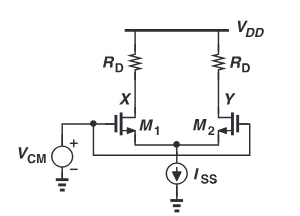

# 장말문제 10.36 — MOS 차동쌍(Fig 10.26)이 포화를 유지하는 최소 공급 전압

## 원문
In the MOS differential pair of Fig. 10.26, $V_{CM} = 1\ \text{V}$, $I_{SS} = 1\ \text{mA}$, and $R_D = 1\ \text{k}\Omega$. What is the minimum allowable supply voltage if the transistors must remain in saturation? Assume $V_{TH,n} = 0.5\ \text{V}$.

## 조건
- 회로: 본문 Fig 10.26의 MOS 차동쌍
- $V_{CM} = 1\ \text{V}$, $I_{SS} = 1\ \text{mA}$, $R_D = 1\ \text{k}\Omega$
- $V_{TH,n} = 0.5\ \text{V}$
- 트랜지스터는 포화 영역에 있어야 함

## 구할 것
- 허용되는 최소 공급 전압 $V_{DD}$

## 상속·참조
- 본문 Fig 10.26 (교재 525쪽): 평형에서 $V_X = V_Y = V_{DD} - R_D\dfrac{I_{SS}}{2}$ (10.110)
- 본문 식 (10.112) (교재 526쪽): $M_1$, $M_2$가 포화에 있으려면 드레인 전압이 $V_{CM} - V_{TH}$ 아래로 내려가지 않아야 함:
  $$V_{DD} - R_D\frac{I_{SS}}{2} > V_{CM} - V_{TH} \qquad (10.112)$$

## 회로 — Fig 10.26
```spice
VCM  n1   0    {V_CM}   ; 전압원, + 쪽이 위
RD1  VDD  X    {R_D}    ; 두 저항 모두 R_D로 인쇄
RD2  VDD  Y    {R_D}
M1   X    n1   n2  nmos
M2   Y    n1   n2  nmos    ; 좌우 반전 (게이트 오른쪽)
ISS  n2   0    {I_SS}
* n1 = 두 게이트를 묶은 노드, n2 = 공통 소스(테일) 노드. 둘 다 그림에 라벨 없음
```
- 단자: VDD = 전원, 값 미지정 (가로 레일) / 입력은 전압원 V_CM이 두 게이트를 직접 구동 (개방 단자 없음) / X, Y는 드레인 선 옆 라벨만 (원 없음)
- 표시: 노드 라벨 V_DD (레일 오른쪽 끝), X (M1 드레인 선 왼쪽, M1 바로 위), Y (M2 드레인 선 오른쪽, M2 바로 위) / 소자 라벨 R_D (왼쪽 저항 왼쪽), R_D (오른쪽 저항 오른쪽), M1 (M1 오른쪽), M2 (M2 왼쪽), V_CM (전압원 왼쪽), I_SS (전류원 오른쪽) / 부호 + (전압원 오른쪽 위), − (전압원 오른쪽 아래) / 화살표 없음 / 수치·면적 라벨 없음
- 배치: 맨 위 굵은 가로 레일 V_DD / 왼쪽 세로줄 위→아래 R_D, X, M1, 오른쪽 세로줄 위→아래 R_D, Y, M2 / M1 nmos 보통 방향(게이트 왼쪽), M2 nmos 좌우 반전(게이트 오른쪽) / 전압원은 M1 왼쪽 아래, + 단자 → 위로 → 오른쪽 가로선 → n1 접속점 → 오른쪽 M1 게이트 / n1 접속점에서 아래로 내려가 맨 아래 가로선(게이트 공통선, 소스 공통선보다 낮음)이 오른쪽으로 M2 게이트보다 오른쪽까지 간 뒤 위로 꺾여 왼쪽으로 M2 게이트 / 두 소스는 아래로 내려가 가로선으로 가운데 n2 점, n2에서 아래로 I_SS(화살표 아래), 그 아래 접지 / 전압원 − 단자 아래 접지 / 접속점 (세 갈래 이상, 2곳): ① n1 = 왼쪽 전압원 선 + 오른쪽 M1 게이트 + 아래 게이트 공통선 (점) ② n2 = 왼쪽 M1 소스 선 + 오른쪽 M2 소스 선 + 아래 I_SS (점) / 교차: n2 → I_SS 세로선이 게이트 공통선(맨 아래 가로선)과 점 없이 교차 (1곳)


> 참고: Fig 10.26은 본문 그림(교재 525쪽, PDF 15)
