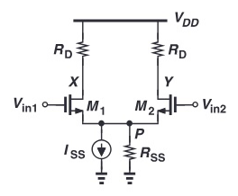

# 장말문제 10.39 — 테일–접지 기생 저항 R_SS가 있는 MOS 차동쌍(Fig 10.74)에서 P가 가상 접지임을 증명

## 조건
- 회로: Fig 10.74 — 테일 노드와 접지 사이에 기생 저항 $R_{SS}$가 달린 MOS 차동쌍 (테일 전류원 $I_{SS}$와 병렬)
- 작은 차동 입력

## 구할 것
- 소신호 모델을 쓰지 않고, 작은 차동 입력에 대해 $P$가 여전히 가상 접지임을 증명

## 회로 — Fig 10.74
```spice
RD1  VDD  X     {R_D}   ; 두 저항 모두 R_D로 인쇄
RD2  VDD  Y     {R_D}
M1   X    Vin1  P   nmos
M2   Y    Vin2  P   nmos    ; 좌우 반전 (게이트 오른쪽)
ISS  P    0     {I_SS}
RSS  P    0     {R_SS}  ; 꼬리 가로선 위 두 번째 점(ISS 점 오른쪽)에서 갈라짐 (같은 노드 P)
```
- 단자: VDD = 전원, 값 미지정 (가로 레일) / Vin1, Vin2 = 입력 (개방 원) / X, Y는 드레인 선 옆 라벨만 (원 없음)
- 표시: 노드 라벨 V_DD (레일 오른쪽 끝), X (M1 드레인 선 왼쪽), Y (M2 드레인 선 오른쪽), V_in1 (왼쪽 입력 원 왼쪽), V_in2 (오른쪽 입력 원 오른쪽), P (R_SS 분기 점 오른쪽 아래) / 소자 라벨 R_D (왼쪽 저항 왼쪽), R_D (오른쪽 저항 오른쪽), M1 (M1 오른쪽), M2 (M2 왼쪽), I_SS (전류원 왼쪽), R_SS (저항 오른쪽) / 부호 없음 / 화살표 없음 / 수치·면적 라벨 없음
- 배치: 맨 위 굵은 가로 레일 V_DD / 왼쪽 세로줄 위→아래 R_D, X, M1, 오른쪽 세로줄 위→아래 R_D, Y, M2 / M1 nmos 보통 방향(게이트 왼쪽), M2 nmos 좌우 반전(게이트 오른쪽) / V_in1 원 → M1 게이트, V_in2 원 → M2 게이트 / M1 소스는 아래로 내려가 꼬리 가로선, 오른쪽으로 I_SS 점, 그 오른쪽 R_SS 점(P)을 지나 오른쪽 끝에서 위로 꺾여 M2 소스 / I_SS 점에서 아래로 I_SS(화살표 아래) → 접지, R_SS 점에서 아래로 R_SS → 접지 (두 접지는 나란히) / 접속점 (세 갈래 이상, 2곳): ① I_SS 점 = 왼쪽 M1 소스 쪽 가로선 + 오른쪽 가로선 + 아래 I_SS (점) ② R_SS 점 = 왼쪽 가로선 + 오른쪽 M2 소스 쪽 가로선 + 아래 R_SS (점) / 교차: 없음


