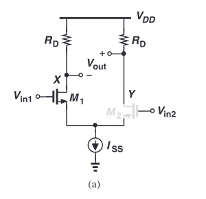

# 장말문제 10.40 — Fig 10.27(a)에서 M_2가 꺼졌을 때 M_1이 포화에 머무를 조건

## 원문
In Fig. 10.27(a), $V_{in1} = 1.5\ \text{V}$ and $V_{in2} = 0.3\ \text{V}$. Assuming $M_2$ is off, determine a condition among the circuit parameters that guarantees operation of $M_1$ in saturation.

## 조건
- 회로: 본문 Fig 10.27(a)의 MOS 차동쌍
- $V_{in1} = 1.5\ \text{V}$, $V_{in2} = 0.3\ \text{V}$
- $M_2$는 꺼져 있다고 가정

## 구할 것
- $M_1$이 포화 영역에서 동작하도록 보장하는 회로 파라미터 사이의 조건

## 상속·참조
- 본문 Fig 10.27(a) (교재 527쪽): $V_{in1}$이 $V_{in2}$보다 훨씬 크면 $M_1$이 테일 전류 전체를 흘림 → $V_X = V_{DD} - R_D I_{SS}$ (10.115), $V_Y = V_{DD}$ (10.116)

## 회로 — Fig 10.27(a)
```spice
RD1  VDD  X     {R_D}   ; 두 저항 모두 R_D로 인쇄
RD2  VDD  Y     {R_D}
M1   X    Vin1  n1  nmos
M2   Y    Vin2  n1  nmos    ; 좌우 반전 (게이트 오른쪽), 회색으로 흐리게 인쇄
ISS  n1   0     {I_SS}
* n1 = 공통 소스(테일) 노드, 라벨 없음
* V_out: + 원은 오른쪽 세로줄(Y 노드)의 R_D 바로 아래 점에서, − 원은 X 점에서 이어짐 → V_out = V_Y − V_X
```
- 단자: VDD = 전원, 값 미지정 (가로 레일) / Vin1, Vin2 = 입력 (개방 원) / V_out = 차동 출력, + 원은 Y 노드, − 원은 X 노드에 이어짐 (개방 원 두 개)
- 표시: 노드 라벨 V_DD (레일 오른쪽 끝), X (X 점 왼쪽 아래), Y (오른쪽 세로줄 아래쪽, M2 드레인 위 선 오른쪽), V_out (두 출력 원 사이), V_in1 (왼쪽 입력 원 왼쪽), V_in2 (오른쪽 입력 원 오른쪽) / 소자 라벨 R_D (왼쪽 저항 왼쪽), R_D (오른쪽 저항 오른쪽), M1 (M1 오른쪽), M2 (M2 왼쪽, 회색) / 부호 + (위 출력 원 왼쪽), − (아래 출력 원 오른쪽) / 화살표 없음 / 수치·면적 라벨 없음
- 배치: 맨 위 굵은 가로 레일 V_DD / 왼쪽 세로줄 위→아래 R_D, X 점, M1 드레인 / 오른쪽 세로줄 위→아래 R_D, + 출력 점, 긴 세로선(Y 라벨), M2 드레인 / M2가 M1보다 아래로 내려 그려짐 (세로 오프셋) / + 출력 점에서 가로선이 왼쪽으로 + 원, X 점에서 가로선이 오른쪽으로 − 원. 두 원은 두 세로줄 사이에 위(+)·아래(−)로 놓이고 그 사이에 V_out 라벨 / M1 nmos 보통 방향(게이트 왼쪽), M2 nmos 좌우 반전(게이트 오른쪽). M2 기호와 라벨은 회색으로 흐리게 인쇄 (꺼진 소자 표시) / V_in1 원 → 가로선 → M1 게이트, V_in2 원 → 가로선 → M2 게이트 / M1 소스는 아래로 내려가 꼬리 가로선, 가운데 n1 점을 지나 오른쪽 끝에서 위로 꺾여 M2 소스 / n1에서 아래로 I_SS(화살표 아래), 그 아래 접지 / 접속점 (세 갈래 이상, 3곳): ① X = 위 R_D + 아래 M1 드레인 + 오른쪽 − 출력선 (점) ② + 출력 점 = 위 R_D + 아래 M2 드레인 선(Y) + 왼쪽 + 출력선 (점) ③ n1 = 왼쪽 M1 소스 선 + 오른쪽 M2 소스 선 + 아래 I_SS (점) / 교차: 없음


> 참고: Fig 10.27은 본문 그림(교재 527쪽, PDF 16). 크롭은 패널 (a)만 담음 ((b)는 반대 방향 큰 입력, (c)는 특성 그래프로 이 문제에 쓰이지 않음)

## 풀이
### 전류와 드레인 전압
- $M_2$가 꺼져 있으므로 $M_1$이 $I_{SS}$ 전체를 흘리고 $V_X = V_{DD} - R_D I_{SS}$
### 포화 조건
- 게이트가 $V_{in1} = 1.5\ \text{V}$이므로 포화하려면 $V_X \ge V_{in1} - V_{TH}$ ($V_{TH}$는 $M_1$의 문턱 전압)
- $V_{DD} - R_D I_{SS} \ge 1.5\ \text{V} - V_{TH}$
- ($M_2$가 꺼져 있다는 가정은 $M_1$의 과구동 $\sqrt{2I_{SS}/(\mu_n C_{ox} W/L)} \le 1.5\ \text{V} - 0.3\ \text{V} = 1.2\ \text{V}$일 때 성립)
### 답
- $R_D I_{SS} \le V_{DD} - 1.5\ \text{V} + V_{TH}$
