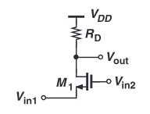

# 장말문제 10.41 — I_D ∝ (V_in1 − V_in2)인 한 트랜지스터 "차동 증폭기"(Fig 10.75)의 문제점

## 원문
An adventurous student constructs the circuit shown in Fig. 10.75 and calls it a "differential amplifier" because $I_D \propto (V_{in1} - V_{in2})$. Explain which aspects of our differential signals and amplifiers this circuit violates.

## 조건
- 회로: Fig 10.75 — 한 학생이 만든 회로. 게이트에 $V_{in2}$, 소스에 $V_{in1}$을 넣은 트랜지스터 하나와 $R_D$
- 학생은 $I_D \propto (V_{in1} - V_{in2})$이므로 "차동 증폭기"라고 부름

## 구할 것
- 이 회로가 (이 장에서 정의한) 차동 신호와 차동 증폭기의 어떤 측면을 위반하는지 설명

## 회로 — Fig 10.75
```spice
RD   VDD   Vout  {R_D}
M1   Vout  Vin2  Vin1  nmos   ; 좌우 반전 (게이트 오른쪽), 소스 = Vin1
```
- 단자: VDD = 전원, 값 미지정 (T 전원 기호) / Vin1 = M1 소스 쪽 입력 (개방 원) / Vin2 = M1 게이트 쪽 입력 (개방 원) / Vout = 출력 (개방 원)
- 표시: 노드 라벨 V_DD (T 기호 오른쪽), V_out (출력 원 오른쪽), V_in2 (게이트 쪽 입력 원 오른쪽), V_in1 (소스 쪽 입력 원 왼쪽) / 소자 라벨 R_D (저항 오른쪽), M1 (M1 왼쪽) / 부호 없음 / 화살표 없음 / 수치·면적 라벨 없음
- 배치: 한 세로줄 위→아래 VDD T 기호, R_D, Vout 접속점, M1 드레인 / M1 nmos 좌우 반전(게이트 오른쪽, 드레인 왼쪽 위, 소스 왼쪽 아래) / Vout 접속점에서 가로선이 오른쪽으로 출력 원 / M1 게이트 → 가로선 → 오른쪽 V_in2 원 / M1 소스 → 아래로 → L자를 좌우 반전한 꺾임으로 왼쪽 가로선 → 왼쪽 아래 V_in1 원 / 접속점 (세 갈래 이상, 1곳): Vout = 위 R_D + 아래 M1 드레인 + 오른쪽 출력선 (점) / 교차: 없음



## 풀이
### 입력의 비대칭
- $V_{in2}$는 게이트(입력 저항 무한대), $V_{in1}$은 소스(입력 저항 약 $1/g_m$이고 $I_D$를 그대로 흘림)로 들어간다. 두 입력이 같은 대접을 받지 않는다
- 두 입력에서 본 이득도 다르다: $V_{in2}$에서 $-g_m R_D$, $V_{in1}$에서 $+(g_m + g_{mb})R_D$
### 공통 모드 제거
- 두 입력이 함께 오르면 몸체 효과로 $I_D$가 변해 출력에 $g_{mb} R_D$의 공통 모드 이득이 남는다
- 또 $V_{in2} - V_{in1} > V_{TH}$일 때만 켜진다. 차동 입력이 0인 평형에서 꺼져 있어, 테일 전류 같은 독립 바이어스가 없다
### 출력
- 출력은 $V_{DD}$에 대한 단일 출력이다. 차동 출력이 아니므로 전원 잡음 등 두 출력에 똑같이 들어오는 잡음이 빠지지 않는다
### 답
- 차동 신호는 크기가 같고 위상이 반대인 두 신호를 대칭인 두 입력으로 받고 두 출력의 차로 내야 한다. 이 회로는 입력이 게이트와 소스로 비대칭이라 입력 저항과 이득이 서로 다르고, 몸체 효과로 공통 모드 이득이 있으며, 출력이 단일 출력이라 공통 잡음을 제거하지 못한다
