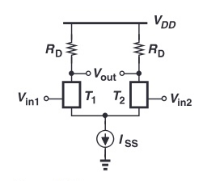

# 장말문제 10.47 — I_D = γ(V_GS − V_TH)³ 특성의 새 트랜지스터로 만든 차동쌍(Fig 10.76)

## 원문
Suppose a new type of MOS transistor has been invented that exhibits the following I-V characteristic:

$$I_D = \gamma(V_{GS} - V_{TH})^3, \qquad (10.222)$$

where $\gamma$ is a proportionality factor. Figure 10.76 shows a differential pair employing such transistors.

(a) What similarities exist between this circuit and the standard MOS differential pair?

(b) Calculate the equilibrium overdrive voltage of $T_1$ and $T_2$.

(c) At what value of $V_{in1} - V_{in2}$ does one transistor turn off?

## 조건
- 새로 발명된 MOS 트랜지스터의 I-V 특성:
  $$I_D = \gamma(V_{GS} - V_{TH})^3 \qquad (10.222)$$
  $\gamma$는 비례 계수
- 회로: Fig 10.76 — 이런 트랜지스터 $T_1$, $T_2$를 쓴 차동쌍 (드레인 저항 $R_D$ 두 개, 테일 전류원 $I_{SS}$)

## 구할 것
- (a) 이 회로와 표준 MOS 차동쌍 사이에 어떤 유사점이 있는가?
- (b) $T_1$과 $T_2$의 평형 과구동 전압
- (c) $V_{in1} - V_{in2}$가 얼마일 때 한 트랜지스터가 꺼지는가?

## 회로 — Fig 10.76
```spice
RD1  VDD   out1  {R_D}   ; 두 저항 모두 R_D로 인쇄
RD2  VDD   out2  {R_D}
XT1  out1  Vin1  n1  box "T1"   ; 단자 순서: 위(상자 위 끝), 옆(상자 왼쪽), 아래(상자 아래 끝)
XT2  out2  Vin2  n1  box "T2"   ; 단자 순서: 위, 옆(상자 오른쪽), 아래
ISS  n1    0     {I_SS}
* T1, T2 = 속이 빈 세로 직사각형 상자 (트랜지스터 기호 대신)
* n1 = 공통 테일 노드 (라벨 없음)
* out1, out2 = 두 R_D 아래 점에서 안쪽으로 이어진 개방 원. 두 원 사이에 "V_out" 라벨 하나 (차동 출력)
```
- 단자: VDD = 전원, 값 미지정 (가로 레일) / Vin1, Vin2 = 입력 (개방 원) / out1, out2 = 차동 출력 V_out (개방 원 두 개, 각 원 옆 라벨 없음)
- 표시: 노드 라벨 V_DD (레일 오른쪽 끝), V_out (두 출력 원 사이), V_in1 (왼쪽 입력 원 왼쪽), V_in2 (오른쪽 입력 원 오른쪽) / 소자 라벨 R_D (왼쪽 저항 왼쪽), R_D (오른쪽 저항 오른쪽), T1 (T1 상자 오른쪽), T2 (T2 상자 왼쪽), I_SS (전류원 오른쪽) / 부호 없음 / 화살표 없음 / 수치·면적 라벨 없음
- 배치: 맨 위 굵은 가로 레일 V_DD / 왼쪽 세로줄 위→아래 R_D, 출력 점, T1 상자 / 오른쪽 세로줄 위→아래 R_D, 출력 점, T2 상자 / 각 출력 점에서 짧은 가로선이 안쪽으로 개방 원 (사이에 V_out 라벨) / T1 상자: 위 끝에서 선이 출력 점으로, 왼쪽 가운데에서 가로선이 V_in1 원으로, 아래 끝에서 선이 아래로. T2 상자는 좌우 대칭 (입력선이 오른쪽) / 두 상자 아래 끝 선이 꼬리 가로선으로 이어져 가운데 n1 점, n1에서 아래로 I_SS(화살표 아래), 그 아래 접지 / 접속점 (세 갈래 이상, 3곳): ① 왼쪽 출력 점 = 위 R_D + 아래 T1 + 오른쪽 출력선 (점) ② 오른쪽 출력 점 = 위 R_D + 아래 T2 + 왼쪽 출력선 (점) ③ n1 = 왼쪽 T1 선 + 오른쪽 T2 선 + 아래 I_SS (점) / 교차: 없음



## 힌트
### (c) 꺼질 때 다른 쪽이 $I_{SS}$ 전부
- 한 트랜지스터가 막 꺼지는 순간에는 그 소자의 $V_{GS}$가 $V_{TH}$이고, 다른 쪽이 테일 전류를 모두 흘린다
- 두 입력의 차는 공통 소스 노드를 거친 KVL로 두 $V_{GS}$의 차이므로, 표준 쌍처럼 전체 대신호 특성식을 세우지 않고 이 경계 한 점만 보면 된다

## 풀이
### (a) 표준 쌍과의 공통점
- 테일 전류원 때문에 $I_{D1} + I_{D2} = I_{SS}$이고, KVL로 $V_{in1} - V_{in2} = V_{GS1} - V_{GS2}$이다. 전류는 $V_{GS}$만의 단조 함수이므로 입력 차만으로 전류가 나뉜다
- 평형($V_{in1} = V_{in2}$)에서 $I_{SS}/2$씩, 출력 공통 모드 $V_{DD} - R_D I_{SS}/2$, 차동 출력 한계 $\pm R_D I_{SS}$
- 제곱 법칙 쌍처럼 $V_{GS} = V_{TH}$에서 전류가 0이므로 유한한 입력 차에서 한 소자가 완전히 꺼진다
### (b) 평형 과구동
- $\dfrac{I_{SS}}{2} = \gamma(V_{GS} - V_{TH})^3$에서 $(V_{GS} - V_{TH})_{equil} = \left(\dfrac{I_{SS}}{2\gamma}\right)^{1/3}$
### (c) 한 소자가 꺼지는 입력 차
- $T_2$가 막 꺼지면 $V_{GS2} = V_{TH}$이고 $T_1$이 $I_{SS}$ 전부를 흘려 $V_{GS1} - V_{TH} = (I_{SS}/\gamma)^{1/3}$
- 공통 소스 노드를 거친 KVL로 $V_{in1} - V_{in2} = V_{GS1} - V_{GS2} = (I_{SS}/\gamma)^{1/3} = 2^{1/3}(V_{GS} - V_{TH})_{equil} = 1.26\,(V_{GS} - V_{TH})_{equil}$ (제곱 법칙 쌍은 $\sqrt{2}$배)
### 답
- (a) 합 전류 $I_{SS}$ 고정, 평형에서 $I_{SS}/2$씩, 출력 한계 $\pm R_D I_{SS}$, 입력 차만으로 전류가 나뉘고 유한한 입력 차에서 한쪽이 꺼진다는 점이 표준 MOS 쌍과 같다
- (b) $(V_{GS} - V_{TH})_{equil} = (I_{SS}/2\gamma)^{1/3}$
- (c) $|V_{in1} - V_{in2}| = (I_{SS}/\gamma)^{1/3} = 2^{1/3}(V_{GS} - V_{TH})_{equil}$
